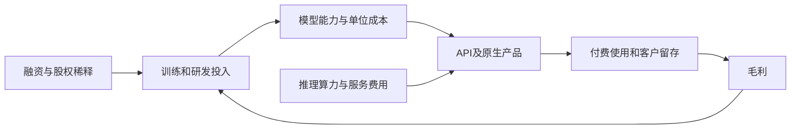

# MiniMax（0100.HK）研究报告

> 研究与资料截止：2026-10-02｜已核实2026年1月9日在港交所上市，现简称MINIMAX-W｜财务截至2026-06-30，完整中报9月30日发布｜参考股价：10月2日收盘242.80港元，腾讯16:08:16 HKT及香港01收市报道交叉确认｜9月末总股本352,480,183股，含全部A/B股｜总市值855.82亿港元，约109.08亿美元｜TTM股权PS 66.04倍。汇率使用9月30日中间价交叉换算1美元=7.845926港元。

MiniMax的商业价值在于把模型能力转成全球用户和企业愿意付费的产品。当前投资问题是收入高速增长后，能否留下足以覆盖训练、推理、设备和融资稀释的每股现金流。

## AI研究偏见自觉

信息丰富度评级：B，客户经济性接近C。已上市、有年度与半年度报表，收入、融资和股本可以核查；但分部毛利、企业净收入留存、单位推理成本、重大客户贡献和模型真实生产成功率披露不足。AI研究局限：技术发布数量和评测成绩容易被误读为经济护城河；估值高度依赖尚未发生的现金转正。

- [x] 先核验上市状态，不再按“私营AI公司估值”处理。
- [x] ARR与已确认收入分开；优先股公允价值变动与经营亏损分开。
- [x] 读取9月30日新发布中报，使用真实经营现金流及设备现金支出。
- [x] 区分经济权益和投票权，并更新9月员工股份增发。
- [x] 不把算术PASS写成盈利路径已验证。

---

## 第一步：核心数据总览

### 可得四年历史与最新半年

单位：百万美元。公司没有可比的五年营收历史，2022年尚无收入，不补造2021年。历史经调整净亏损排除了股权激励等项目，不能代替现金消耗。

| 指标 | 2022 | 2023 | 2024 | 2025 | 2026上半年 |
|---|---:|---:|---:|---:|---:|
| 收入 | 0 | 3.460 | 30.523 | 79.038 | 116.573 |
| 毛利 | 0 | -0.854 | 3.738 | 20.079 | 20.813 |
| 毛利率 | 不适用 | -24.7% | 12.2% | 25.4% | 17.9% |
| IFRS净利润 | -73.728 | -269.246 | -465.238 | -1871.617 | -357.997 |
| 经调整净利润 | -12.150 | -89.074 | -244.243 | -250.856 | -293.031 |
| CFO | -11.019 | -64.455 | -258.483 | -279.641 | -318.106 |
| 设备资本支出 | 0.256 | 0.697 | 0.759 | 0.920 | 187.626 |
| 简单FCF | -11.275 | -65.152 | -259.242 | -280.561 | -505.732 |
| 现金及等价物 | 4.691 | 206.295 | 288.912 | 507.621 | 930.905 |

来源：[2025年报](https://www1.hkexnews.hk/listedco/listconews/sehk/2026/0422/2026042202118.pdf)、[招股书历史财务](https://www1.hkexnews.hk/listedco/listconews/sehk/2025/1231/2025123100025.pdf)、[StockAnalysis损益](https://stockanalysis.com/quote/hkg/0100/financials/)、[现金流](https://stockanalysis.com/quote/hkg/0100/financials/cash-flow-statement/)、[经济通现金流](https://m.etnet.com.hk/www/eng/stocks/realtime/quote_ci_cashflow.php?code=100)。2026H1现金流和设备支出来自9月30日完整中报，第三方现金流页仍为空，属于已取得原件、尚缺独立第二源的关键缺口。

2026H1 IFRS净亏损有所收窄，但研发开支296.870百万美元高于毛利20.813百万美元，经营经济性离盈利仍远。2025巨额优先股重估损失主要是非现金；它应从分析经营表现时剥离，但不能因此忽略真实研发、推理费、股权激励及设备投入。本期经调整净亏损比上年同期138.735百万美元扩大。[官方半年业绩](https://www.minimax.io/news/minimax-announces-first-half-2026-financial-results-1787744160)

### 按实际披露周期看增长

公司没有披露完整四季度分部损益，因此下表使用年度及半年度实绩，2025下半年由全年减上半年推算；未将ARR填成季度收入。

| 项目，百万美元 | 2025上半年 | 2025下半年，推算 | 2026上半年 |
|---|---:|---:|---:|
| AI原生产品收入 | 21.223 | 31.857 | 42.644 |
| 开放平台及企业服务收入 | 9.206 | 16.752 | 73.929 |
| 总收入 | 30.429 | 48.609 | 116.573 |
| 毛利 | 3.685 | 16.394 | 20.813 |
| 毛利率 | 12.11% | 33.73% | 17.85% |

开放平台/企业收入成为主要来源，占本期63.4%；中国大陆外收入占60.8%。增长主要由调用量、付费用户和Token套餐驱动。平台兼有个人开发者和企业客户，不能把整项收入都称“大企业合同收入”。[中期公告](https://www1.hkexnews.hk/listedco/listconews/sehk/2026/0826/2026082600680.pdf)、[路透社交叉核验](https://www.investing.com/news/stock-market-news/chinas-minimax-sees-revenue-nearly-quadruple-in-first-half-as-ai-demand-surges-4876820)

半年毛利率同比改善，环比却从33.73%下降到17.85%。二者并不矛盾。公司未披露足够的分部成本，不能据此计算API真实毛利率；价格变化、扩容、服务结构均可能影响结果。真正需要跟踪的是新增收入带来的毛利是否能覆盖新增训练和履约投入。

八月业绩会披露ARR超过8亿美元。ARR是当期收入速度年化或公司定义的运行率，既不是2026年已实现收入，也不是同等稳定性的一年合同。按量API、套餐额度、折扣和用户迁移都会影响下月兑现。本报告只把ARR当需求领先信号，不拿它替代TTM165.182百万美元收入。[业绩会报道](https://www.webull.com/news/15472214899246080)

### 现金、债务与融资续航

最新现金流改变了研究重点：上半年CFO流出318.106百万美元，设备现金支出187.626百万美元，简单FCF流出505.732百万美元。还有租赁本金及利息0.673百万美元；不应把经调整亏损293.031百万美元当作全部资金消耗。[完整中报现金流](https://www1.hkexnews.hk/listedco/listconews/sehk/2026/0930/2026093002173.pdf)

资产负债表设备净额74.913百万美元与购置现金187.626百万美元并不相等；预付款、资本支出结算时点、折旧和其他变动都可能造成差别，未取得设备与预付款逐项勾稽前，不把现金支出机械视为当期新增可用GPU价值。经营现金流中预付及其他应收增加135.241百万美元，应付增加112.444百万美元，后者提供短期供应商融资。

| 流动性项目 | 百万美元 | 含义 |
|---|---:|---|
| 6月末现金等价物 | 930.905 | 报表事实 |
| 一年内定存 | 14.038 | 报表事实 |
| 流动公允价值金融资产 | 278.347 | 并非全部银行活期现金 |
| 银行借款 | 133.555 | 需扣除 |
| 租赁负债 | 3.868 | 诊断披露；现金流已扣租赁，DCF现金调整不再扣本金 |
| 6月末净流动金融资产 | 1089.735 | 现金+定存+流动金融资产-银行借款；租赁作经营成本 |
| 七月融资增量净现金 | 1195.144 | 配售净款+可转债净款-债券本金，统一汇率换算 |
| 估计第三季度现金消耗 | 252.866 | 假设按上半年简单FCF一半，非实际三季报 |
| 10月初模型净现金 | 2032.013 | 估计值，不是公司披露余额 |

公司6月末所称现金结余1322.8百万美元还含长期金融资产、受限现金等，本报告未全额视作可自由动用资金。七月配售净款94.4371亿港元、可转债净款64.333亿港元，但债券本金65亿港元依旧要偿还。将两项融资全部加成净现金会夸大股东价值。[融资完成公告](https://www1.hkexnews.hk/listedco/listconews/sehk/2026/0716/2026071601147.pdf)

按上半年资金消耗速度简单压力测试，模型净现金约可覆盖2.01年消耗；这是静态预算测试，不是经营预测。未来训练投入和设备采购可能更快，现金账户中也可能有受交易条件限制的资产。公司可能早于耗尽资金时再融资。将可转债按现金偿还处理后，其本金已从净现金扣除；若转股必须同时取消该扣款并增加股份，不能只计其中有利的一面。

> 段永平式追问：用户每多付一美元，公司最终多留下多少可分配现金？

---

## 第二步：生意本质分析

这门生意是：个人和企业为更便宜、更快、更好用的文字、语音和视频能力付钱，公司需要不断训练模型并购买推理算力来履约。

AI原生产品可以形成界面习惯、角色资产和创作流程；开放平台的收入来自API调用及套餐，其复购更依赖任务完成质量、成本和稳定性。客户转换模型接口的表面成本可很低，真正迁移成本来自重新评测、提示和工具适配、监控、安全审核与生产风险。这些成本属于客户工作流，MiniMax能否独占尚未证明。

利润不是“收入减一次训练费”。每次调用有推理成本，模型迭代持续消耗训练与研发，服务全球客户还需可靠性、合规和售后。三项决定性变量是每单位任务毛利、研发投入相对收入的下降速度、达到正现金流前的融资价格和股份数量。

> 段永平式追问：如果竞争者价格再下降，公司靠什么留住客户并让毛利增长？

---

## 第三步：护城河评估

| 来源 | 判断 | 可检验条件 |
|---|---|---|
| 品牌/定价权 | 中弱 | 用户愿意为可靠完成任务付溢价，才是定价权；模型发布热度不是 |
| 转换成本 | API较弱，应用端中等 | 企业真实迁移/重评测成本、续费、净收入留存 |
| 网络效应 | 未证明强网络效应 | 更多用户能否产生合法可复用反馈，并显著改善其他用户体验 |
| 规模经济 | 潜在存在 | 调度、推理利用率和多模态基础设施复用，须落到毛利而非Token总量 |
| 技术领先 | 真实能力有积累，持续性不确定 | 同成本真实任务表现与连续版本迭代，不用单一榜单代替 |
| 分发与生态 | 正在形成 | 外部开发者、工作流集成和原生产品是否降低获客开支并留存 |

过去几年，公司从研究团队变成具备全球产品与收费平台的组织，经济护城河在建设中。开放模型可扩大使用和开发者基础，同时也降低接口绑定；模型开源或开放权重不意味着所有版本都无限制商业使用。本报告未重新核查每个最新版本的许可证全文，不依据“开源”标签推导永久分发优势。

十年竞争优势应来自“同等可靠性下更低的总任务成本”，包括调用失败、工具使用和人工复核，而非只比单Token价格。大厂可用其他业务补贴模型，客户也会多模型路由。技术能领先一个发布周期，未必能积累十年的超额利润。

> 巴菲特式追问：如果对手拿到同类算力和研究人才，这家公司仍拥有什么不易复制的客户资产？

---

## 第四步：逆向思考与风险清单

最强空方观点：MiniMax可能是一家增长很快、技术不错，但经济利润持续归属于GPU、云平台和分发入口的公司。收入增长并不等于技术投资回报，因为每次迭代都要重新追赶；目前毛利不足覆盖研发，再融资又不断分摊现有股东的未来收益。相对股价高点便宜，不等于相对可实现现金流便宜。

| 失败路径 | 主观概率等级 | 后果 | 观察指标 |
|---|---|---|---|
| 模型能力被追平，API价格持续下降 | 高 | 使用增长但毛利不增长 | 单位任务净收入、毛利率、续费 |
| 训练和推理投入失控 | 中高 | 现金转正推迟 | 研发、资本开支、预付款与净现金消耗 |
| 大厂渠道/多模型路由挤压 | 中高 | 客户迁移或失去议价权 | 集成入口份额、关键客户留存 |
| 融资窗口关闭 | 中 | 被迫缩减研发、低价融资或价值归零 | 净现金、短债到期与融资条款 |
| 版权、数据和跨境规则 | 中 | 赔偿、禁令、产品调整 | 诉讼进展、律师意见与准备金 |
| 核心人才流失 | 中 | 迭代质量和速度下降 | 核心团队稳定性、持续研发产出 |

概率仅为定性判断。中报披露存在知识产权争议，仍在进行且未确认准备，并不能据此判定最终无损失；本报告没有对诉讼胜负作法律判断。[中报或有事项](https://www1.hkexnews.hk/listedco/listconews/sehk/2026/0930/2026093002173.pdf)

历史上基础技术进步常产生大量消费者剩余，但供应商股东回报取决于竞争结构。可用通信设备/互联网基础设施的价格下降机制作类比，不能据此断言AI模型公司必定失败。最可能的分析错误是高估“便宜模型”的永久稀缺性，或低估高质量企业部署产生的真实迁移成本。

> 芒格式追问：即使AI需求判断正确，我会不会仍因利润归属和稀释判断错误而亏钱？

---

## 第五步：管理层评估

| 决策 | 已知结果 | 评价 |
|---|---|---|
| 同时做基础模型与原生应用 | 获得应用反馈和全球付费用户 | 有助快速验证，但多线研发分散资源 |
| 扩大开放平台与Token套餐 | 企业/平台收入快速增长 | 需求验证较强，毛利和留存验证不足 |
| 2026年上市及七月配售/可转债融资 | 显著延长资金续航 | 融资执行能力强，必须同时计稀释与偿债 |
| 股权激励 | 9月新增3,244,875股，另授新奖励 | 能留人才，也是真实每股成本 |

中报最新可行日期列示闫俊杰经济受益22.65%、控制投票权69.13%；B股通常每股十票。9月末员工新股发行后，若其持股不变，机械更新约22.44%经济权益、68.92%投票权。这是根据已披露股数重算，不代替最新权益申报。创始人兼任主席与CEO，研发战略能保持连续性，小股东难以直接改变资源配置。[中报治理章节](https://www1.hkexnews.hk/listedco/listconews/sehk/2026/0930/2026093002173.pdf)、[九月法定月报](https://www1.hkexnews.hk/listedco/listconews/sehk/2026/1002/2026100200077.pdf)

员工激励不能只因非现金就全部加回、同时又不计股数增长。现金流模型保留真实研发成本，以未来股份稀释反映权益奖励；若改用含完整SBC的现金等价成本，应避免再扣同一笔稀释。管理层判断力的后续评分应看：相同投入能否创造更高毛利、是否披露客户经济性、资本配置是否改善每股价值。

> 段永平式追问：如果创始人暂时离开，研究方向、产品节奏和资本纪律是否仍能自行运转？

---

## 第六步：行业与文明趋势

智能服务成本下降会扩大软件、内容和自动化需求，这是合理长期方向。但便宜智能供给越多，利润越可能集中到有分发、私有工作流、客户授权和责任承担能力的环节。模型厂需要证明自己能在价值链上保留差异化，而不是仅做可随时替代的调用供应商。

不用咨询机构的大TAM直接估值。作为条件算术，十万家企业每年支付一万美元，可形成十亿美元年收入；它仍需客户获取、留存、实际调用量和价格支持。AI原生产品还受娱乐与创作预算约束，API受企业实际生产回报约束。收入空间不等于利润空间。

云服务供应商及高性能芯片的价格和可得性影响成本。公司扩大阿里云关联交易上限，说明董事会规划了更高的服务采购需求，但交易上限不是已发生开支，也不是供应商占比。关键客户和供应商本期集中度缺少足够独立数据，不写具体占比。[关联交易公告](https://www1.hkexnews.hk/listedco/listconews/sehk/2026/0826/2026082601949.pdf)

> 李录式追问：站在十年后，MiniMax是企业生产系统的稳定供应商，还是客户随时替换的价格竞争者？

---

## 第七步：估值与安全边际

### 当前价格隐含很大商业成功

| 指标 | 数值 | 解释 |
|---|---:|---|
| 市值，亿港元 | 855.82 | 全部A/B股乘收盘价 |
| 市值，亿美元 | 109.08 | 同一汇率换算 |
| TTM确认收入，亿美元 | 1.65182 | 全年减上年半年加最新半年 |
| TTM股权PS | 66.04 | 不用ARR替代收入 |
| 模型EV/TTM收入 | 53.73 | 减模型净现金，包含Q3烧钱假设，非已披露EV |
| PE、PEG、股息收益率 | 不适用 | 亏损，未分红 |

上市价格165港元不能视为价值锚；公司刚上市，尚无完整估值周期。第三方统计页仍显示313.64百万股，比九月法定352.48百万股少，属于滞后口径，不能用旧股份数抬高每股价值。智谱等同业的PS也受运行率、收入确认、融资与研发模式影响；未建立同期可比经济利润，不因“同行更贵”判定便宜。[上市分配公告](https://www1.hkexnews.hk/listedco/listconews/sehk/2026/0108/2026010801342.pdf)、[StockAnalysis统计](https://stockanalysis.com/quote/hkg/0100/statistics/)

### 十年条件DCF：主估值101港元，可信度低

亏损公司强行用PE没有意义。采用未来十个12个月周期的现金流路径，以DCF检验当前市值需要多大成熟现金流。现金流已扣真实推理、训练研发、销售管理、税、设备及营运资金，股权激励的经济成本通过股份增加体现，正负现金流均未另扣SBC现金替代费用。预测视为无金融债务的经营现金流，不含借款利息；银行债务和债券本金在起始净现金扣除。租赁租金保留在经营现金支出，资产调整不再扣其本金。训练投入即使会计上可以调整，也不会从现金预算消失。

| 未来年度 | 第1年 | 第2年 | 第3年 | 第4年 | 第5年 | 第6年 | 第7年 | 第8年 | 第9年 | 第10年 |
|---|---:|---:|---:|---:|---:|---:|---:|---:|---:|---:|
| 基准收入，十亿美元，假设 | 0.8 | 1.35 | 2.0 | 2.75 | 3.5 | 4.3 | 5.2 | 6.2 | 7.3 | 8.5 |
| 基准自由现金流，十亿美元，假设 | -0.70 | -0.55 | -0.25 | 0 | 0.25 | 0.50 | 0.75 | 1.00 | 1.25 | 1.50 |

第十年现金率约17.65%，意味着成熟后推理毛利足够高、训练研发和资本支出占比大幅下降。这已经是明显改善路径，不能称为保守延续当前报表。

| 假设/结果 | 悲观 | 基准 | 乐观 |
|---|---:|---:|---:|
| 第十年现金流，十亿美元 | 0.4 | 1.5 | 4.0 |
| 折现率 | 20% | 15% | 13% |
| 永续增长 | 2% | 3% | 3.5% |
| 每年员工等非现金股份稀释 | 4% | 2% | 1.5% |
| 第十年股数，百万股 | 521.76 | 429.67 | 409.07 |
| 每股现值，港元 | 6.40 | 101.43 | 382.63 |

表内年度稀释只代表SBC及其他非现金员工奖励，不包含外部现金募资。终值期第十年后假设无净股份增加，后续员工报酬由成熟现金率覆盖；若未来长期仍持续净稀释，应降低终值。模型将每年现金流按当年稀释股数分摊；留存期初净现金按第十年股数保守分摊，避免假装现金今天会分给股东。基准前三年累计现金亏损15亿美元，模型期初净现金约20.32亿美元可以覆盖但余量有限。悲观累计负现金流超过模型起始净现金，必须缩减投入或完成额外融资；表中6.40港元只是在持续经营条件下的算术值，融资失败可接近零。未来外部募资不作为免费流入加入DCF；另有三年融资稀释压力测试。

基准经营价值约90.34%来自终值，说明所谓“101港元”并不精确，主要是远期盈利假设的压缩表达。主估值取整101港元，用于价格纪律，不能当作确定价值。保留相同亏损期、折现率和稀释，将正现金流按比例放大，当前242.80港元要求第十年现金流约38.57亿美元；若保持基准成熟现金率，需要约218.58亿美元年收入。这里是反向模型要求，不是公司经营目标或预测。

### 三年股权PS情景：退出价格与今天价值分开

以下为市场可能如何给未来收入定价的压力测试，主估值仍采用现金流。股权PS包含整个权益，不能再加净现金；不派股息。未来股数同时反映员工激励及可能外部融资，均为假设。

| 项目 | 悲观 | 基准 | 乐观 |
|---|---:|---:|---:|
| 三年后收入，十亿美元 | 0.8 | 2.0 | 4.0 |
| 退出股权PS | 3 | 8 | 12 |
| 未来股份，百万股 | 550 | 440 | 400 |
| 三年后退出股价，港元 | 34.24 | 285.31 | 941.51 |
| 按15%要求回报折为今天价值，港元 | 22.51 | 187.59 | 619.06 |
| 参考价起算三年总回报 | -85.90% | +17.51% | +287.77% |
| 年化回报 | -47.95% | +5.52% | +57.11% |

基准PS现值187.59港元显著高于DCF101.43港元，差额体现市场愿意为尚未兑现现金流的增长付费。不能把这两个模型平均后掩盖争议。更激进的收入和更高退出倍数能产生很大上行，但目前尚无足够证据把乐观情景当最可能情景。即使股价低于前高，当前价格下基准三年年化约5.52%，仍低于本报告15%的要求回报。

> 巴菲特式追问：如果五年不能卖，我能承受期间持续烧钱、再次融资，并等待尚未证实的现金转正吗？

---

## 第八步：最终决策与行动清单

| 维度 | 结论 | 信心 |
|---|---|---|
| 生意质量 | 已有真实付费需求，盈利模型仍在验证 | 中 |
| 护城河 | 模型研发和全球产品化有价值，稳定超额利润未证实 | 中低 |
| 管理层 | 产品和融资执行强，每股资本回报仍待观察 | 中 |
| 最大风险 | 低毛利增长与持续资本消耗被ARR叙事掩盖 | 中高 |
| 长期趋势 | 需求空间大，价值捕获不确定 | 中 |
| 估值 | 当前242.80港元高于101港元主估值 | 低，模型敏感 |

**结论：对以可预测现金流为标准的长期资金，当前价格回避新增。主估值约101港元，条件研究/买入线约66港元。** 66港元来自主估值35%折价；它只有在留存、毛利和资金安全同时改善时才有意义，不是“跌到就买”。

| 策略 | 行动 |
|---|---|
| 空仓者 | 等实际收入兑现、毛利增长和现金转正路径更明确；股价约66港元及以下才重新评估安全边际 |
| 持仓者 | 按高波动、可能再融资的成长投资管理，不能当稳定复利资产；是否减持取决于成本、资金与风险预算 |
| 加仓信号 | 可验证的企业留存，毛利增长持续快于新增研发/资本开支，融资后每股价值改善，价格达到要求 |
| 减持/退出信号 | ARR上升但确认收入或毛利停滞、资金消耗加速、低价大规模稀释、核心技术/客户优势衰减 |
| 能推翻谨慎结论的证据 | 连续披露周期显示单位任务贡献毛利和客户留存稳定，并产生可重复正自由现金流 |

> 以下为框架模拟，非本人原话。段永平：知道用户为何长期付费，比知道模型多强更重要。巴菲特：可替代供给的价格下降未必惠及股东。芒格：扣掉持续研发、算力和股份稀释再讨论利润。李录：AI改变世界，仍要证明这家公司能留下经济价值。

## AI分析置信度与投资确定性

上市状态、已确认收入、净亏损、融资条款及最新股本置信度高；客户留存、毛利结构、未来现金转正与估值置信度低。技术进步确定性高于单一股票回报确定性。本报告用于学习研究，不构成收益保证。

需一手验证：企业净收入留存与取消率；平台毛利及单任务成本；Token套餐使用强度；算力预付与187.626百万美元设备现金的勾稽；版权争议进展；员工激励和融资后的每股权益；模型在真实工作流中的稳定性。这些问题对投资判断的重要性高于再增加一份榜单。

## 数据来源与审计记录

官方上市、年报、中报及九月月报均已live复核，主要PDF及提取文本保存在“证据”。财务用原件加StockAnalysis/经济通/路透交叉；AAStocks相关页抓取失败，无适用Macrotrends ADR财务替代，未假称完成指定站点验证。汇率来自[SAFE](https://www.safe.gov.cn/AppStructured/hlw/RMBQuery.do?COLLCC=546877760)及[同日央行授权公告转载](https://finance.sina.com.cn/jjxw/2026-09-30/doc-initqkpm5764738.shtml)。[腾讯行情](https://qt.gtimg.cn/q=hk00100)与[香港01收市报道](https://global.hk01.com/财经快讯/60395691/港股第4季开局无北水-全日泻640点失两万四-金融股重伤多泻逾5)核验242.80港元。

关键双源：2025收入79.038/79.04百万美元；IFRS亏损1871.617/1872百万美元；2026H1收入116.573/116.6百万美元、净亏损357.997/358百万美元；现金930.905/930.91百万美元；九月股本352,480,183/352,480,183股，误差均小于1%。市值工具原始摘要：计算85.58B HKD，报告85.58B HKD，偏差0.00%，通过。金融工具的默认交叉验证阈值2%，本研究另按1%检查。原始输出见[financial-rigor.txt](financial-rigor.txt)。

最新H1现金流、设备支出、管理层权益等仍有独立第二源缺口，明确保留研究草稿的来源限制。Decimal模型与report_audit抽检不代表已确认完整准出；详见[审计状态.md](审计状态.md)。
