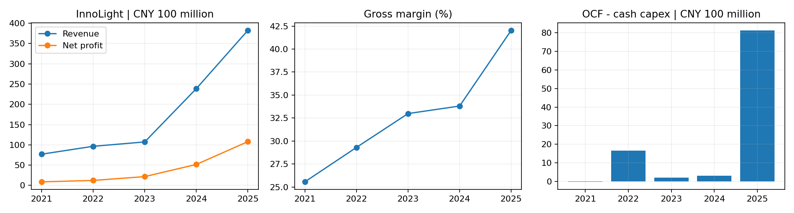

# 中际旭创投资研究报告：高速光互连增长兑现，现金转换与新架构决定持续性

研究日：2026年10月22日（北京时间）。资料截止同日；A股行情参考2026年10月21日。研究A股300308，H股03308单列。**截止日最新完整财务是2026半年报，三季报预约10月30日，不能引用尚未披露的季度实绩。**[披露日程](https://emweb.securities.eastmoney.com/pc_hsf10/pages/index.html?code=SZ300308&color=b&type=web)

**结论：空仓者观望，持仓者在验证增长和现金回笼的前提下持有，不支持凭AI叙事直接核心重仓。** 646.77元参考价需要较高的正常化利润和持续增长。三年基准折现约676元，安全边际薄；约500–510元才接近本报告基准折现值再打75折的研究参考价。480–520元可启动更深入评估，前提是订单、技术地位与回款没有恶化，非无条件买价。

**信息丰富度A级；AI局限性声明：** 财务披露充分，但高速产品份额、单价、客户名与技术迁移利润贡献不完全公开。容易把行业需求强、客户资本开支高误当成上市公司永久高利润。报告区分正式披露、管理层预测与分析者情景，不以缺数据直接判坏，也不将缺口补成确定数字。

## 一、生意本质：以设计、光电封装、测试和交付满足带宽升级

公司把电信号与光信号转换模块销售给云数据中心、网络设备等客户。核心不是简单组装，而是高速信号完整性、光电协同设计、封装良率、可靠性与大批量交付。复购依靠一代又一代产品通过认证，不是订阅；每次从800G向1.6T乃至新架构切换，都可能重新分配份额与利润。

| 期间／产品 | 收入（亿元） | 毛利率 |
|---|---:|---:|
| 2025光通信收发模块 | 374.57 | 42.61% |
| 2025其他 | 7.83 | 未提取 |
| 2026H1光通信收发模块 | 413.55 | 46.59% |
| 2026H1其他（差额） | 4.23 | 未提取 |

2025模块收入占97.95%，境外全部业务占90.58%；H1境外光模块收入395.99亿元，不能误作全部境外收入。800G／1.6T的精确收入与单价未分拆，不能据行业估算拼出分部表。[2025年报](https://static.cninfo.com.cn/finalpage/2026-03-31/1225056459.PDF)、[2026中报](https://static.cninfo.com.cn/finalpage/2026-08-22/1225491753.PDF)、[上证报摘要](https://paper.cnstock.com/html/2026-03/31/content_2194060.htm)。

段永平式追问：客户为什么复购？因为性能、功耗、良率与供货，而不是换上AI概念就能自动涨价。

## 二、五年盈利与最新现金质量

单位人民币亿元。Capex仅购建固定、无形和其他长期资产现金支出。历史表使用约数，FCF由表中约数相减；精确最新计算见附件。并购及股权投资不含在简化FCF里。

| 年度 | 收入 | 归母净利润 | 毛利率 | 经营现金流 | 现金Capex | 简化FCF | 年末货币资金 |
|---|---:|---:|---:|---:|---:|---:|---:|
| 2021 | 76.95 | 8.77 | 25.57% | 8.13 | 8.40 | -0.27 | 35.15 |
| 2022 | 96.42 | 12.24 | 29.31% | 24.49 | 7.92 | 16.57 | 28.31 |
| 2023 | 107.18 | 21.74 | 32.99% | 18.97 | 17.04 | 1.93 | 33.17 |
| 2024 | 238.62 | 51.71 | 33.81% | 31.65 | 28.66 | 2.99 | 50.54 |
| 2025 | 382.40 | 107.97 | 42.04% | 108.96 | 27.60 | 81.36 | 109.87 |

来源：[2021摘要](https://static.cninfo.com.cn/finalpage/2022-04-25/1213057721.PDF)、[2022年报](https://vip.stock.finance.sina.com.cn/corp/view/vCB_AllBulletinDetail.php?id=9049092)、[2023年报](https://static.cninfo.com.cn/finalpage/2024-04-22/1219703026.PDF)、[2024年报](https://static.cninfo.com.cn/finalpage/2025-04-21/1223155483.PDF)、[2025年报](https://static.cninfo.com.cn/finalpage/2026-03-31/1225056459.PDF)；交叉对照[中商现金流表（万元）](https://s.askci.com/stock/financialreport/300308/cashflow/)、[历史毛利率](https://tool.stockstar.com/summary/caibao/300308)、[东方财富2025指标（收入利润万元）](https://datapc.eastmoney.com/emdatacenter/profit/report?code=300308&gotoF10=1)。个别历史Capex只有一手确数，未完成每一历史格双源精确验证；历史营业利润率全序列未完整提取，不填造。

| 2026H1指标 | 数值 |
|---|---:|
| 营业收入 | 417.78亿元 |
| 归母净利润 | 136.51亿元 |
| 扣非归母净利润 | 130.92亿元 |
| 经营现金流 | 18.00亿元 |
| 现金Capex | 48.02亿元 |
| 简化自由现金流 | -30.02亿元 |
| 货币资金 | 63.97亿元 |
| 交易性金融资产 | 25.29亿元 |
| 应收账款 | 150.01亿元 |
| 存货 | 198.26亿元 |
| 归母权益 | 398.59亿元 |
| 长期应付款 | 50.57亿元 |

上半年归母增长241.70%，经营现金流却同比减少44.08%；OCF/归母约0.132倍。Q2归母约79.17亿元，Q2单季OCF约-15.68亿元。必须追踪备货转销售、应收转现金；不能把快速增长直接叫“高质量现金复利”。也不能仅因扩产期现金低就认定收入虚假。[半年报](https://static.cninfo.com.cn/finalpage/2026-08-22/1225491753.PDF)、[新华财经独立整理](https://www.cnfin.com/gs-lb/detail/20260821/4458801_1.html)、[21世纪经营资金核查](https://m.21jingji.com/article/20260826/7b78cdd8c4404072ebe4a67432fb91a0.html)。

最近四个已披露完整季度（收入／归母，亿元约数）：2025Q3为102.16／31.37，Q4为132.35／36.65；2026Q1为194.96／57.35，Q2为222.81／79.17。前三者由年报及季度累计差分，见计算附件；季度速率分部未披露，不按总收入分摊。

H1研发投入约12.34亿元，研发费用约11.53亿元，两口径不能混为一谈。[中报](https://static.cninfo.com.cn/finalpage/2026-08-22/1225491753.PDF)、[新华财经](https://www.cnfin.com/gs-lb/detail/20260821/4458801_1.html)。

**净现金边界：** H1货币资金＋交易性资产，扣短借、一年内到期负债、长借、租赁后约70.48亿元；若再全额扣长期应付款，约19.91亿元。2025审计附注四(32)明确当时9.00亿元为少数股东回购义务；2026增至50.57亿元的完整增量性质未逐项对齐，因此以扣除前后区间展示，不将其武断定性为纯银行借款或无息货款。[2025审计附注](https://static.cninfo.com.cn/finalpage/2026-03-31/1225056461.PDF)。上述都不是10月最新现金：7月H股融资在H1资产负债表日之后，后续扩产和投资亦会消耗资金，不能把融资额机械全部加到6月现金当当前值。

段永平式追问：提前锁料最终能否提高交付与回报，还是把需求下行风险留给库存？现金回笼是答案。

## 三、护城河与技术路线

| 护城河 | 判断 | 检验方法 |
|---|---|---|
| 品牌／定价权 | 高端交付声誉有价值，客户议价强 | ASP下降与单位成本下降谁更快 |
| 转换成本 | 认证、联合开发及可靠性较强 | 下一代产品定点、认证和续单 |
| 网络效应 | 主业弱，出货多不自动形成平台网络 | 不赋予互联网式永久垄断溢价 |
| 规模效应 | 采购、封测学习和研发分摊显著 | 扩产后良率、回款和增量ROIC |
| 技术壁垒 | 多工艺与硅光集成形成能力 | 换架构后的实际收入及利润 |

LightCounting公开摘要支持领先地位，但本次未取得可独立核验的最新800G或1.6T精确份额；不写“全球份额X%”或“领先几年”。[原始行业摘要](https://lightcounting.com/newsletter/en/may-2026-optical-vendor-landscape-376)。竞争者新易盛、Coherent等的产品组合与垂直整合程度不同，不用同行当期高PE证明估值合理。

### CPO／NPO／硅光：既是机会，也会重分价值

硅光是实现光电功能的一类技术平台，可插拔／近封装／共封装是不同集成与部署形态，两者不是简单互斥关系；硅光方案仍可能需要外部高性能激光器。Lumentum技术原文列示200G EML及CW激光＋硅光路径，[一手技术说明](https://www.lumentum.com/en/blog/enabling-next-phase-ai-optical-infrastructure)。

NVIDIA的2025公告将InnoLight列为并行发展的可插拔模块供应商，不能把同篇CPO生态叙述偷换成中际已有CPO订单。[NVIDIA原文](https://nvidianews.nvidia.com/news/nvidia-spectrum-x-co-packaged-optics-networking-switches-ai-factories)。2026年其称CPO交换机进入生产，风险不是遥远概念。[最新官方产品披露](https://nvidianews.nvidia.com/news/vera-rubin-full-production-agentic-ai-factory)。

本公司的中报展示NPO、XPO、CPO、OCS研发；产品展示不等于大规模收入、客户验证不等于永久利润。新架构可能保留其光引擎及封装能力，也可能让部分传统模块价值转移至芯片与平台厂。过去五年规模和高端能力增强，未来五年需在技术切换中重新证明。

巴菲特式追问：如果产品外形消失，公司的工艺、客户认证和研发组织是否还能收费？有潜力，但必须有新订单和利润证明。

## 四、逆向思考：高集中度下，增长故事的另一面

2025前五客户75.98%，最大24.06%；前五供应商51.50%，最大35.76%。客户匿名，不能据市场传闻猜具体云厂商；上游规模采购优势与依赖同时存在。[年报原文](https://money.finance.sina.com.cn/corp/view/vCB_AllBulletinDetail.php?id=12041853&stockid=300308)

| 失败路径 | 概率判断 | 影响／验证 |
|---|---|---|
| 云客户Capex放缓或重复下单回撤 | 无可靠统计概率 | 高；看交期、应收、订单变化 |
| ASP降价快于成本下降 | 周期性风险 | 高；看分速率毛利与成本 |
| 关键物料紧缺、涨价或限制 | 供应集中已存在 | 高；锁料条款、替代认证 |
| CPO转型未取得价值份额 | 未能可靠量化 | 高；新架构收入而非概念展示 |
| 扩产备货遇需求下修 | 资金占用已出现 | 高；库存账龄、跌价、现金回收 |
| 美国限制升级 | 提案已经出现，立法结果未知 | 高；看最终法律及客户采购变化 |
| 完全断供／归零损失 | 未单列概率、未建模 | 尾部；模型可能高估回报 |

美国S.5548于9月24日提出，文本点名中际旭创及新易盛，针对有关联邦采购，拟有立法后五年实施安排。**这仍是提案，不能写成已生效、全美国商业云客户禁购或全面禁运。** 但海外营收高占比意味着不能忽视供应链重构。[美国政府原文](https://www.govinfo.gov/content/pkg/BILLS-119s5548is/xhtml/BILLS-119s5548is.html)

多方最强证据是800G与1.6T放量已经转成收入、利润和毛利提升。反方最强论点是单位利润高峰、集中客户与供给扩张使高增速不能永续。管理层7月、8月谈2027需求属于订单能见度判断，不是无条件不可取消收入。[7月调研原文](https://vip.stock.finance.sina.com.cn/corp/view/vCB_AllBulletinDetail.php?id=12466864)、[8月调研](https://data.eastmoney.com/notices/detail/300308/AN202608231828345475.html)。

历史类比更适合通信设备的技术迭代与资本开支周期，不将公司直接等同于互联网泡沫失败者，也不因龙头身份忽视周期。芒格式追问：最可能在哪里犯错？把客户指引当永久需求，把锁料库存当已实现利润。

## 五、管理层与资本配置

技术与客户团队是核心资产，创始人及骨干留任、人才激励和研发组织比短期概念更关键。刘圣负责的管理团队已在产品升级中兑现经营增长，但不能据此免除并购和资金使用的检验。

| 决策 | 评价与跟踪 |
|---|---|
| 研发及高端产能扩建 | 支持增长，2026–2027需检验利用率与FCF |
| H股上市 | 拓宽境外融资，兼有稀释，不将募资当利润 |
| 40–80亿元回购计划 | 用于员工持股／激励，不能全部计为注销回报 |
| 投资中石科技 | 17.47亿元取得10.47%股份，协同尚待兑现 |

回购与投资来源：[回购公告](https://static.cninfo.com.cn/finalpage/2026-09-01/1225538120.PDF)、[中石交易过户](https://data.eastmoney.com/notices/detail/300308/AN202609301830044481.html)。

7月权益公告明确山东中际、王伟修、王晓东一致行动；股份合计以当时披露股数为基础，最新总股本下约16.41%，不沿用超配前16.53%。控股股东减持完成公告与历史权益变动分开，不把旧累计减持当新卖出计划。[一致行动披露](https://static.cninfo.com.cn/finalpage/2026-07-30/1225449716.PDF)、[减持完成](https://static.cninfo.com.cn/finalpage/2026-01-16/1224938645.PDF)。这不是AB股超额投票权；完整家族穿透及截止日所有账户变化未独立复核。

段永平式追问：关键技术负责人退休，组织是否仍能完成下一代产品认证？需看产品梯队和研发交付，而不是只看当前盈利。

## 六、行业与文明趋势

AI训练、推理和数据中心互连需要更多带宽，但AI总资本开支不是光模块TAM，光模块增长也不自动等于公司利润增长。需求应拆成端口数、每端口带宽、光连接渗透、单价、公司份额和利润率；CPO、铜互连适用距离及架构变化会影响可得市场。

本次没有拿到足够独立、同口径、可审计的长期TAM与公司份额预测，不拼凑精确市场空间。李录式追问：十年后，公司保留的是今日一代产品，还是跨形态的光互连平台能力？估值不能提前把后者全数兑现。

## 七、估值：区分增长价值与安全边际

10月21日A股不复权收盘646.77元，[Investing](https://cn.investing.com/equities/shandong-zhongji-electrical-historical-data)、[新浪行情](https://quotes.sina.cn/hs/company/quotes/view/sz300308)。最新已核实总股本1177909641股，A股1115234641、H股62675000；回购库存不默认为注销。[9月月报](https://www.cfi.net.cn/p20261008000206.html)、[另一披露确认](https://static.cninfo.com.cn/finalpage/2026-09-01/1225538120.PDF)。

A价×全部股本=**A股等价市值7618.37亿元**，不是实际A＋H合计市值。实际市值需两地股份分别乘两地价格并统一汇率，本次不伪造H股同日报价／汇率。半年报EPS不能直接乘新股本推算利润；以归母利润÷最新总股本构造A股每股估值，避免新发行稀释遗漏。

| 指标 | 结果 | 限制 |
|---|---:|---|
| A股等价市值 | 7618.37亿元 | 全股本按A价 |
| TTM至中报归母 | 204.53亿元 | 2025全年＋2026H1−2025H1 |
| TTM PE | 37.25倍 | 历史运行利润 |
| 2026假设PE | 25.39倍 | 全年归母300亿元，非指引 |
| 相对H1旧净资产PB | 19.11倍 | 未加入7月IPO，非当前精确PB |

近似TTM收入652.29亿元；PEG、EV/Revenue及历史PE分位未完成同日及净债口径验证，不报伪精确值。无法对齐新易盛等同行的同日价格、稀释和利润口径，不以泛泛高倍数作锚。

### 三年三情景：定价检验

全年2026归母300亿元为分析起点，较H1机械年化略高，隐含下半年交付继续；不是公司业绩预告。此后三年悲观收缩10%、基准增长15%、乐观增长30%，退出PE15／22／30倍。基准要求较强竞争力持续，乐观要求新代际成功与客户扩张。没有把当前超高同比永续化。

| 情景 | 年增速 | 2029归母（亿元） | 退出PE | 2029退出价（元） | 今日折现值（元） |
|---|---:|---:|---:|---:|---:|
| 乐观 | 30% | 659.10 | 30 | 1678.65 | 1332.57 |
| 基准 | 15% | 456.26 | 22 | 852.17 | 676.48 |
| 悲观 | -10% | 218.70 | 15 | 278.50 | 221.08 |

按人民币8%折现、不计三年分红，基准约676.48元，与646.77元参考价接近。要求25%安全边际约507.36元。480–520元是条件评估区间，非认为跌到此价风险消失。悲观折现约221.08元，说明增长预期失效的潜在损失显著。

反向检查：当前等价市值若给22倍，需要年归母约346.29亿元；给30倍则需约253.95亿元。重点是何时能持续赚到、能否转为股东现金。以2026假设300亿元计算25.39倍，并非单看2025静态约70倍，也不是已经便宜的结论。

### 十年仓位压力测试

人民币r=8%，规范化Rf2%＋beta1×ERP6%，非当日实测；ROIC稳态增量20%假设设计与工艺仍保留优势，明显低于繁荣期高ROE所暗示的回报。永续g为0%／1%／1%，上限低于框架人民币基准2%。终值PE=(1−g/ROIC)/(r−g)=12.50／13.57／13.57倍，分母8／7／7个百分点，不用同行高PE作为2036退出倍数。

2036归母假设120／600／1200亿元，覆盖技术失位、成熟增长及跨架构成功。净股息−稀释k=0.3%是假设；激励回购不能直接提高它。

| 情景 | 2036归母（亿元） | 十年IRR |
|---|---:|---:|
| 悲观 | 120 | -14.70% |
| 基准 | 600 | 0.97% |
| 乐观 | 1200 | 8.19% |

主观权重30%／50%／20%，不是统计概率；工具对三档IRR加权不等于对概率加权现金流求IRR，k按工具年化加项近似，不是逐年分红模拟。

| r | 加权情景IRR | 是否覆盖r |
|---|---:|---|
| 6% | 0.92% | 未通过 |
| 8% | -2.29% | 未通过 |
| 10% | -4.63% | 超出人民币区间，仅参考 |

r6%时分母6／5／5个百分点，基准均满足至少5个百分点。合理区间内本次±2pp扰动未翻转。技术替代、客户资本开支下修和贸易限制放入情景；完全断供、归零尾部未单列，可能进一步降低回报。

### 估值分歧对账

三年基准给出略高于现价的折现值，但未提供足够安全边际；十年压力测试又限制长期大仓位。若只读“基准价值高于现价”，容易错误推成重仓买入。前者是定价检验，后者是仓位约束；结合强产品能力、需求趋势、客户供应集中、现金流与政策风险，最终是空仓观望、已有仓位条件持有。十年低于r没有单独一票否决生意和持有。

巴菲特式追问：如果股市关闭五年，能否接受技术切换、现金流和客户资本开支的不确定性？以现价本研究不愿新增核心仓位。段永平式追问：即使生意好，也必须为不确定性留够价格余地。

## 八、综合决策备忘录

| 维度 | 判断 | 置信度 |
|---|---|---|
| 生意质量 | 高端光互连需求已转为业绩，现金转换待跟进 | 中高 |
| 护城河 | 工艺、认证、规模较强，随架构迁移再验证 | 中 |
| 管理层 | 研发经营执行有效，扩张与投资回报待复核 | 中 |
| 最大风险 | 客户／供应商集中、技术切换、现金和贸易 | 中高 |
| 文明趋势 | AI互连需求长期有空间，不保证当前利润率 | 中高 |
| 估值 | 三年基准安全边际薄；十年限制仓位，扰动未翻转 | 中低 |

空仓者：观望，等待更好的价格或回款／技术证据。持仓者：若增长及新代际认证继续兑现，可持有与风险预算匹配的仓位，不凭同比增速继续提升集中度。加仓信号：备货转交付、应收回款改善，关键新产品形成实际收入，或价格进入条件参考带。卖出／重审信号：大客户持续砍单、库存跌价、技术切换失位、关键市场限制实质落地。没有用户组合资料，不给个人仓位比例或短线交易指令。

四位大师模拟点评：未取得四位对本公司的足够一手观点，巴菲特、芒格、段永平、李录均“资料不足，不模拟代言”。式追问为研究方法，不是原话。

## 附录：核验范围与研究限制

财务关键指标、股本、三年情景、十年终值与敏感性用项目工具校验，见verification.txt、inputs.json、model.json和calculations.json。源间2024／2025毛利率33.80%／42.03%与原报告33.81%／42.04%有小尾差，以原年报为准；不能将其误作趋势差异。

尚未取得：2026Q3财报、分速率精确收入及ASP、最新可独立核验份额、完整新架构利润贡献、长期应付款新增部分逐项性质、7月IPO后最新资产负债表。需要一手验证：锁料是否可取消、交付与回款条款、新产能良率、关键材料涨价传导、海外生产法律边界、客户订单重复率与CPO实际商业收入。

AI分析置信度：已披露财务及合同／政策文本中高，技术迁移、客户未来开支与长期估值中低。投资确定性来自可持续现金回报，不来自资料数量或AI关注度。本报告供学习研究，不构成个性化投资建议。

抽检记录：固定种子42抽取8项，6项披露数值核对通过，其中长期应付款仅完成一手余额核对，其新增部分性质仍待验证；2项模型假设单列，不冒充外部验证。见audit-extract.txt、audit-facts.json、audit-assumptions.json及audit-facts-verdict.txt。最终终值参数audit通过，未建模完全断供／归零风险已在正文保留。
