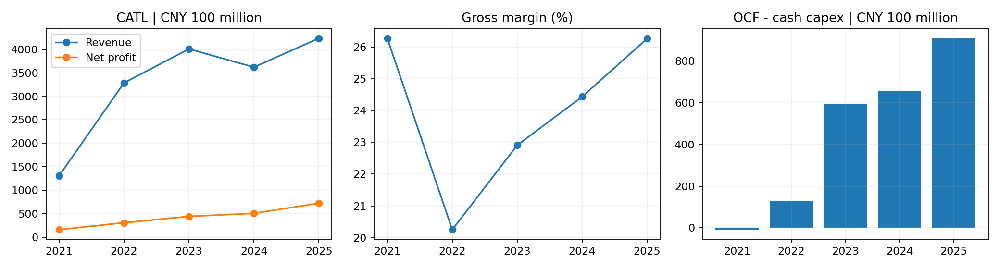

# 宁德时代投资研究报告：制造护城河仍在，税费与现金转换决定安全边际

研究日：2026年10月22日（北京时间）。资料截止同日；行情参考2026年10月21日收盘。研究主标的为A股300750，H股03750单列，不混用报价、币种及市值。季报未经审计。

**结论：A股有条件分批买入／已有仓位持有，先控制仓位，不直接升级为核心重仓。** 参考A价227.90元，盈利估值已较年初旧报告显著下降，但新增税负、现金转换及海外扩产使“低PE”不能自动等于低风险。模型基准含安全边际的参考价约220元，200–220元更有吸引力，220–250元适合小额分批验证，超过约294元需重新评估基准安全边际。上述区间以年度盈利850亿元假设及后续增长成立为条件，非保底价格。

**信息丰富度A级；AI局限性声明：** 财务与行业资料充足，但容易把龙头共识当成确定性。本报告重点检验单位利润、税负传导、营运资金与资本配置。未来利润、情景概率、ROIC和折现率均是分析者假设，不是公司承诺。资料多不会消除技术替代和政策风险。

## 一、生意本质：出售可规模交付的安全、寿命与综合成本

公司主要向车企和储能客户销售电池，底层能力是电化学、制造工艺、供应链及质量控制的组合。收入主要来自产品交付，非软件订阅；新车型定点和认证有粘性，但车企有动力引入第二供应商或自研。复购依靠持续性能、成本及可靠性，不能按消费品牌的无条件提价权理解。

| 2025业务 | 收入（亿元） | 占比 | 毛利率 |
|---|---:|---:|---:|
| 动力电池 | 3165.06 | 74.70% | 23.84% |
| 储能电池 | 624.40 | 14.74% | 26.71% |
| 材料及回收 | 218.61 | 5.16% | 27.27% |
| 矿产资源 | 59.78 | 1.41% | 11.25% |
| 其他 | 169.17 | 3.99% | 未提取 |

来源：[2025年报](https://www.hkexnews.hk/listedco/listconews/sehk/2026/0309/2026030901592_c.pdf)、[第三方分部整理](https://stock.stockstar.com/IG2026031000000102.shtml)。分部及总额四舍五入有尾差。2025储能毛利率高于动力，不能用去年静态分部表证明今年储能必然拖累毛利；今年结构变化须看交流侧系统、交付周期和报价。

段永平式追问：客户付钱买的是最便宜的电芯，还是全生命周期成本和可靠性？公司的优势主要在后者，但必须持续兑现。

## 二、财务质量：盈利增长，现金转换开始承压

单位人民币亿元，毛利率除外。FCF仅为经营现金流减购建长期资产现金支出，不含全部并购、股权投资及融资活动。

| 年度 | 收入 | 归母净利润 | 毛利率 | 经营现金流 | 现金Capex | 简化FCF | 年末货币资金 |
|---|---:|---:|---:|---:|---:|---:|---:|
| 2021 | 1303.56 | 159.31 | 26.28% | 429.08 | 437.68 | -8.60 | 890.72 |
| 2022 | 3285.94 | 307.29 | 20.25% | 612.09 | 482.15 | 129.94 | 1910.43 |
| 2023 | 4009.17 | 441.21 | 22.91% | 928.26 | 336.25 | 592.01 | 2643.07 |
| 2024 | 3620.13 | 507.45 | 24.44% | 969.90 | 311.80 | 658.10 | 3035.12 |
| 2025 | 4237.02 | 722.01 | 26.27% | 1332.20 | 423.45 | 908.75 | 3335.13 |

历史来源：[2023年报摘要](https://money.finance.sina.com.cn/corp/view/vCB_AllBulletinDetail.php?id=9876405&stockid=300750)、[2022年报](https://static.cninfo.com.cn/finalpage/2023-03-10/1216084559.PDF)、[2025年报](https://www.hkexnews.hk/listedco/listconews/sehk/2026/0309/2026030901592_c.pdf)；交叉对照[东方财富](https://emweb.securities.eastmoney.com/pc_hsf10/NewFinanceAnalysis/Index?code=SZ300750&type=web)、[中商现金流表](https://s.askci.com/stock/financialreport/300750/cashflow/)、[经济通资产负债表](https://www.etnet.com.hk/www/sc/ashares/quote_ci_bs.php?code=300750)。个别历史Capex只取得一手确数，五年营业利润率未完成独立全序列复核，不补造。

| 最新指标 | 数值 |
|---|---:|
| 前三季度收入 | 4421.37亿元 |
| 前三季度归母 | 645.30亿元 |
| 前三季度扣非归母 | 578.76亿元 |
| 前三季度经营现金流 | 616.25亿元 |
| 前三季度现金Capex | 421.67亿元 |
| 前三季度简化FCF | 194.58亿元 |
| 期末货币资金 | 3698.14亿元 |
| 期末交易性金融资产 | 627.80亿元 |
| 含租赁的简化净金融资产 | 2426.68亿元 |
| 归母净资产 | 3868.81亿元 |

净金融资产=货币资金＋交易性金融资产−短借−长借−债券−一年内到期非流动负债−租赁负债；未将应付货款当金融债务，也未扣所有受限资金、少数股东权益及经营必需现金，不能全部作为可分配净现金。现金等价物与货币资金不是同口径。

三季度单季收入1652.21亿元、归母212.46亿元，分别同比增长58.58%与14.54%；单季归母率约12.86%。前九个月OCF/归母约0.955倍，OCF同比下降23.60%。不能沿用旧报告“现金流/利润长期大于1.8倍”的表述。[三季报原文](https://static.cninfo.com.cn/finalpage/2026-10-21/1225613175.PDF)、[上证报](https://www.cnstock.com/commonDetail/805665)、[第三方现金流表](https://stock.quote.stockstar.com/finance/cashflow_300750.shtml)、[第三方资产负债表](https://stock.quote.stockstar.com/finance/balance_300750.shtml)。

最近四季收入／归母（亿元、约数）：2025Q4为1406.30／231.67；2026Q1为1291.31／207.38；Q2为1477.86／225.46；Q3为1652.21／212.46，累计差分见计算附件。季度分部收入没有完整公开同口径拆分，不能按年度结构分摊造数。

公司业绩会解释单位盈利受产品结构、税费变化影响；现金流受缩短供应商账期、预付和研发支持影响。这些解释合理但仍待后续现金数据检验；支持供应链可能增强韧性，也永久提高营运资金需求，不能只认短期影响。[10月20日业绩会](https://www.cfi.net.cn/p20261021000283.html)

段永平式追问：税费和供应链付款条件改变后，企业还能赚多少可分配现金，而非只维持出货？

## 三、护城河：制造与认证强，网络效应有限

| 类型 | 证据与判断 | 可推翻证据 |
|---|---|---|
| 品牌／定价权 | 安全可靠形成声誉，但客户强势，定价权不绝对 | 税负无法转嫁且单位利润持续下降 |
| 转换成本 | 车型开发、认证、质量追踪提高切换成本 | 第二供应商认证周期缩短、份额持续流失 |
| 网络效应 | 主业较弱，不能套平台逻辑；换电另作期权 | 换电利用率长期不足 |
| 规模效应 | 采购、良率、研发分摊、服务网络形成复合优势 | 海外工厂低利用率抵消规模优势 |
| 技术壁垒 | 多体系研发与制造一致性较强 | 替代路线率先量产且成本可靠性占优 |

SNE统计2026年1–8月全球注册EV/PHEV/HEV电池装车，宁德333.0GWh、市占39.4%，比亚迪15.1%、LG新能源8.1%。这支持现有竞争力，不代表储能份额或厂家全部出货量。[SNE原始发布](https://sneresearch.com/en/insight/release_view/744/page/0)

2025研发约221亿元，产能772GWh、在建321GWh；专利及申请合计54538项，不能写成全是已授权专利。技术指标不等于经济护城河，研发回报需看量产成本和客户订单。[公司年度经营说明](https://www.catl.com/en/news/6773.html)

过去五年规模和客户覆盖增强；未来五年是否继续变宽，取决于税后单位盈利、海外良率与新体系量产。巴菲特式追问：十年后领先的是今天的电池化学配方，还是持续把新配方稳定量产的组织？本研究更看重后者。

## 四、逆向风险：不要把税费当成自动修复项

| 失败路径 | 概率判断 | 影响及监测 |
|---|---|---|
| 新税负不能转嫁 | 无可靠统计概率，现实压力已出现 | 高；跟踪单Wh盈利与合同改价 |
| 车企自研、多供或价格战 | 持续发生的竞争机制 | 高；跟踪同口径份额和单位毛利 |
| 海外政策限制／本地化超支 | 无可靠量化概率 | 高；已投产能利用率而非规划规模 |
| 固态、钠离子等路线替代 | 路线不确定 | 高；看良率、成本、车规认证 |
| 大规模质量召回 | 未量化、未建模 | 高尾部损失；看预计负债与质量事件 |
| 供应链支持消耗现金 | 已有表现 | 中高；看应收、存货、预付及FCF |

政策原文：2026年9月起相关锂离子等电池消费税2%，2027年9月起4%；符合要求的钠离子、固态等有阶段性免税安排。[税务局全文](https://shanghai.chinatax.gov.cn/zcfw/zcfgk/xfs/202607/t480969.html)。另2026年4月至年底电池增值税出口退税9%降为6%，2027年起取消；出口消费税退免另按文件执行，不能混同。[财政部原文](https://szs.mof.gov.cn/zhengcefabu/202601/t20260109_3981637.htm)。不将名义税率直接乘全部收入当净利润损失，国内外结构、抵扣及客户分担均影响结果。

美国1260H名单与商务部实体清单不是同一种限制；公司6月声明称正申请移除，不代表已移除。[公司声明](https://www.catl.com/en/news/6832.html)。匈牙利9月为首两线试生产，不是规划100GWh全量稳定投产。[项目原文](https://www.catl.com/en/news/7000.html)。

多方：规模、制造学习、客户认证和储能机会使利润可持续。反方：利润峰值、税负和客户去依赖令低PE只是周期顶点；新能源趋势不会自动让股东获得高回报。历史类比采用半导体／汽车零部件的规模制造逻辑，不直接等同消费品垄断。芒格式追问：最可能犯错的是把份额领先当成不可压缩的单位利润。

## 五、管理层与资本配置

曾毓群的技术及制造组织能力是核心资产；核心人物依赖亦是风险。9月末瑞庭持股22.04%，曾通过直接间接持有瑞庭全部权益构成利益绑定，不将持股比例理解为AB股超额投票权。[三季报](https://static.cninfo.com.cn/finalpage/2026-10-21/1225613175.PDF)、[关联公告](https://www.cfi.net.cn/p20260915003575.html)。

| 决策 | 结果与评价 |
|---|---|
| 持续研发与多化学体系布局 | 构建产品选择权，仍需检验新产品利润贡献 |
| 海外建厂与H股融资 | 匹配本地化，项目爬坡及资本回报未完结 |
| 分红与回购 | 形成股东回报，但回购用途区分注销与员工激励，不能重复计入收益 |
| 支持供应商、缩短部分账期 | 有助产业韧性，代价是更多营运资金占用 |

2025累计拟分红含中期约361亿元，约归母的一半，不能把年末315亿元与全年361亿元相加。[财联社](https://www.cls.cn/detail/2307584)。对资本配置整体正面，但不凭分红率推断未来无条件稳定。段永平式追问：创始人退出后，质量纪律、技术判断和客户信任能否组织化延续？组织证据比个人故事更重要。

## 六、行业与文明趋势

电动化、储能及电网调节是长期需求驱动，但需求量增长、收入增长和利润增长不同。SNE装车数据比把整个能源投资规模当公司TAM更有解释力。比亚迪有整车内供、LG新能源有区域及补贴因素，不能直接用整车PE／含补贴利润率证明宁德便宜。

本报告不将零碳产业投资总额等同电池可得收入，也不虚构未来十年精确市占。李录式追问：能源转型继续时，公司是价值创造者还是资本支出承担者？关键看新增产能税后ROIC。

## 七、估值与安全边际

A价227.90元，H价364.80港元，均为10月21日历史参考；[A行情](https://cn.investing.com/equities/amperex-tech-a-historical-data)、[独立A价报道](https://stock.finance.sina.com.cn/stock/go.php/vReport_Show/kind/lastest/rptid/845917427216/index.phtml)、[H行情](https://cn.investing.com/equities/contemporary-amperex-tech-historical-data)。总股本4627249686股，A股4408949386、H股218300300，[月报](https://www.cfi.net.cn/p20261007000676.html)、[经济通](https://www.etnet.com.hk/www/sc/ashares/quote_ci_brief.php?code=300750)。尚未注销的回购不直接扣除。

**A股等价市值**=A价×全部股本=10545.50亿元，用于A股每股收益估值；这不是按两地报价加权的实际AH合计市值。实际AH市值=A股数×A价＋H股数×H价×同日汇率。本次未核实同日汇率，不伪报合计市值，也不据此给精确H股目标价。

| A股估值指标 | 数值 | 口径 |
|---|---:|---|
| 等价市值 | 10545.50亿元 | 全股本按A价 |
| 近似TTM PE | 12.02倍 | 全年2025＋2026九月累计−2025同期，旧同期取约数 |
| PB | 2.73倍 | 归母净资产 |
| 2026假设PE | 12.41倍 | 全年850亿元，非公司指引 |

PS、EV/Revenue可按输入重算，但净金融资产中受限现金、少数股东和合并口径未完全调整，本报告不将简化EV写成精确值。PEG和历史PE分位没有完成统一口径验证，不报告伪精确百分位。

### 三年三情景：定价判断

2026归母850亿元为分析者起点，接近全年运行量级而非机械承诺。采用悲观利润收缩10%、基准增长8%、乐观增长18%；退出PE为10／16／22倍，体现周期制造与龙头持续性的不同判断。股本保持不变，未把未来回购收益预先计入。

| 情景 | 年增速 | 2029归母（亿元） | 退出PE | 2029退出价（元） | 折现至今日（元） |
|---|---:|---:|---:|---:|---:|
| 乐观 | 18% | 1396.58 | 22 | 663.99 | 527.10 |
| 基准 | 8% | 1070.76 | 16 | 370.24 | 293.91 |
| 悲观 | -10% | 619.65 | 10 | 133.91 | 106.30 |

折现率8%，不加三年期间分红（定价保守简化）。基准今日约293.91元，75%参考约220.43元；200–220元更有吸引力、220–250元分批验证，非无条件买价。悲观折现约106.30元说明下行可显著超出常见短线止损。

反向检查：A等价市值按16倍PE需正常化利润约659亿元；当前2026假设850亿元若回落到约659亿元，估值优势显著收窄。反向DCF在无完整十年逐年FCFE预测时不报唯一隐含增速，以下给透明终值压力检验。

### 十年仓位压力测试

人民币r=8%=规范化Rf2%＋beta1×ERP6%，这些不是当日实测估计。稳态增量ROIC18%假设制造优势延续但新资本回报低于优秀历史存量；永续g悲／基／乐为0%／1%／1%，不把十年成长率永续化。终值PE=(1−g/ROIC)/(r−g)，为12.50／13.49／13.49倍，分母8／7／7个百分点。假设2036归母500／1600／3000亿元，净股息率减稀释k=2%为情景输入，不是分红承诺。

| 十年情景 | 2036利润（亿元） | 十年IRR |
|---|---:|---:|
| 悲观 | 500 | -3.10% |
| 基准 | 1600 | 9.43% |
| 乐观 | 3000 | 16.40% |

概率权重25%／50%／25%是主观压力权重，不是统计频率。工具对各档IRR加权不等同对概率加权现金流求IRR；k采用年化加项近似，不是逐年实际分红贴现。重大召回／彻底损失尾部未单列概率，可能高估回报，见风险限制。

| r | 加权情景IRR | 覆盖资本成本 |
|---|---:|---|
| 6% | 11.55% | 通过 |
| 8% | 8.04% | 勉强通过 |
| 10% | 5.47% | 区间外，仅参考 |
| 7%补查 | 9.64% | 通过 |
| 9%补查 | 6.67% | 未通过 |

**不能只看±2pp的“稳定通过”：补查人民币区间内9%后，仓位测试发生翻转。本结论对折现率敏感，仓位建议降级。** r6%下分母6／5／5个百分点，其余区间内档均满足至少5个百分点。

### 估值分歧对账及旧论文更新

三年基准判断A股有吸引力；十年r8%仅勉强通过、r9%未通过，约束的是重仓而不是买入唯一否决。综合制造护城河、研发组织、趋势和价格，保留分批买入／持有；同时税费、现金转换和敏感性要求避免一次性满仓。相较5月旧报告“观望等300–350元”，本次使用新股价、新利润、最新股本及税制重新推导，不机械继承旧价格带。未完成复权、分红和时点解释前，不直接计算424元至227.9元的投资回报。

巴菲特式追问：r错一个百分点，是否改变仓位结论？会，因此吸引力不能等同高确定性重仓。段永平式追问：股市关闭五年能否承受税负和技术投入波动？只在可承受长期持有的资金范围内买入。

## 八、综合决策

| 维度 | 结论 | 置信度 |
|---|---|---|
| 生意质量 | 具长期竞争力的制造生意，非无周期订阅 | 中高 |
| 护城河 | 规模、质量学习、认证和研发组合较强 | 中高 |
| 管理层 | 资本回报记录较好，新扩张仍需复核 | 中 |
| 最大风险 | 税费传导、现金转换、海外与技术 | 中高 |
| 文明趋势 | 电动化与储能需求持续，利润率不保证 | 中高 |
| 估值 | 三年基准有余地；十年区间内翻转，收紧仓位 | 中低 |

空仓者：A股参考价附近可小额分批，200–220元条件更好；不是把越跌越买当纪律。持仓者：保持与长期风险预算匹配的仓位，税负影响未清楚前不因低PE盲目加大。加仓信号：单位盈利企稳、营运资本支持不再持续扩大、海外良率与现金回报兑现。卖出／重审信号：份额和单位利润同步持续恶化，重要区域市场被实质关闭，质量事故或新技术造成资本回报永久下移。未取得用户组合信息，不给个性化仓位百分比。

四位大师模拟点评：未取得四位对本公司足够的一手立场，巴菲特、芒格、段永平、李录均“资料不足，不模拟代言”。文中式追问为分析框架，不是本人引语。

## 附录：数据与模型核验边界

2025收入、归母、2026Q3货币资金及总股本已做多源数值交叉验证，结果见verification.txt；跨平台一致不等于独立审计。三年、十年、敏感性与准出检查用项目工具运行，参数与原始输出保存在同目录。2023经济通毛利率19.19%与一手22.91%冲突，该值弃用，以[公司债说明书](https://www1.hkexnews.hk/listedco/listconews/sehk/2026/0211/2026021100017_c.pdf)及原年报为准，不能平均。

AI分析置信度：历史财务与披露事实较高；税费转嫁幅度、长期利润与估值中低。投资确定性取决于未来竞争和现金回报，不随资料数量自动提高。需要一手跟踪：客户改价、国内外应税结构、海外产线良率、现金支持是否常态化、换电单站利用率，以及新体系成本和认证进度。本报告供学习研究，不构成个性化投资建议。

抽检记录：固定种子42，抽取9项，其中6项历史／披露事实通过数值核对，2项分析假设单列、不冒充验证，1项模型输出通过复算。见audit-extract.txt、audit-facts.json、audit-assumptions.json、audit-calculations.json及对应verdict；估值口径最后复检通过，重大召回未建模警告已显式保留。抽检不能证明预测正确。
