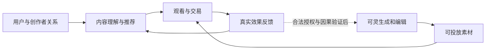

# 快手与可灵深度研究报告

**研究与检索截止：2026年10月16日（北京时间）；财务截至2026年6月30日；股价采用10月15日收盘。**

快手（01024.HK）收盘价28.58港元。按9月末已发行A、B股合计43.04151598亿股计算，市值1,230.13亿港元、折人民币1,054.24亿元；滚动十二个月归母PE约6.69倍。汇率采用10月15日官方中间价1港元兑0.85702元人民币。基准内在价值约46港元，属于包含现金回报恢复假设的研究估值。可灵不是独立上市证券，其私募认购价格不能直接作为快手的可兑现净资产。[S1–S4]

**核心判断：快手已经拥有中等强度的社区与交易护城河；可灵已经证明产品和商业化能力，但尚未证明能跨越模型代际、持续赚取超额利润。未来最值得押注的资产，是被客户反复使用的生产流程，以及生成、分发、成交之间的真实反馈。**

若必须给出一个十年利润数，本报告的基准是：**2036年快手归母净利润约370亿元人民币；其中可灵独立净利润约60亿元，按届时60%经济权益计，贡献约36亿元。** 三年、五年、十年的经营条件和反面情景在后文完整展开。这不是公司指引，也不是对未来IFRS利润的精确预测。

## 研究边界

快手财务信息丰富度为A，可灵独立经济性为B，完整训练配方与客户留存数据为C。财务披露多，并不意味着十年结果确定。

- **事实**：已披露财务、合同条款、已发布技术文件。
- **公司声称**：发布会效果、内部实验提升、未由本报告独立复现的性能。
- **推断**：这些事实对竞争优势和价值分配的含义。
- **假设**：所有未来收入、利润率、持股比例、资本投入与折现参数。

本次没有访问内部训练集、客户账单、GPU采购合同，也没有进行模型盲测或管理层访谈；因此不编造参数量、训练成本、客户续约率、付费市场份额或团队现有人数。模型榜单不代替生产测试，算术审计不验证预测。本文用于学习与研究。

---

## 一、先分清买的是哪两门生意

快手让商家为可触达、可转化的用户关系付费。可灵让创作者与企业为更便宜、更可控的视频生产付费。前者卖的是有效分发，后者卖的是生产能力；供给增加对两者的影响并不相同。

| 业务 | 谁付钱、为什么复购 | 主要利润变量 | 主要替代者 |
|---|---|---|---|
| 线上营销 | 商家为成交、线索和曝光付费，效果好才续投 | 用户有效时长、广告匹配、转化率、商家ROI | 抖音、微信、小红书及其他营销渠道 |
| 直播 | 用户为主播互动和虚拟礼物付费 | 付费用户、付费强度、主播分成及治理成本 | 其他直播、娱乐与社交方式 |
| 电商等服务 | 商家为交易基础设施和服务付费 | 成交规模、真实复购、有效费率、退款和补贴 | 抖音电商、传统电商及私域渠道 |
| 可灵 | 创作者订阅，企业按使用量或合同购买 | 有效成片量、净单价、推理成本、训练投入、留存 | 其他模型、自部署模型、多模型创作平台 |

“其他服务”已经包含可灵，电商GMV则不是收入。预测时必须先把可灵从其他服务中拆出，再加入可灵外部收入，内部使用和集团间结算要抵销。生成素材给快手广告带来的收益，也只能计入广告业务一次。

### 盈利改善是真实的，现金投资加速也是真实的

以下金额单位为人民币亿元。归母净利润与调整后利润分开看，简单FCF仅指CFO减现金资本支出，不代表全部可分配现金。

| 年度 | 总收入 | 归母净利润 | 经营现金流CFO | 现金资本支出 | 简单FCF |
|---|---:|---:|---:|---:|---:|
| 2021 | 810.82 | -780.74 | -55.19 | 77.64 | -132.83 |
| 2022 | 941.83 | -136.90 | 7.95 | 51.00 | -43.05 |
| 2023 | 1,134.70 | 63.96 | 207.81 | 48.97 | 158.84 |
| 2024 | 1,268.98 | 153.35 | 297.87 | 80.63 | 217.24 |
| 2025 | 1,427.76 | 186.17 | 267.16 | 149.42 | 117.74 |
| 2026上半年 | 692.51 | 60.49 | 90.44 | 179.41 | -88.97 |

2021年大额亏损包含上市前优先股相关非现金影响，不能用来外推成熟经营亏损。该年CFO和资本支出本次仅取得数据库值，原件未逐项复核，只用于背景；其余年度按已核验口径列示。2022年采用之后年报重分类数，不能拼入旧现金流分类。详细来源与缺口见[财务证据](财务与经营证据.md)。[S1–S3]

2025年收入构成为：线上营销约815亿元、直播约391亿元、其他服务约222亿元。最新季度更值得警惕：2026年第二季度广告收入同比仅增长4.4%，直播下降13.5%，可灵收入则超过8.5亿元。同期平均DAU为4.123亿，同比增长0.8%。新业务增长不能遮住主业成熟的事实。[S1、S2]

| 最近四季度，人民币亿元 | 2025Q3 | 2025Q4 | 2026Q1 | 2026Q2 |
|---|---:|---:|---:|---:|
| 线上营销 | 201.02 | 236.18 | 196.43 | 206.39 |
| 直播 | 95.74 | 96.55 | 84.92 | 86.90 |
| 其他服务，含可灵 | 58.78 | 62.95 | 55.81 | 62.06 |
| 总收入 | 355.54 | 395.68 | 337.16 | 355.35 |
| 归母净利润 | 44.88 | 52.29 | 29.03 | 31.46 |

季度结构来自公司披露，尚无完整独立标准化分项复核；原件定位和年度勾稽在财务证据中。季度波动不能忽略季节性，表格用于观察结构，不用某一季乘四充作全年业绩。

2026年第一、第二季度可灵实际收入分别超过6.5亿、8.5亿元；3月约5亿美元的ARR是年化运行率，并不是过去十二个月收入或已锁定合同额。收入已经具有商业意义，但公司尚未提供足够完整的可灵独立损益表和现金流表，无法据此直接推算净利润率。[S1、S5]

对股东更重要的是现金转换：2025年CFO/归母净利润约1.44倍，简单FCF/归母约0.63倍；2026上半年分别约1.50倍和-1.47倍。上半年再扣租赁及其利息现金支出19.19亿元后，余量约-108.16亿元。部分投入可能创造未来收益，但不能在投入发生时就把回报算成已经实现。

滚动十二个月的CFO为239.79亿元、资本支出258.08亿元，简单FCF为-18.29亿元。第三方数据库已更新CFO，却把TTM资本支出留在2025全年数，因而显示正FCF；本报告已用官方半年与年报重建，不采用该错误结果。低PE与负FCF可以同时存在。

> 巴菲特式追问：需要不断更换算力设备的业务，应该按纯软件平台还是持续再投资的生产设施估值？本报告采用后者的现金纪律。

---

## 二、创始人、团队与组织：有能力，不等于激励天然一致

### 程一笑：产品与组织能力是主要资产

程一笑的关键履历是从工具起步，把产品逐步发展成内容社区，并在2021年接任CEO、2023年接任董事长。评价他的核心不是工程师标签，而是能否持续平衡用户体验、商业化与组织成本。[S6]

快手的社区关系和普通创作者生态，是这种产品选择长期积累的结果。判断为正面的证据是商业化成熟后公司实现全年盈利；需要重新检验的是，过去降低成熟业务成本的能力，能否转化为管理前沿模型投资的能力。两者的预算节奏、人才市场和反馈周期不同。

### 宿华：技术创业背景重要，当前分工更重要

宿华曾任职谷歌、百度，联合创业后承担过重要技术和管理角色；如今不宜继续把他当作快手日常经营的一号负责人。官方董事资料与中报应优先于旧人物报道。[S6]

截至2026年8月25日披露，宿华经济权益约9.88%、普通事项投票权约32.49%；程一笑对应为8.84%和33.34%。二人拥有的投票权明显超过经济权益，保护长期投入的同时，也降低了小股东纠正重大资本配置错误的能力。特殊事项另有表决规则，不能把普通事项票权推广到所有事项。[S1]

### 可灵是多层团队的成果，不能围绕一位“明星科学家”估值

| 层级 | 已核实信息及边界 | 投资含义 |
|---|---|---|
| 业务负责人 | 7月2日公告已称盖坤为可灵CEO；9月30日内部调整的媒体报道强调其专职负责可灵，程一笑接手社区科学线 | 组织开始为新业务单独配置责任；仍需验证团队独立经营能力 |
| 视频生成技术 | 万鹏飞的个人学术资料及会议资料可支持其视频生成团队领导经历 | 支持连续研发能力，不能据此推断全部团队名单或当前组织图 |
| 图像生成相关人员 | QCon北京2026讲师资料把李岩列为京东零售视觉与AIGC负责人，之前负责快手可灵AI·可图团队 | 不能继续将其列为可灵现任负责人；个人变动也不等于整个视频团队流失 |
| 推荐、广告与系统 | OneRec等论文及部署材料反映了另一条推荐与工程团队的积累 | 这是可复用的研究与工程底座，但不等于全部成员属于可灵 |

这类公司真正的组织资产包括：数据清洗和标注规范、训练失败的排查经验、分布式训练与推理优化、产品评测集，以及技术团队与客户之间的反馈机制。某位负责人离开，可能带走路线判断；系统是否还能在下一轮迭代保持质量和成本，才决定组织护城河。[S7、S8]

如果CEO离开，成熟社区大概率能够继续运行；如果可灵关键模型负责人、基础设施负责人及产品负责人同时流失，下一代迭代风险会显著增加。这个反事实意味着：快手适合评价组织和现金回报，可灵还需要像一级市场项目一样做关键人员留任、知识产权归属和梯队尽调。

### 融资不是白送给快手股东的高估值

7月2日公告提出可灵投前估值150亿美元、认购上限30亿美元，并安排最高15%的员工激励池。8月31日正式公告确认认购额度已经用满，表列认购出资合计204.471亿元人民币。但协议承诺注资、全部认购、逐笔款项到账以及重组交割，是不同状态；本次未找到足以逐笔核验全部到账及重组完成的材料。[S9、S10]

| 条款 | 已披露事实 | 普通股股东必须追问的事 |
|---|---|---|
| 充分摊薄权益 | 在全部认购及激励安排用满的假设下，快手相关主体合计68.33%，投资者约16.67%，员工池15% | 未来融资还会稀释多少；经营控制是否持续 |
| 管理层激励 | 盖坤约3%权益奖励，另有约1%期权安排；程一笑约1%权益奖励 | 奖励的业绩条件、归属条件及上市股东承受的成本 |
| 可灵表决权 | 特定盖坤股份享有不同投票安排；8月更新的假设表中3%经济权益对应23.62%投票权 | 不把经济持股、董事席位和控制权混为一谈 |
| 投资者保护 | 存在合资格上市等约定及相关赎回机制 | 触发条件、承担主体、现金负担及普通股清偿顺位 |

完整条款与定位见[创始人与治理证据](创始人与治理证据.md)。这里不把私募股份理解为与上市普通股拥有完全相同的权利，也不把68.33%当作十年不变的比例。

有两个细节值得提高权重。第一，母公司在上述假设结构中的投票权约53.8%，明显低于经济权益；若盖坤额外1%期权行使并取得特殊投票权、不发生其他资本变化，条件推算母公司票权约50.25%，控制余量有限。

第二，未能在约定最迟上市日期或2031年10月30日两者较早者前完成上市，以及特定重组事项逾期，可能触发回购；已递表另有缓冲条件。回购价格包含8%年单利等调整，义务主体为北京可灵及其集团公司，不能直接称为上市母公司全额担保或已经形成的无条件债务。新融资、上市期限和人才安排必须放在同一张资本结构表中分析。[S9、S10]

我对管理层的评价是：**产品判断和工程组织能力值得认真研究，资本配置的最后成绩仍要看归属于上市股东的自由现金流。** 最值得盯的冲突，是母公司承担算力、客户和品牌资源，而新业务的权益与控制权逐渐向员工或外部投资者转移。发生这种转移未必不合理，但应有透明的交易价格、费用分摊与资金安排。

> 段永平式追问：人对不对，要看他们怎么分配现金、权利与风险，不能只看他们做出了什么产品。

---

## 三、技术选型：可灵的优势具体在哪里

### 视频生成的难点不只是增加几个画面

生成模型需要同时处理空间细节、时间一致性、人物身份、运动规律、镜头语言和声音同步。输出越长、分辨率越高，可供出错的位置越多；演示片段漂亮，并不能保证客户指定的第十个镜头也可交付。

可灵早期官方资料公开了扩散Transformer、三维时空建模和3D VAE等路线。后续产品扩展到联合音视频、参考素材、运动控制和编辑。这里必须区分“该模型家族采用过什么公开方法”与“最新4.0内部仍如何实现”：最新完整配方、参数量、各模块开销没有公开证据，不能从早期博客补齐。[S11]

| 技术层 | 为什么重要 | 什么能成为壁垒，什么不能 |
|---|---|---|
| 视频压缩表示，如3D VAE | 在压缩空间中学习，降低视频训练与生成开销，同时尽量保留运动细节；这里第三维指时间 | 更好的率失真和系统效率有价值；不等于已有显式三维场景或物理模拟器 |
| 扩散／流匹配与Transformer建模 | 组织高维生成过程，表达空间和时间依赖 | 数据、训练稳定性和规模化经验可能领先；不能据未公开细节断言最新模型采用某一独家架构 |
| 数据构造 | 切镜、去重、字幕、动作描述、镜头关系、质量筛选决定监督质量 | 有合法权利、能覆盖失败案例的高质量数据，比原始视频条数更有用 |
| 条件控制和音视频联合建模 | 保持品牌、人物与声音一致，使客户能修改局部而不必推倒重来 | 真实项目中的可控性形成产品差异；竞争者能够逐项追赶 |
| 后训练与评测 | 对齐美学、运动、指令和商业可用性，减少失败样本 | 私有偏好与失败数据可能积累；本报告无法确认可灵最新后训练算法和全部奖励机制 |
| 推理工程 | 蒸馏、采样优化、批处理、缓存、算力调度等影响速度与成本 | 持续工程执行可以形成成本优势；这些是行业可用方法，不代表已确认可灵逐项实施 |
| 工作流与企业交付 | 资产管理、版本、协作、审阅、权限、稳定接口和可追溯交付 | 客户迁移时要重建的实际生产系统，比单次生成按钮更难替代 |

可灵自己的公开研究已经比几个架构名更具体。2025年Kling-Omni技术报告描述了多模态语言理解、DiT生成与超分模块的配合，采用监督微调、DPO偏好优化，并披露蒸馏、FP8及缓存等工程方法；作者报告蒸馏把模型求值次数从150次减至10次。这说明团队能把研究和服务效率结合，但不等于全部交付成本下降同样倍数，也不代表4.0完整沿用该实现。[Kling-Omni报告](https://arxiv.org/html/2512.16776v1)

从路线选择看，DiT是网络架构，扩散或流匹配是训练与采样方式，它们不是互斥的赛道。统一理解与生成有利于复杂指令和局部编辑，也增加数据构造与多任务平衡难度；高压缩表示节省算力，却可能丢失商品小字和细部结构。可灵需要在质量、控制、时延和价格之间持续取舍，靠一次“架构选对了”无法保证十年胜出。

“物理看起来合理”也不等于拥有可验证的物理模拟器。广告、影视需要的是可靠且可编辑的表现；机器人训练或安全关键仿真还需要状态、因果、动作交互和可复现验证。可灵可以向世界模型探索，但本报告没有把机器人市场直接计入收入。

### 截至研究日，已经进入4.0阶段，但可用性不能混写

| 项目 | 核实到的状态 | 对判断的作用 |
|---|---|---|
| 3.0／Omni、Turbo与工作流接口 | 3.0／Omni支持原生4K；Turbo支持720P／1080P并强调效率；公司披露MCP及CLI已推出 | 已从体验型工具走向批量生产接入；不可把标准版4K套给Turbo；收入和利润仍需单独验证 |
| 4.0与4.0 Flash | 9月30日官方宣布早期访问；Flash自9月28日起向指定订阅用户开放，计划10月扩大覆盖 | 证明持续迭代；不等于本次已验证全部用户/API均可用 |
| 4.0原生30秒、最多10关键帧 | 官方宣布的规格 | 更贴近完整广告片与分镜控制；本报告未独立盲测交付成功率 |
| 10-bit HDR、延长至两分钟 | 官方正文仍写待推出 | 属于路线图，不纳入已实现能力或收入 |

4.0最有商业价值的方向是减少重生成和局部返工。若角色、产品和镜头控制更稳定，客户完成同一个任务所付出的总成本会下降；即使一次调用更贵，也可能更愿意留在可灵。反之，规格更高但成功率没有改善，就很难形成定价权。[S12]

### 快手更难复制的技术资产，可能是推荐和成交反馈

OneRec将推荐由多阶段选择逐步转向生成式建模；后续版本研究计算分配优化和真实交互偏好对齐。相关论文报告了线上实验效果，但这些是作者实验，版本、流量和指标口径不同，不可把各项提升相加，更不可直接等同收入增长。[S13]

快手拥有“向谁展示什么—用户是否停留—商家是否成交”的反馈。一个新模型公司可以买到训练GPU，仍很难快速复制已有社区的长期交易反馈。对快手而言，最值得保留的闭环如下：

虚线部分非常关键：观看、成交数据并不自动成为可灵可以无限使用的训练数据；企业私有素材也可能明确禁止训练。内部效果反馈还必须排除投放人群、价格、预算等混杂因素。如果能合法地让模型学会“什么内容帮助什么客户完成什么目标”，这比学习更多公开视频更有差异化。

---

## 四、赛道：需求很大，利润可能流向别人

### 从“生成视频”到“完成一次商业创作”

短期最清晰的付费需求是电商素材、广告创意、短剧与动画、预演以及专业镜头补充。长片全流程替代和实时交互世界属于更远的选择权。它们对可控性、版权、时延和协作的要求不同，不能拿同一个市场规模相加。

本报告的行业基准判断是：生成量增长，同时单位生成价格下降；这不是确定的价格路径。业务收入增长取决于量的增长能否超过价格下降；利润增长还要再扣除训练、推理、客户获取和版权服务成本。

供应链上的利润可能留在四个位置：先进算力与基础设施、最强的特定模型、掌握客户的创作工作流、拥有版权资产与分发渠道的平台。可灵现在横跨模型与创作工具，快手另有分发渠道，这是有价值的组合，但不是已经完成的闭环。

### 真正要比较的是有效交付成本

下面只是演示性假设，不是可灵或竞品的实际报价或测评：

| 假设条件 | 模型A | 模型B |
|---|---:|---:|
| 每次生成收费，元 | 2 | 1 |
| 单次达到指定交付标准的概率 | 40% | 15% |
| 期望生成收费，元/合格交付 | 5.00 | 6.67 |
| 后期修改时间，分钟 | 5 | 12 |
| 人工每分钟2元后的总成本，元 | 15.00 | 30.67 |

简化公式是“单次价格÷成功率＋人工修改成本”，隐含成功率稳定、允许重复尝试等条件；现实中失败往往相关，还存在重试预算上限。表格未包括等待、沟通和合规成本。客户为最终可交付结果付钱。正式尽调应固定任务、输出时长、重试预算和评审标准，比较中位数及长尾失败成本。

对供应商，成本下降也未必提升利润。假设收入100、GPU成本40、其他变动成本20，贡献利润为40；GPU成本减半，但售价下降40%，贡献利润反而降到20。把“推理成本将大降”直接翻译成“可灵利润率必然大升”，缺少了竞争这一环。

### 当前竞争格局应更新，不能照抄旧名单

| 竞争者／位置 | 截至本次可核实的信息 | 对可灵的主要压力 |
|---|---|---|
| 字节Seedance | 2.5于7月31日发布，强化长片段、参考及编辑能力 | 视频模型、工具、广告分发可以一起竞争，是最直接的综合对手 |
| Google Veo | 官方持续提供视频生成及企业服务接口 | 模型研究、算力和云客户关系；不是只比画面质量 |
| 阿里Wan | 3.0官方文档于9月仍标预览；此前版本存在开放权重生态 | 自部署和云端低成本替代；不能把3.0预览等同所有能力开源 |
| MiniMax | H3于7月31日官方发布 | 原生多模态与全球产品竞争，可能争夺相同创作者预算 |
| Runway | 官方4.5及工作流产品；7月推出模型路由，8月接入Seedance 2.5 | 即使自有模型不是每次最强，仍可拥有客户工作流 |
| Adobe | 已接入可灵3.0／Omni等合作模型 | 同时提供分销和替代选择，可能把可灵变成后台可切换供应商 |
| OpenAI Sora | 官方公告显示Web/App于4月26日结束、Videos API与Sora 2系列于9月24日移除 | 本报告将其作为历史技术标杆和产品退出案例，不列为当前可直接采购对手 |

产品状态与原始链接集中于[技术证据](技术与竞争证据.md)。以上不声称已经穷尽全球竞争者，也不以不同任务、不同时间的榜单给出一个虚假的综合第一名。

Adobe接入尤其具有两面性：扩大可灵触达，但也使客户可能留在Adobe、把底层模型随时切换。Adobe对部分合作模型的企业版权补充保障有专门条件与名单，不能将Firefly品牌等同于可灵自动获得相同赔偿承诺。[S14]

> 李录式追问：视频生产效率提升所创造的价值，最后是被模型公司留下，还是被客户、算力商、工作流入口拿走？这个问题比总生成量更重要。

---

## 五、护城河：今天、三年后，分别是什么

### 今天的护城河不是一个统一的“AI壁垒”

| 来源 | 快手主业 | 可灵 | 证伪方式 |
|---|---|---|---|
| 用户关系与网络效应 | 中等偏强：创作者、用户、商家相互依赖；多平台使用仍普遍 | 当前偏弱：一个人的更多生成，不必然让另一个人的体验更好 | 用户及商家持续迁移，关系复购下降 |
| 数据与反馈 | 较强的经营反馈，但不是无限可用的私有训练库 | 可能通过返工、偏好、资产一致性积累有用数据 | 数据不可合法复用，或投入后不能改善交付成本 |
| 技术与工程 | 大规模推荐、商业化和系统效率具有积累 | 处于有竞争力的前沿梯队；持久领先尚未证明 | 相同交付任务被竞品用更低总成本完成 |
| 切换成本 | 商家经营关系和历史数据有成本，消费者换应用成本低 | 单一API低，项目资产、评审及企业流程可能提高成本 | 客户不迁移项目也能经路由器轻易换模型 |
| 规模成本 | 能摊薄内容与商业基础设施成本 | 使用规模有利于调度，但新增算力、训练不能省略 | 单位成本改善仍落后于市场价格下降 |
| 定价权 | 受商家ROI及替代渠道限制 | 尚缺同客户提价后留存、续约和毛利数据 | 提价即流失；增长依赖补贴、赠送额度 |

快手不是没有护城河，而是护城河不足以隔绝更大平台的进攻。可灵不是没有差异化，而是差异化仍需要每一代产品重新证明。购买一批GPU或拥有海量视频都不构成充分条件。

### 三年后的护城河：看谁把“作品”变成“生产系统”

到2029年，今天的原生音频、参考图、镜头控制很可能成为主要产品的基础能力。基准判断是，单点模型功能的稀缺性下降，以下四项才有机会构成新的壁垒：

1. **可复用的客户资产**：品牌、角色、镜头库、版本历史和团队审批进入日常生产，迁移需要重做质量验证。
2. **任务层成本优势**：对某类高频任务持续少返工、低延迟、稳定交付，而不是某个样片领先。
3. **经授权的反馈闭环**：真实客户接受和拒绝的修改记录，能合法改善下一轮效果；内部交易反馈能提高商家回报。
4. **可信企业交付**：数据隔离、权限、可追溯来源、商业许可、服务等级和预算可控，足以支撑正式采购。

这些是应当建立的护城河，不是现在已经被证明拥有的四项资产。MCP、CLI和API能扩大使用，也让代理更容易接入替代模型；接口普及本身甚至会降低切换成本。需要客户迁移的是项目、资产与流程，才可能形成更强的锁定。

对快手主业，三年后最有价值的能力是用AI提升真实成交、降低商家成本，同时保持社区信任。若AI内容污染导致用户更难识别真实人物与商品，原来的关系优势也会被损害。内容越便宜，可信内容、审美判断、有效分发越稀缺。

我愿意给可灵的判断是“有形成中等护城河的条件”，还不能给出“已拥有十年宽护城河”。与一个全新模型创业公司相比，快手的资金、工程基础和客户场景降低了生存风险；与字节、Google等综合平台相比，这些资源又不是独占。

---

## 六、五年和十年后，公司可能变成什么

| 时间 | 基准形态 | 更好的结果 | 更差的结果 |
|---|---|---|---|
| 2029，三年 | 成熟社区的经营现金支撑AI投入；可灵成为专业创作工具和供应商之一 | 品牌资产、协作及投放反馈开始形成迁移成本 | 成片能力趋同，调用增长被降价抵销 |
| 2031，五年 | 快手是内容交易平台；可灵是跨平台视频生产服务，两者部分协同 | 从卖生成额度升级为承接完整创作任务，企业收入更稳定 | 可灵成为路由平台背后的算力密集型供应商，规模有了，净利很薄 |
| 2036，十年 | 国内社区仍有现金价值，可灵成为全球视觉生产基础设施中的一家 | 形成项目资产、工作流、反馈和责任交付的组合，享有较稳定利润率 | 主业关系衰退，新技术持续烧钱；可灵被整合、出售或失去控制权 |

五年后，我更倾向于“两个相关业务协同”而非“可灵完全取代快手”。快手的用户关系与可灵的全球专业客户并非天然相同。前者对内容真实性和互动有需求，后者需要可靠的商业交付，把两者强行合成一个产品反而可能损害体验。

十年后的公司名称、组织边界和股权结构可能改变。可灵独立融资、上市、被部分出售或者失去合并控制，都可能使“集团营业收入”“可灵独立利润”“快手归母利润”分叉。本报告长期模型以经济权益归属为核心，不假装能提前预测所有会计列报和一次性投资收益。

真正的乐观终局不是“人人每天生成更多视频”，而是企业把创作任务、品牌资产、预算和交付责任长期交给可灵。真正的悲观终局也不是模型不再进步，而是模型进步太快、客户切换太容易，价格持续下降，资本回报无法覆盖投入。

> 芒格式追问：即使技术判断全部正确，这个投资还可能怎样失败？答案是定价权、资金需求和股东分配。

---

## 七、十年后的利润：基准370亿元，如何算出来

本节全是研究情景，单位均为人民币亿元。净利润口径包括正常训练研发、推理成本、设备折旧、销售管理、股份支付与税费，不使用“扣除AI投入后”的虚高利润。为避免重复计费，主业利润率已含日常分摊费用，额外集团成本只代表尚未分配的增量成本。

公式为：

**快手归母利润＝主业外部收入×主业净利率＋可灵外部收入×可灵独立净利率×快手经济持股比例－额外集团税后成本。**

### 基准路径

| 假设／计算项 | 2029 | 2031 | 2036 |
|---|---:|---:|---:|
| 线上营销收入 | 950 | 1,050 | 1,300 |
| 直播收入 | 310 | 290 | 250 |
| 电商与其他收入，不含可灵 | 330 | 410 | 590 |
| 主业收入合计 | 1,590 | 1,750 | 2,140 |
| 主业净利率 | 14% | 15% | 16% |
| 主业净利润 | 222.60 | 262.50 | 342.40 |
| 可灵外部收入 | 70 | 120 | 300 |
| 可灵独立净利率 | 8% | 12% | 20% |
| 可灵独立净利润 | 5.60 | 14.40 | 60.00 |
| 快手届时经济持股 | 68% | 65% | 60% |
| 可灵归属于快手的利润 | 3.81 | 9.36 | 36.00 |
| 额外集团税后成本 | 4 | 5 | 10 |
| **快手归母净利润** | **222.41** | **266.86** | **368.40** |

表中小数只用于复算，投资判断取约220亿、270亿、370亿元。可灵持股比例是考虑未来融资与员工激励后的假设，既不是公告承诺，也不是预测一定以该比例上市。

### 这些数字需要哪些现实条件

**第一，主业缓慢增长，直播持续收缩。** 广告到2036年达到1,300亿元，依赖有效商业化与交易效率，而非假定用户数翻倍。直播降至250亿元，明确计入结构压力。电商与其他服务增加到590亿元，需要交易质量、变现能力及新服务扩张；单靠提高费率，商家可能流失。

**第二，主业净利率恢复并提升至16%。** 这要求推荐、流量采购和基础设施效率抵消竞争投入。AI广告收益已在此处，不会再另加一个“AI赋能利润”。2026年利润率走弱，所以这不是机械延续最新一期，而是需要未来经营结果验证的恢复假设。

**第三，可灵十年后收入300亿元，净利率20%。** 这意味着它必须从快速增长的工具，变成全球规模的持续生产服务。一个用于检验数量级的组合是：300万个直接付费席位、年净收入3,600元，贡献108亿元；另有12.8万个不重叠的企业/API账户等价、年净收入15万元，贡献192亿元。合计300亿元。

这里的“账户等价”是反推所需规模，不是现实客户统计；API聚合商、企业员工和直接订阅不得重复计数，收入须扣渠道分成、折扣、退款并按会计口径确认。这个组合说明基准也不轻松：需要大量持续付费用户、稳定企业预算，以及新增需求对降价的抵消。若只成为大量一次性尝鲜用户使用的产品，这个模型不成立。

**第四，20%净利率要求完整成本受控。** 公司没有披露足以证明这一利润率的独立成本表；它需要推理贡献利润足够高、训练迭代不无限吞噬收入、销售渠道可控、硬件经济寿命合理。只证明单次GPU成本下降不够。

**第五，可灵的上行只有部分属于快手。** 基准可灵赚60亿元，归属快手只有36亿元。这也是为什么快手主业的长期利润率，比“可灵下一代模型能多生成多少秒”对集团基准利润更敏感：主业净利率每变动1个百分点，2036年利润变化21.4亿元；可灵持股每少10个百分点，利润少6亿元。

### 三种结果，而非一个看似精确的十年预测

| 情景 | 2029快手归母 | 2031快手归母 | 2036主业收入／净利率 | 2036可灵收入／净利率 | 2036可灵独立利润 | 2036快手归母 |
|---|---:|---:|---|---|---:|---:|
| 悲观 | 112.80 | 82.10 | 1,000／7% | 60／0% | 0 | 67.00 |
| **基准** | **222.41** | **266.86** | **2,140／16%** | **300／20%** | **60** | **368.40** |
| 乐观 | 323.44 | 451.86 | 3,100／20% | 1,000／28% | 280 | 773.00 |

悲观情景假设可灵早期亏损、长期基本盈亏平衡，快手权益进一步降至50%；乐观情景也只给快手60%的可灵权益，并扣15亿元额外集团成本。所有中间分解均保存在[模型文件](利润与估值模型.json)。

**我的主判断是约370亿元，合理研究区间非常宽，约70亿至770亿元。** 这个区间不是统计置信区间，不包含全部尾部风险。监管、资本消耗、资产减值或核心生态严重受损时，利润可能低于悲观情景甚至转负；模型成功也不保证市场一定给予高估值。

---

## 八、利润要变成股东现金，还需要跨过什么

截至2026年6月末，广义可用资金包括受限现金、定存与金融资产，不能直接全部加到股权估值。尤其需要把供应商融资与银行借款分开识别。[S1]

| 保守现金桥梁 | 人民币亿元 | 处理 |
|---|---:|---|
| 现金及等价物 | 116.96 | 纳入流动资金池 |
| 短期定存 | 123.58 | 按账面纳入 |
| 流动金融资产 | 563.53 | 含7.19亿元上市权益，余下为理财及其他；按账面近似，非无风险现金 |
| 减：银行等借款 | -273.62 | 融资性负债 |
| 减：票据及剩余应付中的供应商融资 | -252.53 | 252.48票据与0.05其他部分，不重复算作现金创造 |
| 减：6月末应付股利 | -25.84 | 随后支付的现金，不视为当前新股东富余资金 |
| 减：经营与压力缓冲 | -150.00 | 研究假设，并非公司披露的受限资金 |
| **纳入估值的富余净额** | **102.08** | 保守模型输入 |

这是一张以6月末为底稿、扣已知应付分配的估值桥梁，**不是10月15日真实净现金估计**。长期定存、非流动金融资产和可灵新增认购资金未作为额外可分配价值计入。它们可能有价值，但必须核对到账、承诺用途、少数股东和优先权；若进一步剔除7.19亿元上市权益，上述净额降至94.89亿元。

还存在一个日期缺口：除已扣的应付股利外，模型暂把2026下半年经营、投资、回购及融资净变化设为零，并从2027年开始预测。这不保证保守，持续现金消耗可能高估估值。每减少100亿元可归属净现金，每股价值降低约2.71港元；新增认购资金也须扣承诺投入和相关权益后才能讨论上调。不能因静态底稿资产取值较谨慎，就忽略期间现金变化。

估值现金流已经扣租赁付款，故不再扣116.72亿元租赁负债；但银行和供应商融资前现金流与相应债务必须一致处理。融资的钱不能计入经营利润，子公司的全部现金也不能无条件算作母公司可支配现金。

### 基准利润与现金回报之间保留了明显差额

| 基准桥梁，均为归属比例调整后的假设 | 2029 | 2031 | 2036 |
|---|---:|---:|---:|
| 归母净利润 | 222.41 | 266.86 | 368.40 |
| 加回税后银行／供应商融资成本 | 15 | 15 | 15 |
| 非现金折旧等净回加，已扣租赁现金付款 | 90 | 105 | 120 |
| 减：全部资本投入 | -200 | -195 | -190 |
| 减：营运资金及其他经营现金留存 | -37 | -42 | -38 |
| 归属经营现金流，取整 | 90 | 150 | 275 |

这是检验资本强度的假设桥梁，不是公司提供的现金预算。训练研发和股份支付已保留为经济成本，不额外加回粉饰现金。即便十年赚约370亿元，基准可用于估值的经营现金也只取275亿元。若设备折旧年限高估、训练频率增加或客户回款变差，差额还会扩大。

---

## 九、估值与一级市场视角：好技术也可能买贵

### 主估值约46港元，条件比低PE更重要

本报告用归属于快手经济权益的经营自由现金流估值：扣全部资本支出、营运资金、税款、租赁付款及股份支付经济成本，银行／供应商融资前折现，然后加上述富余净现金。可灵已按持股与再投资计入，**不再加一次可灵私募持股价值**。

| 情景 | 2027至2036年度经营现金流假设，亿元 | 折现率／永续增速 | 每股价值，港元 |
|---|---|---|---:|
| 悲观 | 20、20、25、30、35、35、38、40、40、40 | 15%／0% | 8.55 |
| **基准** | **-20、30、90、120、150、180、210、235、255、275** | **12%／2%** | **46.04** |
| 乐观 | 30、80、160、230、310、380、450、510、570、620 | 11%／3% | 123.08 |

估值将2027年视为第一个年度折现期，未做精确到日的折现。基准没有假设立即恢复高现金分配，而是允许再投入和逐步修复；但它确实假设十年经营资产仍有持续价值。基准经营价值约56.6%来自终值，说明估值对护城河持续性高度敏感。

维持基准现金流，仅改变折现率与永续增速，结果如下。单位为港元／股。

| 折现率 | 永续增速0% | 永续增速2% | 永续增速3% |
|---|---:|---:|---:|
| 10% | 52.72 | 60.63 | 66.27 |
| 12% | 41.56 | 46.04 | 49.03 |
| 14% | 33.83 | 36.56 | 38.30 |

反向看，当前人民币市值扣上述净现金后，如果要求12%的回报且永久零增长，大约需要每年114.26亿元的稳定经营现金流。这是稳态反算，不是市场真实预期的唯一解释。当前TTM简单FCF为负，核心分歧正是何时恢复、能恢复多少；不能用当前低PE替代对恢复路径的判断。

另作十年价格回报压力测试：假设届时股数、汇率不变，不计现金分配，悲观／基准／乐观利润分别按8／12／18倍PE定价，对应约14.53／119.85／377.20港元，价格年复合回报约-6.54%／+15.41%／+29.43%。这是条件性终点比较，不能与今天的DCF相加；未来分红、回购、增发与净现金会改变总回报，未在此机械承诺。

### 私募150亿美元投前估值，需要更高门槛

可灵是快手内部已经成长起来的业务，直接投可灵与买快手普通股的风险、权益和退出路径不同。30亿美元认购全部用满时，机械投后180亿美元；这不是独立二级市场形成的价格，也不证明普通股可按同样价格出售。[S9、S10]

一级市场投资人首先应拿到：按客户批次划分的留存与收入扩张、完整单位成本、不同模型版本的贡献利润、训练开支预算、算力资产寿命、渠道分成、合规责任、关联费用分摊，以及赎回与清算条款。拿不到这些，融资规模越大，也不能替代对投资回报的判断。

我的选择是：**值得进入深度尽调名单，但不能仅凭这一融资估值直接给普通股报价。** 同一个可灵，优先股、员工普通股和快手间接持股可能具有很不一样的现金流顺序。把“180亿美元×68.33%”称为快手无条件可兑现的底价，会遗漏少数股东、优先权、后续投入和时间成本。

还可以反算价格门槛。按研究日美元中间价，180亿美元机械投后约合1,210.55亿元人民币。为便于比较，暂假设普通股同权、十年不再稀释、不分红、汇率不变，2036年可灵基准利润60亿元、退出25倍PE，股权价值为1,500亿元，十年价格复合回报仅约2.17%。若希望获得15%年回报，同样25倍退出估值，需要届时净利润约195.89亿元；按20%净利率，要收入约979.47亿元。

这不是对有特殊条款优先股的正式估值，提前退出、分红和权利保护会改变结果，进一步稀释则可能降低回报。但它揭示了一个重要区别：**我可以认可可灵的技术前景，同时认为当前融资价格对普通股意义上的投资回报要求很高。** 对一级市场投资人，便宜的融资来源、退出条款和拿到的权益，与模型质量同样重要。

### 行动框架

| 情况 | 研究结论与条件 |
|---|---|
| 空仓、偏好确定现金回报 | 先观察现金转换；当前低PE不足以替代可灵成本与再投资验证 |
| 能承受高波动、认可基准恢复路径 | 30港元及以下进入有条件研究／小比例建仓区；须接受悲观估值远低于股价，不能称为无风险地板 |
| 已持有 | 重点检查主业经营利润、资本投入、净融资与可灵权益，不因模型发布自动加仓 |
| 价格约46港元附近 | 基准假设大致反映，继续持有需由现金改善或更高的经营质量支持 |
| 价格超过60港元、现金证据没有相应改善 | 要求比本报告更强的增长和现金假设；不应只靠“AI龙头”维持估值 |
| 可灵财务拆分、企业留存和现金投资回报明显改善 | 可以上调对护城河及现金流的判断，而不仅仅提高估值倍数 |

30、46、60港元是研究行动线，不是精确交易指令，也不是保证收益的支撑位。当前持仓和风险预算未知，本报告不推断适合用户的实际仓位。

---

## 十、最强反对意见与可证伪清单

最强空方论点是：快手主业增长缓慢，可灵需要长期重资本投入；一旦模型被商品化，利润由GPU供应商与客户入口分走。上市股东承担了早期风险，却只能分享被融资、激励和优先条款摊薄后的收益。最终可能出现收入很好看，分红能力反而下降。

这一论点有现实依据，但也不能反过来断言全部AI投入都会浪费。若可灵的成片效率、客户资产与工作流确实形成黏性，今天的投入可能换来未来高回报。需要检验投资回报，而非预先把投入全算好或全算坏。

| 失败路径 | 主观风险程度 | 该观察什么 | 什么会改变判断 |
|---|---|---|---|
| 主业生态衰退 | 中高 | 活跃与有效时长、商家续投、真实复购，不能只看MAU | 商家回报、用户留存持续改善 |
| 模型能力追平、价格战 | 高 | 同任务净价、交付成功率、贡献利润与客户流失 | 在价格正常化后仍有稳定净收入留存 |
| 算力资本回报不足 | 高 | Capex/CFO、设备利用率、融资余额、折旧与更新 | 扣全部投入后连续形成归属股东的现金 |
| 工作流入口掌握议价权 | 中高 | 直接客户与渠道收入比例、多模型切换率 | 客户资产与企业流程确实留在可灵 |
| 人才与激励失衡 | 中 | 核心团队稳定性、研发组织连续性、员工池与关联成本 | 留任和研发产出不依赖单一个人，分摊透明 |
| 权利与跨境交付受限 | 中 | 商用许可、训练授权、地区可用性和索赔处理 | 清晰合同、可核验来源与稳定企业交付 |

风险程度是定性判断，没有可校准的概率。本报告最可能错在两处：一是低估主业被其他平台侵蚀的速度，二是把未来模型成本下降过多地留给了可灵，而不是留给客户。

### 下一步需要一手验证的十个问题

1. 同一批付费客户在半年、一年后保留多少收入？剔除免费额度与涨价后怎样？
2. 付费额度兑换、实际推理支出、退款与收入确认之间如何勾稽？
3. 固定真实客户任务后，可灵与主要对手的成片成功率、修改次数和总成本各是多少？
4. 训练、推理、带宽、算力折旧与销售渠道分别消耗多少收入？
5. 模型每轮升级带来的是新增客户价值，还是被迫维持竞争位置的成本？
6. 客户资产、项目历史和审批流程是否实际造成迁移成本？多模型客户如何分配预算？
7. 快手与可灵之间的数据授权、算力、员工、广告资源按什么价格结算？
8. 融资款何时到位，多少被承诺投入，谁承担赎回和退出义务？
9. 核心技术人员的归属、竞业、激励和接班梯队如何安排？
10. 去掉融资流入后，哪一年能稳定产生归属普通股的现金，靠哪些已签客户支持？

## 最终判断

快手的护城河在社区关系、商家经营和推荐交易反馈；可灵的差异化在持续视频研发、可控创作和规模化工程。**三年后的护城河要靠客户资产、生产流程、效果反馈和成本建立；五年后争夺的是创作任务入口；十年后能留下多少利润，取决于资本回报与股东权益。**

以现有公开证据，我把快手视为“有成熟现金来源、也承担AI再投资风险的公司”，把可灵视为“已验证商业需求、尚待验证长期经济性的成长业务”。基准2036年归母利润约370亿元，属于需要持续兑现的经营结果，不是技术趋势自动赠送的收益。

AI分析对已披露财务与发布状态的置信度较高，对竞争机制为中等，对十年利润为低至中等。实际投资确定性取决于客户留存、资本回报与利益分配，无法由资料数量或计算精度替代。

---

## 来源与复核材料

主文集中列关键来源，细节、页码、访问边界与第三方差异放在三份证据笔记中。旧报告仅用于发现核验线索，本文关键事实重新检索。

- S1：[2026中报原件](https://ir.kuaishou.com/system/files-encrypted/nasdaq_kms/assets/2026/09/08/10-47-47/Interim%202026.pdf)、[二季度官方业绩](https://ir.kuaishou.com/news-releases/news-release-details/kuaishou-technology-announces-second-quarter-and-interim-2026)。
- S2：[2025年度官方业绩](https://ir.kuaishou.com/news-releases/news-release-details/kuaishou-technology-announces-fourth-quarter-and-full-year-2025)。
- S3：[StockAnalysis财务](https://stockanalysis.com/quote/hkg/1024/financials/)、[财务与经营证据](财务与经营证据.md)，区分数据库标准化口径与公司原始口径。
- S4：[9月股本月报](https://www.hkexnews.hk/listedco/listconews/sehk/2026/1007/2026100700815_c.pdf)、[国家外汇管理局中间价](https://www.safe.gov.cn/AppStructured/hlw/RMBQuery.do)；行情来源详见财务证据。
- S5：[2026一季度官方业绩](https://ir.kuaishou.com/node/11461/pdf)。
- S6：[公司董事资料](https://ir.kuaishou.com/corporate-governance/board-of-directors)、[创始人与治理证据](创始人与治理证据.md)。
- S7：[万鹏飞学术主页](https://magicwpf.github.io/)、[QCon北京2026李岩讲师资料](https://qcon.infoq.cn/2026/beijing/speaker/10176)。
- S8：[9月30日组织调整报道](https://finance.sina.com.cn/jjxw/2026-09-30/doc-initrftc2485377.shtml)，这是媒体报道，不伪称公司公告。
- S9：[7月2日可灵融资与激励公告](https://www1.hkexnews.hk/listedco/listconews/sehk/2026/0702/2026070204065.pdf)。
- S10：[8月31日认购进展公告](https://www1.hkexnews.hk/listedco/listconews/sehk/2026/0831/2026083102335.pdf)。
- S11：[技术路线、竞品与版本证据](技术与竞争证据.md)，含早期官方说明、论文、竞品官方产品文档及不确定事项。
- S12：[9月30日可灵4.0官方说明](https://kling.ai/blog/kling40-kling-visual-realism-creative-control-introducing-storytelling?tab=all)。
- S13：[OneRec技术报告](https://arxiv.org/abs/2506.13695)、[OneRec-V2技术报告](https://arxiv.org/abs/2508.20900)，线上实验为作者报告。
- S14：[Adobe合作模型保障范围](https://helpx.adobe.com/co/legal/product-descriptions/partner-model.html)、[企业创作合作模型说明](https://helpx.adobe.com/firefly/web/work-with-enterprise-features/creative-production/partner-models-in-firefly-creative-production-for-enterprise.html)。

计算与审计附件：[利润与估值模型](利润与估值模型.json)、[可复算脚本](利润与估值模型.py)、[市场输入与现金口径](模型市场输入.json)、[审计说明](审计说明.md)。所有未来假设单独标记，任何PASS只代表对应数字或算式通过核对。
