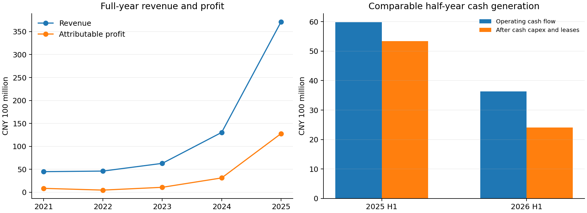

# 泡泡玛特投资研究报告

> 标的：泡泡玛特国际集团（09992.HK）。研究截止：2026-10-22，北京时间；统一估值快照：2026-10-21收盘。最新完整财务：2026年中报；TTM指截至2026-06-30的十二个月。除股价、市值另注外，金额单位均为人民币亿元。报告用于学习研究。

**结论：空仓者观望，已有小仓位者有条件持有，暂不支持重仓。**公司已经证明自己能接续推出热门IP，也有全球渠道和较强资产负债表；尚未证明的是，海外热度回落后能否维持现金回报。129.8港元约为11.2倍TTM归母利润，看上去便宜；换成本文约94亿元的常态化盈利情景，约为15.8倍，安全边际就明显变薄。基准三年估值折现约140港元，要求25%安全边际后的研究价约105港元。**100—110港元为有条件分批研究区间，130—150港元为基准价值观察区间**，均须以库存和现金转换未继续恶化为前提，不是价格到达就自动买入。

**信息丰富度：A级；财务事实研究置信度较高，长期投资确定性中等偏低。**上市披露和媒体资料充足，不能替代消费者队列、同店效率和授权合同的一手验证。AI容易在“全球文化品牌”与“过气玩具”两种叙事之间摇摆；本文把已披露事实、渠道样本、机构预测和作者假设分开。主要信息优势来自口径校正和现金流重算，没有声称发现市场不知道的信息。

## 一、数据基线：高利润仍在，增长质量已经变化

### 五年财务与现金支出

| 财年 | 收入 | 归母净利润 | 毛利率 | 报表经营利润 | 经营现金流 | 固定资产现金采购 | 无形资产现金采购 |
|---|---:|---:|---:|---:|---:|---:|---:|
| FY2021 | 44.91 | 8.54 | 61.4% | 11.50 | 7.79 | 2.88 | 0.46 |
| FY2022 | 46.17 | 4.76 | 57.5% | 5.83 | 8.91 | 2.66 | 0.81 |
| FY2023 | 63.01 | 10.82 | 61.3% | 12.31 | 19.91 | 3.24 | 0.68 |
| FY2024 | 130.38 | 31.25 | 66.8% | 41.54 | 49.54 | 3.73 | 1.44 |
| FY2025 | 371.20 | 127.76 | 72.1% | 168.90 | 108.65 | 9.85 | 1.86 |

来源：[2025年报](https://www1.hkexnews.hk/listedco/listconews/sehk/2026/0421/2026042100395_c.pdf)五年摘要及现金流表、[2023年报](https://www.hkexnews.hk/listedco/listconews/sehk/2024/0425/2024042500730.pdf)、[S&P/StockAnalysis损益](https://stockanalysis.com/quote/hkg/9992/financials/)及[现金流](https://stockanalysis.com/quote/hkg/9992/financials/cash-flow-statement/)。早期现金流细项主要沿用平台历史数据，本轮未逐项重取2021—2022原始附表，置信度低于近两期。固定资产采购不是全部资本开支，两项相减后仍须考虑租赁现金付款。

| 财年 | CFO减两项采购，未扣租赁 | 现金与短期投资，平台标准化口径 |
|---|---:|---:|
| FY2021 | 4.45 | 52.85 |
| FY2022 | 5.43 | 50.54 |
| FY2023 | 15.98 | 59.72 |
| FY2024 | 44.38 | 96.32 |
| FY2025 | 96.94 | 172.35 |

上表左列为统一采购口径的历史现金代理，不能当作扣完租赁的自由现金流；近两期租赁后值在估值节另列。右列来自[S&P资产负债表](https://stockanalysis.com/quote/hkg/9992/financials/balance-sheet/)，包括其短期证券分类，不等于全部现金定存；早期仅平台口径，作历史背景，不用于净现金估值。2022现金等价物较少而定存较多，不能把现金账户转为定存误判成现金耗尽。



图中年度是完整财年；右图两期均为半年，未把半年直接乘二。2025年相较更早年份的盈利跃升，使任何低市盈率判断都高度依赖利润能否持续。

### 最新半年与可获得的季度数据

| 指标 | 2025H1 | 2026H1 | 解读 |
|---|---:|---:|---|
| 收入 | 138.76 | 171.73 | 同比增长23.8% |
| 归母净利润 | 45.74 | 50.38 | 同比增长10.1%，慢于收入 |
| 集团净利润 | 46.82 | 51.00 | 含少数股东利润 |
| 非IFRS调整净利润 | 47.10 | 51.56 | 集团净利润加回股份支付；不是调整后归母 |
| 报表经营利润 | 60.44 | 67.25 | 同比增长11.3% |
| 经营现金流净额 | 59.77 | 36.37 | 利润增长时现金流下降 |
| 毛利率 | 70.3% | 69.7% | 仍很高，已有回落 |

原始来源：[完整中报](https://www.hkexnews.hk/listedco/listconews/sehk/2026/0924/2026092400544.pdf)，第三方交叉：[中国基金报/东方财富](https://finance.eastmoney.com/a/202608203847978543.html)、[观点网](https://www.guandian.cn/article/20260820/588017.html)。中报为经审阅、未经审计的中期报表，不当作年度审计意见。

最近四季度无法获得同口径的独立损益和分部绝对额，故不拼接虚假的季度表。[2026Q1业务更新](https://www1.hkexnews.hk/listedco/listconews/sehk/2026/0512/2026051200579.pdf)仅给收入同比75%—80%，没有季度绝对收入及利润。半年增长降至23.8%足以说明减速，不能据此算出精确Q2收入。2025H2收入232.44亿元可由年度减上半年得到，但不等于任何一个季度。

截至本轮检索，没有取得2026Q3发行人业务更新原文；[10月21日财联社报道](https://finance.sina.com.cn/roll/2026-10-21/doc-inivyxhi6168600.shtml)亦称公司尚未公布三季度业务情况。下列信息只能作为预警：

| 信息类别 | 内容 | 本报告如何使用 |
|---|---|---|
| 机构渠道样本，媒体转述 | 高盛追踪天猫及抖音Q3销售同比下降约30% | 两个平台样本，不能替代全球收入 |
| 机构预测，媒体转述 | 花旗预计集团Q3收入下降35%、Q4下降17% | 预测，不是已经公布的经营实绩 |
| 新品发布 | 官方公布THE MONSTERS新品发售安排 | 说明产品管线仍在，不证明销量、退货及复购改善 |

来源：[财联社转载](https://finance.sina.com.cn/roll/2026-10-21/doc-inivyxhi6168600.shtml)、[官方新品微博](https://weibo.com/2/detail/5354720874201843)。未取得相关券商完整原报告或底层样本。网上“Q3增长245%—250%”对应的是2025年，不能移植到2026年。

**本节追问：如果不看股价和名人持仓，只看利润与现金回款，我还会觉得增长很确定吗？**答案是不会；须把海外分部和库存变化放到集团增长数字前面。

## 二、生意本质：把角色审美变成可反复购买的消费品

一句话定义：**泡泡玛特通过艺术家合作、角色开发、产品迭代和直营渠道，把消费者对角色的情感转化成商品毛利。**生产可以委外，关键能力在选IP、做商品、控制上新与库存、运营全球零售。

购买动机包括审美、陪伴、收藏、送礼、社交表达和抽取体验。复购依赖持续创造新产品价值；不存在订阅合同锁定。喜欢一个角色可以持续多年，但也可以很快转向另一个角色，或者停止购买。

### IP接力的证据与边界

| IP系列 | 2025H1收入 | 2026H1收入 | 同比或解释 |
|---|---:|---:|---|
| THE MONSTERS | 48.14 | 44.54 | 下降7.5%；包含LABUBU，不等于单个LABUBU商品 |
| 星星人Twinkle Twinkle | 3.89 | 26.50 | 快速增长，贡献集团收入增量约68.6% |
| MOLLY | 13.57 | 9.01 | 下降33.6%，成熟IP也有周期 |
| CRYBABY | — | 16.33 | 已有相当体量 |
| DIMOO | — | 16.19 | 同上 |
| SKULLPANDA | — | 15.51 | 同上 |
| HIRONO | — | 10.09 | 同上 |

数据取自[2026中报](https://www.hkexnews.hk/listedco/listconews/sehk/2026/0924/2026092400544.pdf)IP收入表，主要IP体量由[新华财经/东方财富](https://finance.eastmoney.com/a/202608203847809765.html)辅助校对；没有填满未逐项复核的上年数字。“—”表示本表不列示，不表示零。增量贡献和同比为作者重算。

THE MONSTERS占集团收入由34.7%降至26.0%，证明公司收入不等于单一IP；但剔除星星人，其他业务合计收入仅增长约7.7%。因此“多IP”已经成立，“均衡而稳定的多IP增长”仍需验证。毛绒收入约98.25亿元，占半年收入57.2%；多个IP若都依赖同一毛绒潮流，风险仍可能同步。

大陆会员累计约8244万，半年复购率51.6%，上年同期50.8%。这是**当期有购买会员中至少买两次的比例**，不是全部注册会员留存率，也不是原有消费者的固定队列留存。不能与2025全年55.7%直接比较后宣布恶化或改善。[中报消费者运营披露](https://www.hkexnews.hk/listedco/listconews/sehk/2026/0924/2026092400544.pdf)

### 海外：渠道分化与经营杠杆

| 地区/指标 | 2025H1 | 2026H1 | 同比 |
|---|---:|---:|---:|
| 中国收入（含港澳台） | 82.83 | 122.01 | +47.3% |
| 海外收入 | 55.93 | 49.72 | -11.1% |
| 海外分部利润 | 24.65 | 15.08 | -38.8% |
| 海外分部利润率 | 44.1% | 30.3% | 下降，不能当净利率 |

亚太、美洲收入分别下降9.7%、16.5%；欧洲及其他增长5.9%。亚太、美洲线下收入仍分别增长16.2%、19.5%，线上分别下降39.8%、45.6%。海外总收入下降已说明，并非所有线上降幅都转移到了自营门店。全球期末门店676家，美洲86家；新店和成熟店混合，不能拿期末店数除收入就推断同店效率。[中报地区及渠道表](https://www.hkexnews.hk/listedco/listconews/sehk/2026/0924/2026092400544.pdf)，[南方财经地区报道](https://static.nfnews.com/content/202608/20/c12741089.html)

经营杠杆具有双向性。供货顺畅、客流旺盛时，IP成本与总部费用可以被更大收入摊薄；线上热度下滑但门店租约、人员和海外基础设施持续投入时，分部利润可能比收入下降更快。财报已出现后一种现象。

**段永平式追问：这门生意好在哪里？**最好的部分是公司能把不同创作者和消费者连接起来，反复做出有溢价的商品。最难证明的部分是这种能力能否跨越时尚周期。

## 三、护城河：组合能力比单个玩偶更有价值

| 类型 | 已有证据 | 反证/缺口 | 判断 |
|---|---|---|---|
| 品牌与定价权 | 高毛利、多IP规模和全球销售 | 尚缺同款提价后的销量、折扣和退货序列 | 中等，品牌成立，持续提价未证明 |
| 转换成本 | 收藏体系、角色感情、购买习惯 | 买竞争品牌几乎无经济成本 | 弱至中等，以情感为主 |
| 网络效应 | 社交传播、收藏讨论提高可见度 | 用户增加不会自动让每一件商品更好；负面热度也能扩散 | 弱，不等同于平台网络效应 |
| 规模效应 | 渠道覆盖、供应链、产品测试和艺术家合作积累 | 大量扩店也带来租赁、存货和组织成本 | 中等，是主要壁垒之一 |
| 技术/权利壁垒 | IP权利、设计和产品开发流程 | 制造工艺可复制；外部合作权利不等于永久完整所有权 | IP及组织壁垒强于工程技术壁垒 |

以上是基于[年报业务模式](https://www1.hkexnews.hk/listedco/listconews/sehk/2026/0421/2026042100395_c.pdf)与中报经营结果的分析判断，不是公司自评。没有取得核心IP全部授权期限和续约条款，不能宣称相关角色全部永久归公司所有。艺术家创作不可简单按研发费用衡量，也没有足够同口径数据证明研发投入回报率。

拿到充足资金能复制一批门店、供应链和类似产品，难在同时复制可信赖的艺术家关系、历史角色认知、商品命中率和运营反馈。公司壁垒更接近一套积累出来的组织系统；如果IP命中率和门店效率连续下降，规模也可能成为负担。

过去数年护城河随品牌、海外触达和IP组合扩大而变宽；未来是否继续变宽，取决于新IP是否带来真实增量消费者，以及成熟IP能否低成本延长生命周期。高毛利本身不是永续证明。

**巴菲特式追问：十年后什么还在？**角色库、渠道和创作组织可能仍在；摧毁它们的路径是持续做不出有溢价的产品，却保留扩张时的固定成本。

## 四、逆向检验：怎样从好生意变成差投资

概率为作者定性判断，没有足够样本支持精确发生率；风险相互关联，不能相加。

| 失败路径 | 主观可能性 | 损害 | 可检验信号 |
|---|---|---|---|
| 爆款退潮，新IP主要替代旧IP | 中高 | 收入平台期，利润率回落 | 剔除最大新IP后增长疲弱，老IP延续下滑 |
| 扩产早于真实需求，折价去库存 | 中高 | 毛利和现金流共同下降 | 存货周转继续拉长，折扣与减值增加 |
| 海外扩店遮住同店疲弱 | 中高 | 租约成本放大分部利润下降 | 新店增多而海外收入、分部利润继续下降 |
| 角色权利或创作者合作出问题 | 中，合同不透明 | 核心产品收入中断 | 到期续约、版税及争议披露 |
| 产品安全、盲盒监管或跨境政策冲击 | 中，具体尾部未量化 | 召回、禁售、获客成本上升 | 监管原文、召回及合规支出 |
| 创始人依赖与跨国组织失控 | 中 | 产品判断、库存和激励失配 | 高管离任、开店回报及资本配置恶化 |

库存净额2026年中61.02亿元，2025年末54.73亿元；半年周转约201天，上年同期约83天。2025全年约123天可作为背景，不能与半年值无说明地直接比较。应付贸易款由2025年末约18.58亿元降至约9.05亿元，说明营运资金也在占用现金。这里用法定存货净额；S&P约62.13亿元的库存分类含预付存货款，口径不同，不把差异当作财报错误。[中报营运资金及附注](https://www.hkexnews.hk/listedco/listconews/sehk/2026/0924/2026092400544.pdf)、[S&P资产负债表](https://stockanalysis.com/quote/hkg/9992/financials/balance-sheet/)

空方最强论点不是消费者“为什么会买玩具”，而是2025年异常高的销量和利润率可能无法复制，门店扩张又把可变需求变成固定支出。多方最强反驳是星星人已证明新IP接力，国内需求仍强，海外线上下降可能包含渠道迁移和高基数。两方都需要完整渠道和同店数据验证。

历史类比只用来识别机制：收藏品热潮提示二手溢价不能代替终端复购；长寿角色品牌提示IP可以延伸多年。不能只选择成功的长寿IP来外推公司，也不能因部分收藏热退潮就宣布所有角色消费归零。平台传播早期会加速采用，过度曝光后也可能加速厌倦，这是一项双向的传播效应。

**芒格式追问：我最可能错在哪里？**把星星人的成功外推成每年必有新爆款，或把当前海外下滑外推成永久衰退。两种判断都比现有证据走得更远。

## 五、管理层与资本配置：能力值得认可，回购不等于价格底

王宁兼任主席与行政总裁。中报列示其被视为权益654,381,407股、49.14%，涵盖信托和受控法团，不能简单说成个人直接经济持股49.14%，也不能把同一信托结构重复相加。[中报权益披露](https://www.hkexnews.hk/listedco/listconews/sehk/2026/0924/2026092400544.pdf)

| 时间/决策 | 已观察结果 | 作者评价 |
|---|---|---|
| 多IP商品化与渠道建设 | 2025收入和盈利显著扩大；2026H1新IP接力 | 产品与组织能力较强，跨周期评价尚早 |
| 海外门店扩张 | 线下收入仍增长，但海外整体收入和分部利润下降 | 需重新检验单店回报，不能只奖励开店数 |
| 2026H1回购并注销 | 回购1122万股，支付17.4449亿港元，已注销 | 有股东回报，是否增值取决于长期价值与回购价 |
| 股息与后续回购计划 | 半年已付股息约31.49亿元；未派中期息 | 计划与完成分开，不能将未来计划全加进现金回报 |

已执行数据来自[中报现金流、股份及回购附注](https://www.hkexnews.hk/listedco/listconews/sehk/2026/0924/2026092400544.pdf)；后续回购计划与年度增长目标压力见[8月发布会报道](https://finance.eastmoney.com/a/202608203847978543.html)。没有充分材料把库存变化归咎于个人诚信，也没有独立证据替管理层作诚信保证。

创始人持有大量权益有利于利益一致，也会集中决策。真正的接班风险在于选IP和商品判断能否组织化；本轮没有取得足够关键人才稳定性、IP团队激励及独立产品命中率数据。因此管理层评价“偏正面，中等信心”，不作满分判断。

**段永平式追问：CEO退休后还能经营好吗？**现有品牌与渠道可延续，但创作判断和组织接班尚未充分验证，不能用创始人的成功替代制度证据。

## 六、行业、竞争与长期空间

情绪、审美和社交消费具有长期需求，但具体载体变化很快。泡泡玛特受益于全球消费者对角色商品的接受和中国供应链的商品化能力；它目前更像消费品牌全球化机会，没有证据把它提升为不可逆的技术基础设施变革。

| 对照对象 | 可比之处 | 限制及本报告用途 |
|---|---|---|
| 三丽鸥 | 角色认知、授权与跨品类延伸 | 授权业务结构不同，不能直接搬毛利率和PE |
| 名创优品/TOP TOY | 零售渠道、潮玩消费竞争 | 自有与授权商品组合、门店模式不同 |
| 迪士尼及其他角色品牌 | 内容与角色长生命周期 | 内容、乐园及授权结构不同，不预设泡泡玛特必走同一路径 |
| 独立设计师及新品牌 | 争夺创作者、消费者注意力和收藏预算 | 小团队更灵活，但全球渠道复制更难 |

业务范围可参考[三丽鸥官方投资者资料](https://corporate.sanrio.co.jp/en/ir/)及[名创优品投资者资料](https://ir.miniso.com/)。这里为机制比较，不声称取得同日、同口径竞争对手估值。未获得可复核的最新全球潮玩统一定义市场规模和份额；不把授权零售总额、潮玩厂商收入、全玩具市场拼成一个TAM，也不给伪精确市场份额。缺少可比估值序列是本报告的明确限制，三年PE是假设，不冒充同业均值。

客户风险主要体现为大量小额消费者的偏好共振，不是少数大客户订单；供应链风险在质量、交付和库存协调。本轮未完成前五大客户、供应商占比的独立逐项复核，不据此宣称完全分散。长期空间应靠跨区域成熟门店回报、持续付费人数、成熟IP贡献和现金回报兑现，而不是把全球人口乘一件玩偶价格。

**李录式追问：二十年后它会处于什么位置？**可能成为有全球角色资产的消费品牌，也可能保有品牌却大幅失去峰值盈利。现在的证据支持存在长寿可能，尚不足以支持高确定性的文明级赢家结论。

## 七、估值：市盈率便宜与现金流便宜是两个问题

### 股本、币种与当前定价

采用2026-10-21实际收盘129.80港元；股本取9月末已发行普通股1,331,779,203股，库存股为零。10月奖励授予不自动等于当日增发。统一换算1港元=0.85619元人民币，为当日人民币中间价，**不是实际现汇收盘价**；未来换汇也按这一固定假设，未建模汇率路径。[股价交叉来源](https://cn.investing.com/equities/pop-mart-international-group-historical-data)、[北京日报收盘报道](https://news.bjd.com.cn/2026/10/21/12003992.shtml)、[港交所月报](https://www.hkexnews.hk/listedco/listconews/sehk/2026/1006/2026100601444_c.pdf)、[证券之星股本](https://hk.stockstar.com/hshare/09992)、[中间价](https://finance.sina.com.cn/roll/2026-10-21/doc-inivxvut5536790.shtml)。本轮未混用不同网页缓存中的10月22日盘中/收盘报价。

| 指标 | 工具验算值 | 口径 |
|---|---:|---|
| 股本 | 13.31779203亿股 | 9月末已发行；非加权平均股本 |
| 市值HKD | 1728.65亿港元 | 129.8×已发行股本 |
| 市值CNY | 1480.05亿元 | 统一中间价换算 |
| TTM收入 | 404.17亿元 | FY2025−2025H1＋2026H1 |
| TTM归母净利润 | 132.40亿元 | 同上，未使用调整后集团利润 |
| TTM PE | 11.18倍 | 非平台预期PE |
| FY2025 PE | 11.58倍 | 静态历史盈利 |
| FY2026基准情景PE | 15.75倍 | 作者假设盈利93.97亿元 |
| TTM PS | 3.66倍 | 统一人民币口径 |
| PB | 6.42倍 | 采用2026H1归母权益230.59亿元 |
| TTM租赁后合并现金收益率 | 4.16% | 不是严格归母FCFE收益率 |
| EV/TTM收入，诊断口径 | 3.40倍 | 市值减现金定存加租赁债；非完整EV |
| 历史每股股息对应收益率 | 2.14% | 2025每股人民币2.3817元，不是未来承诺 |

市值手工复算与媒体1728.56亿港元相差约0.01%，来自股本取值/显示精度，本文用月报股本精确乘积。没有可比的长期前复权价格及同日盈利序列，不宣称处于历史PE多少分位；没有稳定正增长共识，PEG不适用。同行PE数据缺口不以任意“行业均值”补齐。

### 现金流与净现金桥

| 项目 | 2025全年 | 2025H1 | 2026H1 | TTM |
|---|---:|---:|---:|---:|
| 经营现金流 | 108.65 | 59.77 | 36.37 | 85.25 |
| 固定资产现金采购 | 9.85 | 3.54 | 6.74 | 13.05 |
| 无形资产现金采购 | 1.86 | 0.21 | 0.51 | 2.16 |
| 融资项下租赁付款 | 6.08 | 2.64 | 5.03 | 8.48 |
| 上述支出后合并现金 | 90.85 | 53.39 | 24.10 | 61.56 |

来源：[2025年报现金流](https://www1.hkexnews.hk/listedco/listconews/sehk/2026/0421/2026042100395_c.pdf)、[2025中报](https://www1.hkexnews.hk/listedco/listconews/sehk/2025/0819/2025081900626.pdf)、[2026中报](https://www.hkexnews.hk/listedco/listconews/sehk/2026/0924/2026092400544.pdf)。TTM是重算值，不是把半年乘二。上述现金仍含非归母部分，股份支付存在经济成本，不能把61.56亿元全部视为可向普通股股东分配的现金。

现金流下降也不能全归因于产品卖不动：半年已付所得税由11.90升至32.20亿元，增加额相当于经营现金净下降的86.7%。这是**算术桥**，不是“税款正常化后现金流一定恢复”的因果结论。税前经营所得现金本身也从69.75降至67.64亿元；库存、应付账款和真实需求仍要追踪。

2026年中现金等价物124.42亿元，加短期定存15.20及长期定存2.02，合计141.64亿元；租赁负债37.28亿元，差额104.36亿元。资产负债表无列示银行或债券借款，不等于零负债。受限现金及非现金权益投资未当作随时可分配现金。定存、租赁附注本轮以发行人原表为主，未全部取得第二独立来源。[资产负债表与附注](https://www.hkexnews.hk/listedco/listconews/sehk/2026/0924/2026092400544.pdf)

104.36亿元是流动性诊断，不直接加到下述估值。若现金流已经扣完整租赁付款，再扣全部租赁负债会有重复扣减风险。若另假设40亿元经营储备，现金定存减储备为101.64亿元，但这是主观划分；本文DCF不再另外加回这笔现金，避免把可派息、维持运营及当前估值口径混在一起。

### 当年盈利基线：全部是作者情景

以2025H2收入232.43776亿元为基数，对2026H2作压力假设：

| 作者情景 | H2收入同比假设 | H2归母净利率假设 | FY2026收入 | FY2026归母净利润 |
|---|---:|---:|---:|---:|
| 悲观 | -35% | 22% | 322.81 | 83.62 |
| 基准 | -25% | 25% | 346.06 | 93.97 |
| 乐观 | -15% | 28% | 369.30 | 105.70 |

这是与项目10月21日经营情景衔接的作者模型，**不是公司指引、机构一致预期或花旗季度预测的机械拼接**。H1已实现归母50.38384亿元，加H2假设收入乘假设利润率。国内新IP仍强，因此未设全集团永久衰退；海外走弱、旧IP回落和费用压力，因此不把2025峰值利润当作基准。未来官方数据可能明显高于或低于整个情景范围。

### 三年三情景：回答价格是否便宜

统一以FY2026基准归母93.96592亿元为起点，经历三个完整年度增长步长至FY2029。三年退出PE分别24/18/12倍，为作者对增长持续性与市场定价的假设，非十年终值倍数。按人民币资本成本8%折现，固定汇率换算港元；未计期间分红或股本变化。

| 情景 | 年利润增速假设 | 三年退出PE | FY2029归母利润 | 三年退出价HKD | 今日折现值HKD | 再留25%边际HKD |
|---|---:|---:|---:|---:|---:|---:|
| 乐观 | 20% | 24 | 162.37 | 341.76 | 271.30 | 203.48 |
| 基准 | 6% | 18 | 111.91 | 176.67 | 140.24 | 105.18 |
| 悲观 | -12% | 12 | 64.04 | 67.39 | 53.50 | 40.12 |

区间很宽恰恰说明确定性有限。当前价格略低于基准折现值，距离25%安全边际价格仍有差距；多头收益很依赖IP成功和海外恢复，悲观情景则有较大本金损失。100—110港元的行动区间围绕105.18港元取整，并非统计置信区间。130—150港元为140.24附近的判断区间，不代表短期交易目标。

### 反向DCF：市场要求现金恢复到什么程度

用十年显式现金流及永续终值，人民币r=8%、终值现金增长g=1%。首年可持续归母现金假设分别50/60/80亿元，之后第2—10年按同一增速增长，第11年起永续增长。这里的现金是**作者设定的可分配现金假设**，不是把合并报表现金直接改名为归母FCFE；不另加现金余额。公式为显式年度现金现值之和，加第11年现金÷(r−g)的折现值。

| 首年可持续现金假设 | 与现市值匹配所需第2—10年增速 | 若第2—10年零增长的折现价值HKD |
|---|---:|---:|
| 50亿元 | 12.05% | 58.73 |
| 60亿元 | 9.31% | 70.48 |
| 80亿元 | 4.96% | 93.97 |

因此现价并没有定价“现金长期零增长”；若起始现金只能稳定在60亿元左右，仍需较长时间接近双位数增长。反过来，若税款及营运资金压力缓解，起始可分配现金回到更高水平，现价也可能有吸引力。该模型用于暴露现金基线敏感性，不能证明其中一个基线必然正确。

### 十年压力测试：只用于约束仓位

十年模型使用人民币利润和市值，故主r=8%，配对人民币永续基准g上限2%；实际取三档0%/1%/1%。8%由规范化无风险基准2%＋β1×权益风险溢价6%构成，这是要求回报的研究假设，不声称是对当日市场β或ERP的实测。报价以港元显示不会自动把人民币现金流折现率改为港元折现率。

稳态增量ROIC取25%：品牌和渠道能提高增量资本回报，但新增海外门店、供应链与库存不应复制峰值利润率。该值是判断，不是把净资产收益率直接当ROIC。永续增长取0%/1%/1%，因为长期人口、消费替代和角色生命周期限制增长；不把未来十年增长率沿用到永远。

终值PE唯一使用：**(1−g/ROIC)÷(r−g)**。r=8%时三档r−g分别8/7/7个百分点，均满足至少5个百分点；对应PE12.50/13.71/13.71倍。IP衰退与海外下滑放在经营情景；授权终止、重大召回和跨境监管冲击仍属未建模风险，未塞进β或折现率。

| 十年情景 | 主观权重 | FY2036归母利润假设 | 永续g | 终值PE | 十年年化回报近似 |
|---|---:|---:|---:|---:|---:|
| 悲观 | 30% | 50亿元 | 0% | 12.50 | -6.76% |
| 基准 | 50% | 170亿元 | 1% | 13.71 | 6.15% |
| 乐观 | 20% | 320亿元 | 1% | 13.71 | 12.98% |

50/170/320亿元均为作者假设，不是公司利润目标；30/50/20为决策权重，不是统计估计。乐观情景要求新IP持续成功并恢复海外效率；基准允许国内增长、海外缓慢修复及利润率正常化；悲观体现IP热度退潮和固定成本压力，并未覆盖公司价值归零尾部。

工具把终值资本利得年化后直接加上1.5个百分点的“股息率减稀释率”近似，**并非逐笔股息时点的精确现金流IRR**。1.5%也是假设，不可再把未来回购重复加成回报。概率加权的年化数为3.64%，不是概率加权现金流的项目IRR，也不是承诺收益。十年模型不单独计入期初现金，未来现金分配已以简化回报项表达。

| 人民币r | 加权年化回报近似 | 是否覆盖对应r | 有效性 |
|---|---:|---|---|
| 6% | 7.00% | 是 | 合理区间内；最窄r−g为5个百分点 |
| 7% | 5.17% | 否 | 合理区间内 |
| 8% | 3.64% | 否 | 主基准 |
| 9% | 2.33% | 否 | 合理区间内 |
| 10% | 1.18% | 否 | 人民币区间外，仅供参考 |

**±2个百分点检查在人民币合理区间内发生翻转：6%通过、8%不通过。**补充±1个百分点时7%/8%/9%均未通过。这表明仓位压力测试对资本成本敏感，应降低仓位上限，不能通过调低r来制造买点。10%仅用于工具锚点和区间外敏感性，不能拿来作为人民币主折现率。

### 估值分歧对账

三年基准折现约140港元，认为当前129.8港元未明显高估，但也没有25%的安全边际；十年基准资本成本下，加入悲观权重后回报压力更大。**前者是定价判断，后者是仓位压力测试，不能互相替代。**项目既有乐观经营情景和段永平的公开偏多立场，更多依赖组织能持续创造IP、海外长期增长和现金转化恢复；本报告对现金正常化与IP寿命的假设更保守。

最终空仓观望来自三年安全边际不足、海外利润下降和库存/现金转换三项共同判断，**不由十年模型一票否决**。已有小仓位可在观察条件下持有，保留新IP和全球品牌上行机会；十年敏感性只进一步限制加大仓位。若以示例组合纪律执行，单标的小仓位控制在可投资资产约2%—3%以内，不使用杠杆；这是保守示例，未掌握用户组合和风险承受能力，不是个性化配置。

**估值追问：如果股市关闭五年，我愿意按现价持有吗？**在尚未看清现金正常化前，不愿以重仓承担这项假设；能理解IP组织能力且已有小仓位者，可以用后续经营证据继续检验。

## 八、决策备忘录与证据触发器

| 六个并列维度 | 结论 | 信心度 |
|---|---|---|
| 生意质量 | 有溢价、有复购，但复购需要持续创新 | 中高 |
| 护城河 | 品牌、创作者及渠道组合有价值，消费者转换成本低 | 中 |
| 管理层 | 产品和组织成绩明确，海外资本效率待检验 | 中 |
| 最大风险 | 新IP替代旧IP、库存和扩店成本挤压现金 | 中高 |
| 文明趋势 | 支持角色消费全球化，不足以确认范式级赢家 | 中低 |
| 估值 | 三年基准略便宜，未达安全边际；十年压力测试不支持重仓且对r翻转 | 中低 |

估值维度与其他五维并列；十年未覆盖r仅约束仓位。即使价格下降，如果经营事实恶化，原来算出的价格区间也必须重算。

| 策略 | 建议及条件 |
|---|---|
| 空仓者 | 观望；100—110港元附近且经营证据未恶化时，才进入分批研究/小仓试建阶段 |
| 已有小仓位 | 有条件持有；以完整财报验证现金与海外效率，不因名人加仓自动跟随 |
| 已有重仓 | 降低集中度和杠杆风险；需要更强的一手需求、合同和门店回报证据支撑 |
| 加仓信号 | 官方完整渠道收入稳定；库存周转连续改善且少依赖折价；海外分部利润率止跌；剔除最大新IP后仍增长；租赁后现金转化恢复 |
| 卖出/降级信号 | 大规模持续折价、重大减值或授权问题；扩店持续但海外利润恶化；真实复购和成熟IP贡献共同下滑；资本配置偏离现金回报 |

“连续改善”应以可比期间和官方披露核验，不用单款售罄截图代替。下一次官方业务更新能解决收入拐点，完整年报才能更好检验库存、费用、税款和现金回报；两者信息量不同。

### 四位大师原文约束

段永平确有公开偏多立场。10月21日短引：“**我应该还会再买一些**。”来源：[雪球原帖链接](https://xueqiu.com/1247347556/413108027)、[北京日报权威转载](https://news.bjd.com.cn/2026/10/21/12003992.shtml)，并已阅读项目[发言归档](../段永平雪球发言-泡泡玛特相关-20261021.md)。原帖本轮不能直接重新展开，项目归档为摘要及索引，并非全文逐字稿；媒体可见短引补足核验。“不超过公司的10%”是计划上限，不是已持有比例；含衍生工具好仓也不等于实股持仓。本文不引用媒体对10%门槛的法律推演。

基于其原文，能作的延伸是：他更看重公司长期创造IP和组织能力，且愿意继续投入。**本报告暂不加仓与其偏多方向存在差异**，原因是对现金正常化、海外效率和安全边际更保守；不能借其名字为观望背书。

巴菲特、芒格、李录：本轮没有读到足够针对泡泡玛特的可靠原始评价，**资料不足，不模拟代言**。前文追问是研究者使用其分析框架，不是他们的引语或交易建议。

### 仍需一手验证的关键问题

1. 海外成熟门店同店销量、客单、折扣、租金及回本期，是否改善？
2. 新IP消费者有多少是新客，多少只是从LABUBU或MOLLY转移？固定消费者队列留存如何？
3. 库存中成品、在途及老款各占多少，减值与清货政策是否充分？
4. 核心合作IP的剩余授权年限、续约定价、创作者退出与跨品类权利如何？
5. 常态化税款、少数股东分配、股份支付经济成本和维护性资本开支后，归母可分配现金到底是多少？

**最终区分：AI分析置信度较高的，是已披露收入、归母利润、海外分部变化和现金流口径；投资确定性较低的，是IP寿命、长期海外增长和每年可派现金。**情景价格、概率、折现率、ROIC和长期利润全部属于分析假设。双平台转载财报不是两次独立审计，工具准出也不是对未来盈利的验证。

## 附录：复算、来源差异与抽检

完整可重算资料：[模型脚本](model.py)、[模型结果](model-results.json)、[金融严谨性工具原始输出](financial-rigor.txt)、[敏感性检查](sensitivity.txt)、[来源与限制](sources.md)、[抽检判决](audit-verdict.txt)。输入为原始披露及明确标注的假设，没有从股价倒填结论。

关键数据交叉验证记录摘录（完整命令及输出见上方工具日志）：

```text
股本：HKEX 1,331,779,203；证券之星 1,331,779,203，一致。
收盘价：Investing 129.80；报道129.80，一致。
市值验算：129.80 × 1,331,779,203 = HKD172,864,940,549.40。
2025收入：HKEX371.20052；S&P371.20亿元，差异小于1%。
2025归母：HKEX127.75689；S&P127.76亿元，差异小于1%。
2026H1收入：HKEX171.72921；第三方171.73亿元，差异小于1%。
2026H1归母：HKEX50.38384；第三方50.38亿元，差异小于1%。
现金等价物：HKEX124.42065；第三方124.42亿元，差异小于1%。
2026H1经营现金流：HKEX36.37324；第三方36.37亿元，差异小于1%。
```

S&P标准化2025 Operating Income约170.30亿元与报表经营利润168.90亿元分类不同；本文用后者，不假装两者已通过同字段验证。存货分类、净利润归属和租赁现金流亦按正文说明统一。现金定存细分、租赁、视同权益和部分IP明细仍以单一官方原表为主，已保留局限，不能声称所有细项均有两家独立数据提供商覆盖。

抽检使用`report_audit.py extract --ratio .15 --seed 42`；事实与原始来源比对，计算与独立Decimal复算比对，假设仅核对录入及运算，不伪造外部预测验证。另定向补检股本、币种、现金桥、IP贡献、三年估值和十年敏感性。最终终值审计须以正文r=8%、ROIC=25%、g=0%/1%/1%再次运行。工具通过仅说明所检数值及模型约束符合规则，不能将其解释为对公司质量或买点的审计背书。
