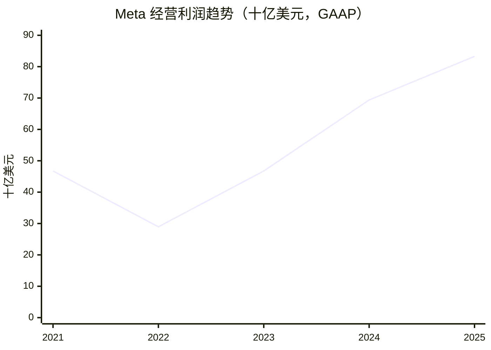
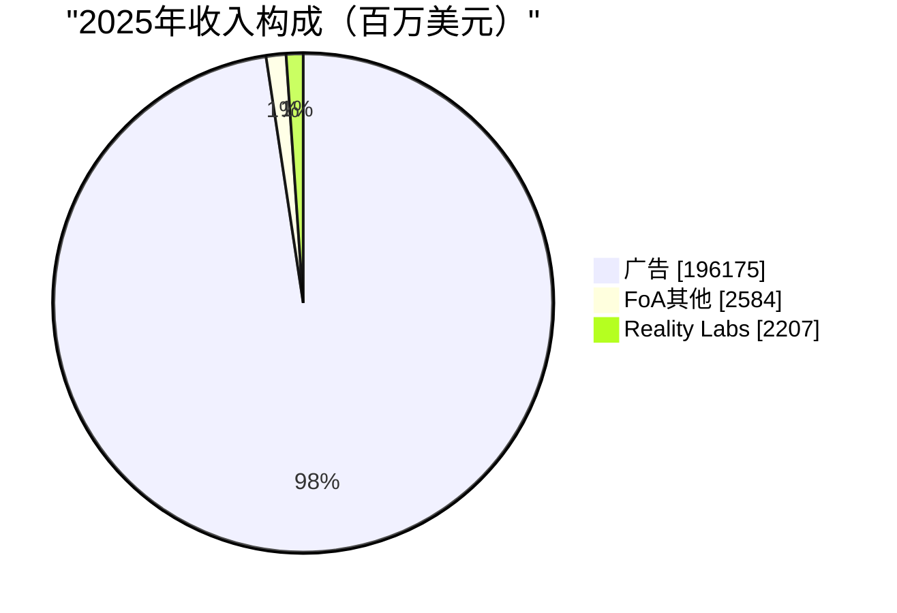

# Meta Platforms（META）独立投资研究报告

> 研究日：2026-10-19（北京时间）；行情：2026-10-16 美股正常交易收盘；最新已公布财报：2026Q2；年度：2021—2025。执行 `/investment-research` 八步框架。美元为唯一估值币种。财务表除特别说明外单位为**百万美元**。本报告用于学习研究。

**结论：709.33 美元处于合理价值区间，持有；空仓者可小额建立观察仓，500—600 美元才是更有吸引力的分批买入区。** 核心广告业务仍优秀，但资本开支、折旧、人才费用和法律支出正在吸收收入增长。不能因为 AI 提升广告效率就推导全部 AI 投资具有高回报。十年模型约束仓位，不单独决定买卖。

**信息丰富度：A级。** AI 分析置信度较高来自披露充分，实际投资确定性只是中等：算力投资回报、新入口份额、监管尾部损失并不能从大量文字中获得确定答案。本报告没有渠道访谈、内部广告投放实验或数据中心资产逐项估值。2026Q3 定于 10 月 21 日盘后公布，截至研究时尚未公布，不能把指引写成实际业绩。[S14]

## 前置：AI 研究偏见自查

资料充裕最容易制造的错觉是“推荐系统带来收入增长，因此通用超级智能投资也一定赚钱”。本报告把广告效率、资本开支、Agent 业务分别处理。减少一半媒体报道不会改变社交网络和广告反馈闭环的判断，却会显著降低对 AI 新产品盈利的信心。真正值得反面检验的是：聪明人为什么会拒绝拥有这台广告现金机器？答案可能是资本配置权高度集中，现金机器的产出并不必然返回普通股东。

- 确定性来自广告重复需求和用户网络，而非报道篇数。
- 不把模型评测领先、下载量、管理层愿景直接折算成净利润。
- 所有未来参数均为研究假设，并非公司指导或市场共识。
- Macrotrends 收入、净利润页面读取失败；并未伪称取得其数据。使用 SEC/公司原始财报与 StockAnalysis，并保留冲突。

## 第一步：数据、口径与证据

### 五年财务

| 指标 | 2021 | 2022 | 2023 | 2024 | 2025 |
|---|---:|---:|---:|---:|---:|
| 收入 | 117929 | 116609 | 134902 | 164501 | 200966 |
| GAAP 净利润 | 39370 | 23200 | 39098 | 62360 | 60458 |
| GAAP 经营利润 | 46753 | 28944 | 46751 | 69380 | 83276 |
| 毛利率 | 80.79% | 78.35% | 80.76% | 81.67% | 82.00% |
| 经营利润率 | 39.65% | 24.82% | 34.66% | 42.18% | 41.44% |
| 经营现金流 | 57683 | 50475 | 71113 | 91328 | 115800 |
| 公司口径自由现金流 | 38439 | 18439 | 43010 | 52103 | 43585 |
| 现金及有价证券 | 47998 | 40738 | 65403 | 77815 | 81592 |

来源：[S1][S2][S3][S4]；毛利率、经营利润率由原报金额计算，非照抄第三方。现金是现金及现金等价物加有价证券，不把非上市股权投资视为现金。

### 最近四个季度分部

| 季度 | 集团收入 | FoA收入 | FoA同比 | FoA经营利润 | FoA经营利润率 | RL收入 | RL同比 | RL经营利润 |
|---|---:|---:|---:|---:|---:|---:|---:|---:|
| 2025Q3 | 51242 | 50772 | 25.93% | 24967 | 49.17% | 470 | 74.07% | -4432 |
| 2025Q4 | 59893 | 58938 | 24.60% | 30766 | 52.20% | 955 | -11.82% | -6021 |
| 2026Q1 | 56311 | 55909 | 33.43% | 26900 | 48.11% | 402 | -2.43% | -4028 |
| 2026Q2 | 60801 | 60370 | 28.05% | 23394 | 38.75% | 431 | 16.49% | -4619 |

FoA 为应用家族，RL 为 Reality Labs。来源：[S5][S6][S7][S8]。**分部毛利率不披露，不用经营利润率冒充毛利率。** 本表 Q1 使用该季原始公告；Q2 半年收入减当季会得 56310，差 1 百万美元，属于原始公布表之间的细小差异，保留原值而不补改。同比均用各季度原报比较期计算。

2025 年分部：FoA 收入 198759，经营利润 102469；RL 收入 2207、经营亏损 19193。[S6] 广告收入 196175，其他 FoA 收入 2584。[S3]

### 当前快照

| 项目 | 数值 | 日期/说明 |
|---|---:|---|
| 正常交易收盘价（美元） | 709.33 | 2026-10-16；公司行情与 StockAnalysis 双源 |
| A+B 总股数（股） | 2547506225 | 2026-07-24 10-Q封面最新可得；不是10月实时股数 |
| 计算市值（百万美元） | 1807022.59 | 收盘价乘上述股数 |
| TTM收入 | 228247 | 截至2026Q2 |
| TTM净利润 | 68098 | GAAP |
| TTM稀释EPS（美元） | 26.54 | 历史稀释加权股数，不能当作期末总股数 |
| 税项调整后EPS（美元） | 29.61 | 26.54+6.20−3.13；仅调整两次税项 |
| 现金及有价证券 | 90260 | 2026-06-30 |
| 长期债券账面额 | 83664 | 不含租赁 |
| 扣债券净现金 | 6596 | 现金加证券减债券 |
| 含租赁总债务 | 112318 | 第三方含经营租赁口径 |
| 含租赁净负债 | 22058 | 含经营租赁，不是所有负债 |
| 股东权益 | 261221 | 2026-06-30 |
| TTM公司口径FCF | 37872 | 2025全年+2026H1−2025H1 |

[S3][S7][S8][S9][S10]。含租赁债务112318由83664债券、2425流动经营租赁、26229长期经营租赁组成；此处沿用第三方定义，不声称已逐项桥接全部融资租赁负债。公司 Q2 长债文字说明四舍五入为 83660；模型取资产负债表 83664，差异不重大。总股数第三方约 25.5 亿股，与原报相差不到一个百分点；只用 A 股 22.05 亿会低估市值。Macrotrends 市值搜索摘要为约 1.807 万亿美元，StockAnalysis 为约 1.81 万亿美元，匹配计算结果。其他聚合站出现 1.88 万亿美元，因时点/股数口径未澄清，不采用。[S11]

**税项不能忽略。** 2025Q3 一次性非现金税费增加 15930；2026Q1 反转部分税费形成 8030 收益。只加回前者而不扣后者，会夸大盈利。调整后 EPS 不是公司发布的全年 non-GAAP EPS，也没有把法律费和裁员费全部视为永久不再发生。[S5][S7]

### 原值冲突与修正

| 字段 | 原始财报 | StockAnalysis原值 | 处理 |
|---|---:|---:|---|
| 2025收入 | 200966 | 200966 | 一致 |
| 2025净利润 | 60458 | 60458 | 一致 |
| 2026Q2现金及证券 | 90260 | 90260 | 一致 |
| 2022经营利润 | 28944 | 33555 | 差异超过一个百分点；采用SEC GAAP，第三方疑似剔除部分重组项目，未证实其完整调整桥 |
| 2022毛利率 | 78.35% | 79.63% | 原报成本25249，采用原报；不能称双源一致 |
| 2025自由现金流 | 43585 | 46109 | 第三方未扣2524融资租赁本金，调整后相等 |
| 2021自由现金流 | 38439 | 38993 | 第三方CAPEX为18690；公司净购建18567；再扣677融资租赁本金，得到公司口径 |

原始财报和第三方有共同上游公司披露，并不代表两套独立审计。这里的“双源”用于转录/口径交叉检查。原值、失败提示和重算在 `data.json`、`tool-audit.log` 中保留，不靠改写第三方制造一致性。

**追问：如果只看净利润和PE，会不会遗漏每年需要支付的算力现金？会。应同时跟踪 FCF、融资租赁及承诺采购。**

## 第二步：生意本质——用户注意力与可衡量的商业效果

一句话定义：Meta 用免费通信和内容产品汇聚注意力，再让广告主竞价购买可衡量的触达与转化。终端用户不是主要付款人，商户和品牌是。广告需求按效果和预算重复发生，并非锁定多年合同的订阅收入。

| 商业要素 | 判断 |
|---|---|
| 用户价值 | 熟人联系、即时通信、内容发现；不同应用分担不同关系 |
| 付款理由 | 在大规模人群中更低成本获取购买、安装、询盘 |
| 留存机制 | 联系人、创作者与品牌受众积累、消费习惯和推荐质量 |
| 运营杠杆 | 推荐和广告模型可服务大量客户；但推理、折旧、内容治理成本随规模上升 |
| 转化闭环 | 广告展示→转化信号→优化投放→广告主追加预算 |
| 边界 | 无法无限提高广告负载，用户时间有限；经济衰退时预算可立即收缩 |

2026Q2 展示量同比增加 14%、单价增加 12%，应用家族日活人群约 36 亿；收入仍然强劲，但集团经营利润下降，说明“量价齐升”不等于“股东现金同步增长”。[S8] 已有社交关系是真资产，但广告预算并不忠诚，效果变差时可转到搜索、电商和其他短视频平台。

**追问：这门生意好在哪？同一套用户和反馈系统能够反复帮助数以不同规模的商户获客，且无需逐个销售定制软件；前提是获客价值超过平台持续投入。**

## 第三步：护城河及竞争

| 类型 | 强弱与证据 | 未来检验 |
|---|---|---|
| 品牌/定价 | 中等；竞价广告的提价来自效果和需求，并非随意提价 | 价格上升时转化回报是否维持 |
| 转换成本 | 用户侧中高、广告主侧中低；熟人网络难迁移，预算易迁移 | 群聊/创作者是否迁往其他平台 |
| 网络效应 | 通信强；算法内容更多依赖内容池和匹配能力 | AI生成内容是否削弱原创供给与信任 |
| 规模经济 | 强；训练、推荐、广告基础设施可复用 | 单位有效转化成本是否随算力投入下降 |
| 技术壁垒 | 中强但动态；广告模型与工程闭环强，基础模型领先不可永久化 | 是否把研发投入转化为可持续增量利润 |

| 对手 | 直接争夺什么 | Meta相对位置 |
|---|---|---|
| Alphabet/YouTube | 视频时长、广告预算、AI入口 | Meta社交/商业消息强，Google搜索购买意图和系统分发强 |
| TikTok | 短视频与年轻用户注意力 | 社交关系不是短视频时长的完整保护罩 |
| Amazon | 有购买意图的广告及商户预算 | Meta能激发需求，Amazon具备交易与购买信号 |
| Apple | 移动系统、隐私规则、可穿戴入口 | Meta缺少手机操作系统控制权 |
| OpenAI等Agent平台 | 用户意图、助手入口与任务执行 | Meta有分发，独立Agent平台可能重新组织交易路径 |
| Snap/Pinterest | 特定人群、视觉发现广告 | 规模较小仍能占据特色场景 |

不伪造统一市场份额：全球广告、美国数字广告、社交广告、短视频时长口径不同，缺乏同期可比数据。本次未获得全部竞争者同日同口径估值，因此不制作貌似精确的同行 PE 排名。五年护城河总体仍强，推荐工程补偿了部分隐私信号损失；但基础设施资本强度上升，护城河不等于资本回报率必然上升。

**追问：十年后护城河还在吗？关系网络大概率仍有价值；如果交互和购买都被跨平台Agent接管，而Meta既失去入口又保留昂贵基础设施，广告反馈闭环可能被削弱。**

## 第四步：反过来想——失败路径

以下“高/中/低”是主观风险等级，并非可统计概率；数值情景概率另见估值。

| 路径 | 概率判断 | 影响 | 可观察信号 |
|---|---|---|---|
| AI资本开支长期不能收回 | 中高 | FCF、回购能力和增量ROIC下降 | 收入增长仍强但FCF长期低迷；融资增加 |
| 广告效果被替代或流量迁移 | 中 | 结构性利润率下行 | 展示量/转化价值增长持续落后对手 |
| 监管重罚、拆分或儿童保护措施 | 低至中，金额不可准确估计 | 重大尾部损失 | 新判决、救济措施、披露应计负债变化 |
| 治理失衡、长期项目不断追加投入 | 中高 | 普通股东回报被稀释 | 项目不设里程碑、回购无法抵消SBC |
| 折旧低估/设备寿命过长 | 中 | 会计利润高于经济利润 | 更新周期缩短、处置损失上升 |
| 关键供应商/电力/数据中心断供 | 低至中 | 推迟商业化并放大固定成本 | 项目延期、闲置与采购承诺损失 |
| 广告宏观衰退 | 中，周期性 | 短期盈利和估值同时下调 | 中小商户预算、CPM下降 |

历史类比只能提示机制：传统门户拥有巨大用户流量仍会被新的入口蚕食；电信网络和光纤建设说明“社会需要更多基础设施”不自动等于“每个建设者赚高回报”。不能机械把 Meta 等同门户或电信商，因为社交网络和效果反馈有不同壁垒。

额外的资产负债表外约束：2026Q2 10-Q 披露未开始的租赁义务约278990、不可取消合同承诺约349310（百万美元），后者包括云容量及硬件/基础设施；两者不能未经检查直接相加为当期债务，未来采购也对应未来服务，但显著限制资本开支的可撤回性。没有把这些金额重复全额扣进EV；估值对未来利润率/现金流的压力已有部分反映，逐项合同到期现金流仍未建模。[S8]

主要空方论点不是广告业务明天消失，而是核心广告利润被科研竞赛与硬件下注永久占用。多方必须证明新增投入产生的现金超过资本成本，不能只展示算法指标改善。2025 年延长部分服务器/网络资产寿命会影响折旧增速，属于需要复核的会计估计，不应直接指控造假。[S2]

**追问：最可能犯什么错？把短期费用调整后的漂亮盈利当作长期所有者收益，并把融资租赁、股权激励与维护性CAPEX漏掉。**

## 第五步：管理层与资本配置

Zuckerberg 是创始人、董事长兼 CEO。2026 代理材料披露其 A 股 639347、B 股 341823978，投票权 60.8%；经济权益约一成多，远低于控制权，不能写“持股六成”。这些是四月代理材料时点，非十月最新持仓。第三方新闻确认控制权约六成；精确经济权益没有获得独立的同日双源核验，因此不报虚假精确百分比。[S12]

| 决策 | 已观察结果 | 研究判断 |
|---|---|---|
| Instagram、WhatsApp平台布局 | 成为应用家族重要网络 | 战略眼光强；单体利润不披露，无法精算并购IRR |
| 2022—2024效率调整 | 经营利润由低谷显著恢复 | 能纠错，但周期与成本调整均有贡献 |
| Reality Labs持续投入 | 2025经营亏损19193 | 产品探索有期权价值，现金回报尚不足证明投入合理 |
| 2024开始股息、持续资本回报 | 提高可见现金回报 | 回购应按扣除SBC后的股数变化评价 |
| 2026大幅扩大算力投入 | 最新CAPEX指引130000—145000 | 将公司从轻资产广告平台推向资本密集阶段 |

2025 研发支出 57372、SBC 20427。[S2] 研发费用已进入损益，不应估值时再重复全额扣除；FCF会加回SBC，则必须考虑稀释或抵消稀释所需回购现金。2025 公告披露股票回购 26260，不能不加辨别地把第三方现金流“普通股回购”列当作纯市场回购，因为其中可能包含员工股权结算相关现金。[S6][S4]

管理层评分：产品迭代与组织动员较强；资本配置中等偏不确定；小股东治理约束偏弱。CEO退休后核心产品和广告基础设施不会立即失效，但跨周期资本配置及下一代入口的统一领导力尚缺乏可验证接班样本。

**追问：是否愿意把资本配置权交给他？可以有限度交付，但不能因创始人过去成功而取消对投入回报的检查。**

## 第六步：AI、行业与长期利润

美国数字广告 2025 年规模约 2946 亿美元、同比增长约 13.9%，来自 IAB/PwC；这是美国市场，不可拿 Meta 全球广告收入直接相除推全球份额。[S13] TAM 的长期增长取决于经济规模、广告数字化和交易效率，不能把全社会所有商业收入都视为广告可获取收入。

AI 对 Meta 有三条经济路径：一是推荐与广告匹配提高转化；二是生成式素材、自动投放和商业消息提高商户投放效率；三是个人 Agent/可穿戴形成新入口。前两条有现有收入承接，第三条仍需证明留存、付费和单位推理成本。

最新产品不能遗漏：Meta 于 2026 年 9 月公开 Muse 个人Agent，并进一步介绍面向小企业、连接 Meta 广告与业务账户的能力。[S15][S16] **发布是事实，商业成功是推断。** 本报告没有得到 Muse 独立收入、付费留存、每任务毛利数据，因此不直接给它一个巨额独立估值。Llama与其他模型、推荐基础设施、定制算力和外部供应商共同构成技术能力，不能仅用开源下载量评价护城河。

| 时间/情景 | 收入假设（百万美元） | 利润机制 |
|---|---:|---|
| 2029悲观 | 260000 | 成长放缓，AI成本压制；三年模型净利润约68844 |
| 2029基准 | 350000 | 商业效果增长抵消成本；三年模型净利润约105976 |
| 2029乐观 | 400000 | 广告效率与商业消息变现，净利润约130346 |
| 2036悲观 | 320000 | 净利率20%，利润64000 |
| 2036基准 | 650000 | 净利率32%，利润208000 |
| 2036乐观 | 1000000 | 净利率36%，利润360000 |

均为情景，不是公司指引。三年利润来自每股收益增长模型，保持期末股数不变；十年利润由收入乘净利率计算。基准2036利润为 **2080 亿美元/年**，但其可分配比例取决于维护性CAPEX、债务与持续研发，不等于2080亿现金全部返还。

未来三年AI的净增益需按“新增广告/商业消息毛利−新增推理运营费−人才成本−折旧”衡量；投资现金流另扣CAPEX。Q2 2026 单季资本开支含租赁本金约31080、FCF仅784，显示收入层面的AI收益尚不足证明所有新增资本投资都达标。[S8] 基准假设后续增长降速、支出纪律改善；若资本开支长期追着收入走，基准净利率和FCF恢复都应下调。

消费者/广告主分散减少单客风险，先进芯片、制造、电力、云服务供应链则相对集中，公司的全球分发不能消除此风险。互联网时代的社会连接价值仍在，AI时代能否保留交易入口才决定价值链位置。

**追问：二十年后更像基础设施还是昙花？社交和商业网络具有基础设施特征；通用AI和眼镜则尚是需验证的长期选择权。**

## 第七步：价格、安全边际与仓位压力

### 当前估值

| 指标 | 结果 | 口径 |
|---|---:|---|
| GAAP TTM PE | 26.73倍 | 股价/26.54 |
| 税项调整PE | 23.96倍 | 股价/29.61；不剔除所有法律与裁员费用 |
| TTM PS | 7.92倍 | 计算市值/收入 |
| EV/Revenue | 8.01倍 | 含租赁债务，现金证券全扣 |
| 公司口径FCF收益率 | 2.10% | TTM37872/计算市值 |

PEG没有客观唯一值：盈利增长会被税项反转和CAPEX周期扭曲，不给“精确PEG”制造便宜结论。没有取得可统一税项、复权和时点的历史PE序列，故不声称历史分位。本报告不把回到旧最高价当成价值依据。

### 三年三情景——回答贵不贵

起点EPS29.61美元；保持股数不变，不额外叠加回购增益。估值增长参数为每股收益增长，股息不计入三年资本利得年化。2029 PE属于有限期限情景判断，**不作为十年终值倍数来源**。

| 情景 | EPS年增速 | 2029 EPS | 2029 PE | 2029价格 | 以10%折现的现值 | 价格年化回报 |
|---|---:|---:|---:|---:|---:|---:|
| 悲观 | -3% | 27.02 | 18倍 | 486.44 | 365.47 | -11.82% |
| 基准 | 12% | 41.60 | 24倍 | 998.40 | 750.11 | 12.07% |
| 乐观 | 20% | 51.17 | 28倍 | 1432.65 | 1076.37 | 26.40% |

基准折现现值仅略高于现价，安全边际有限。三年合理价值中心约750美元，结合情景不确定性给出 **650—800美元合理区间**；**500—600美元分批买入**；**超过900美元需更强盈利/现金流证据**。区间是综合判断，并非由单点模型自动生成。基准PE24倍反映预期仍有增长，但若2029仍处重CAPEX和低FCF，必须下修，不能预设市场永远按软件平台估值。

### 反向DCF

采用美元股权所有者现金流，r=10%、十年后g=3%；不在市值上再次添加现金造成双算。此处明确假设FCF是可归股东的税后现金流代理；近期融资/扩张导致该代理不稳定。未来十年恒定增长只用于解释价格要求，并非预测真实年度路径。

| 起始现金流（百万美元） | 为匹配现价所需十年年增长率 |
|---|---:|
| 实际TTM公司口径37872 | 18.89% |
| 正常化假设60000 | 12.66% |
| 正常化假设80000 | 8.79% |

现价能否便宜，关键取决于长期现金流正常化水平。把维护性资本开支设得过低，会把估值结论“算便宜”。60000和80000是敏感性假设，不是已实现自由现金流。

### 十年终值——回答仓位能多重

r=10%，USD；rf采用长期建模假设4.5%、β=1、ERP假设5.5%，不是声称10月16日国债现货收益率。合理美元r区间9%—11.5%；永续g分别1.5%、3%、4%，上限4%。稳态增量ROIC取20%，是对高资本强度后期回报的判断，明显不能照搬轻资产历史回报。三档净利润见上节，概率25/50/25为主观情景权重，未进行统计校准。股息减净稀释k=0.3%为近似；股数保持不变，不重复计算回购。

退出倍数唯一来自 `PE=(1−g/ROIC)/(r−g)`；不是照搬同行。工具的IRR公式是终值资本利得几何年化加k的简化近似，并非逐年完整分红现金流求根，须按这一限制解读。

| 情景 | 2036净利润（百万美元） | g | r−g | 退出PE | 十年近似IRR |
|---|---:|---:|---:|---:|---:|
| 悲观 | 64000 | 1.5% | 8.5% | 10.88倍 | -8.79% |
| 基准 | 208000 | 3.0% | 7.0% | 12.14倍 | 3.71% |
| 乐观 | 360000 | 4.0% | 6.0% | 13.33倍 | 10.56% |

概率加权IRR是情景年化回报的加权平均，不是组合现金流的IRR。三档未覆盖一切结果，重大监管重罚/强制拆分及数据中心断供仍未量化，极端亏损可以低于悲观情景。

| r | 期望IRR | 是否覆盖r | 有效性 |
|---|---:|---|---|
| 8% | 5.82% | 否 | 区间外仅参考，且乐观r−g不足5个百分点 |
| 10% | 2.29% | 否 | 基准 |
| 12% | -0.25% | 否 | 区间外仅参考 |
| 9% | 3.89% | 否 | 区间内±1个百分点复核 |
| 11% | 0.94% | 否 | 区间内±1个百分点复核 |

**合理币种区间内无翻转，压力测试始终未覆盖资本成本。** ±2个百分点两侧均在区间外，因此另跑±1个百分点；g固定不随r变。所有基准终值分母至少五个百分点。audit日志内固定参考说明出现的内置无风险利率/ERP文字不代表本报告取数；本报告参数以命令中的 `--rf 0.045` 和本节假设为准。

### 估值分歧对账

三年基准约12%的价格年化，十年基准仅约3.7%，差异并非算错：三年预期仍给增长期24倍PE，十年按稳态公式降到约12倍；十年假设没有给尚未验证的AI新业务永久高增速。**三年是定价判断，十年是仓位压力测试。** 长期模型还简化了中途现金回报，不能据此直接一票否决优质核心业务。

六维综合后保留持有/小仓观察建议，但收紧仓位：在分散权益组合中，研究框架示例上限约5%，新观察仓约1%—2%；这不是根据用户完整资产负债制定的个性化比例。达到买入价格同时还需检查FCF和资本纪律，不能仅机械等待跌价。十年结果也提示：若要重仓，就需要更低买价、显著更好的现金回报或有证据支持更高长期利润，不能仅调低r。

**追问：市场关闭五年愿不愿持有？愿意有限仓位持有广告网络，不愿在缺少资本回报证据时押注其全部AI预算。**

## 第八步：综合决策备忘录

| 维度 | 结论 | 信心度 |
|---|---|---|
| 生意质量 | 核心广告与通信网络优秀，现金生成强 | 高 |
| 护城河 | 网络、规模、广告反馈有效；新入口存在侵蚀风险 | 中高 |
| 管理层 | 产品能力强，长期资本纪律与小股东约束不足 | 中 |
| 最大风险 | AI资本配置回报不足叠加监管尾部损失 | 中 |
| 文明趋势 | AI提升已有广告效率，新Agent与眼镜商业化仍待证实 | 中 |
| 估值 | 三年合理、明显安全边际不足；十年压力未过且区间内不翻转，约束仓位 | 中低 |

估值解除语：上述估值一格不是最终决策的唯一裁决，十年未覆盖r只下调仓位；持有结论来自六项并列评价及已完成的分歧对账。

| 策略 | 建议 |
|---|---|
| 空仓者 | 709.33美元可小仓观察；500—600美元且基本面未恶化时分批买入更有吸引力 |
| 持仓者 | 持有；若集中度高，优先控制组合风险，避免因AI叙事不断加仓 |
| 卖出信号 | 广告转化价值持续流失、社交网络转移、AI投入长期缺乏回收且拒绝调整，或估值超过900美元而盈利证据不跟进 |
| 加仓信号 | FCF恢复、资本开支增长显著低于经营现金流增长、单位广告效果改善且利润留存、价格进入安全区 |
| 下一次更新 | 2026Q3正式财报公布后复核盈利、全年CAPEX、2027支出、法律负债与Muse付费/成本披露 |

### 四位大师原文约束

本次没有取得足够可核验的巴菲特、芒格、段永平、李录针对Meta/此次AI资本配置议题的原始言论，**四位均“资料不足，不模拟代言”**。章节借用的是技能要求的分析问题，不代表他们本人赞成该股票、该价格或该模型。

### 审计结论与限制

执行金融工具市值、交叉数据、估值、三年情景；执行终值audit、pe、irr、flip±2个百分点及±1个百分点，并再次执行最终audit。详细命令、输出和非零退出码均保留在 `tool-audit.log`；其中原值冲突故意保留，原始数据选择已由SEC解决，不能抹除。cross-validate 默认按中点及百分之二阈值显示，本报告仍按原始财报为分母、百分之一规则人工复核。

执行 `report_audit extract/verdict`；共抽取137个可识别数值，固定种子42抽检21项，21项数值匹配；其中4项为模型重算，并非外部事实验证，另外包含解释列误抽及第三方冲突原值核对。人工覆盖分类见 `audit-results.json` 与 `audit-coverage.md`。自动审计只能验证数字与核验值是否匹配，不能证明预测成立、资料独立性或覆盖完整性；模型参数样本标为“模型重算”，不称外部事实核验。无法取得Macrotrends完整财务表、精确同日管理层经济持股、分部毛利率、所有竞争者同日估值、Muse独立商业指标，是明确缺口。重大监管/拆分与供应中断尾部未量化，不能把情景概率当作完全分布。

**AI分析置信度：历史主要财务和股价较高，长期增量ROIC、AI新增盈利和十年估值中低。投资确定性：核心广告中高，资本配置与新入口中低，整体中等。**

## 附录：来源与重算

均于北京时间2026-10-19读取；原始事实以SEC/公司披露为准。网页可能持续更新，数据快照留在 `data.json`。工具输出附录为 [`tool-audit.log`](tool-audit.log)，计算脚本为 [`model.py`](model.py)，结果为 [`model-output.json`](model-output.json)。原始网站读取记录的索引和失败说明见 [`source-register.json`](source-register.json)。

- [S1] [Meta 2023 10-K（含2021—2023）](https://www.sec.gov/Archives/edgar/data/1326801/000132680124000012/meta-20231231.htm)
- [S2] [Meta 2025 10-K（含2023—2025）](https://www.sec.gov/Archives/edgar/data/1326801/000162828026003942/meta-20251231.htm)
- [S3] [StockAnalysis财务表](https://stockanalysis.com/stocks/meta/financials/?p=ttm)
- [S4] [StockAnalysis现金流](https://stockanalysis.com/stocks/meta/financials/cash-flow-statement/)
- [S5] [2025Q3原始公告](https://investor.atmeta.com/files/doc_financials/2025/q3/Meta-09-30-2025-Exhibit-99-1-Final.pdf)
- [S6] [2025Q4原始公告](https://www.sec.gov/Archives/edgar/data/1326801/000162828026003832/meta-12312025xexhibit991.htm)
- [S7] [2026Q1原始公告](https://investor.atmeta.com/investor-news/press-release-details/2026/Meta-Reports-First-Quarter-2026-Results/default.aspx)
- [S8] [2026Q2原始公告](https://investor.atmeta.com/investor-news/press-release-details/2026/Meta-Reports-Second-Quarter-2026-Results/)、[2026Q2 10-Q](https://www.sec.gov/Archives/edgar/data/1326801/000162828026050705/meta-20260630.htm)
- [S9] [公司历史行情](https://investor.atmeta.com/stock-info/)、[StockAnalysis历史行情](https://stockanalysis.com/stocks/meta/history/)
- [S10] [StockAnalysis股数与估值](https://stockanalysis.com/stocks/meta/statistics/)
- [S11] [StockAnalysis市值](https://stockanalysis.com/stocks/meta/market-cap/)、[Macrotrends市值摘要](https://www.macrotrends.net/stocks/charts/META/meta-platforms/market-cap)
- [S12] [2026代理材料](https://www.sec.gov/Archives/edgar/data/1326801/000162828026025532/meta-20260416.htm)、[Reuters治理报道](https://www.reuters.com/sustainability/sustainable-finance-reporting/metas-18-billion-lesson-ignoring-shareholders-2026-09-02/)
- [S13] [IAB 2025美国数字广告报告](https://www.iab.com/news/digital-ad-revenue-climbs-to-nearly-300b-as-iab-celebrates-30-year-anniversary/)
- [S14] [Meta 2026Q3业绩发布日期](https://investor.atmeta.com/investor-news/press-release-details/2026/Meta-to-Announce-Third-Quarter-2026-Results/default.aspx)
- [S15] [Meta发布Muse](https://about.fb.com/news/2026/09/introducing-muse-personal-ai-agent/)
- [S16] [Muse面向小企业](https://about.fb.com/news/2026/09/introducing-muse-small-business/)
