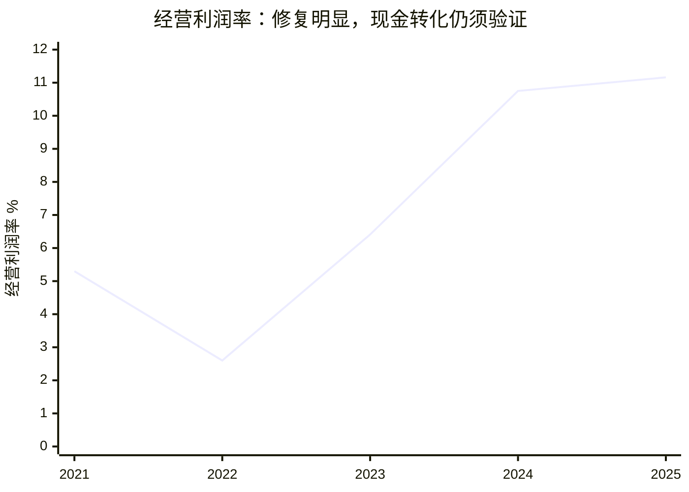

# 亚马逊（AMZN）独立投资研究报告

研究日：2026年10月19日，北京时间。已运行 `date`。行情基准为2026年10月16日美股正式收盘；财务基准为2025财年及截至2026年6月30日的最新已披露季度，不能把尚未披露的第三季度当成实际业绩。金额默认**十亿美元（USD bn）**，每股价格为美元；表内明确使用百万美元时以表头为准。

执行框架：`skills/investment-research.md` 的前置偏见检查、八步研究及财务/终值/报告抽检。此报告独立研究亚马逊，不以其他六家公司的结论代替本公司分析。

**信息丰富度评级：A。AI研究局限性声明：**资料丰富不等于资本回报可预测。最容易犯的错误是把AWS需求增长等同于股东自由现金流增长，把Anthropic估值重估当作经营利润，把AI基础设施的持续更新资本支出全部归为可随时停止的“增长支出”。本报告对公开财务事实的信心较高，对十年利润和资本回报的信心中低。没有客户访谈、服务器利用率、租约项目现金回收期资料；季度分部数据尚未完成独立第三方逐项复核。

**核心结论：优质生意，250美元附近适合持有；空仓者可以小额建立观察仓，主要买入区间为180—210美元。当前没有足够的安全边际支持重仓。**三年模型的加权折现价值为263.71美元，折价空间较小；210.97美元对应其两成安全边际。这个判断同时来自商业质量、竞争、管理层、AI资本支出和估值，不是十年压力测试的一票否决。

最值得关注的不是20.10倍GAAP PE，而是**约35.97倍自定义标准化盈利**和负自由现金流。AWS已经明显加速，问题转为“谁最终为AI算力买单，以及投入多少资本才能赚到这些钱”。

## 前置：偏见自查

- 确定性的来源是零售履约密度、企业云迁移成本和采购复购，而不是新闻数量。
- 即使资料减少一半，商业优势判断基本不变；十年预测仍须保持宽区间。
- “AWS＋广告＋物流效率”已是广泛共识，本报告没有发现独家信息优势。研究增量在于拆分利润重估、投资与云客户的相互关系、租赁债务和现金转化。
- 对未披露数据保留空白，不把广告分部利润、AI客户利用率和维持性资本支出补成精确数字。

## 第一步：数据收集与口径核验

### 1.1 行情、股本与市值

| 项目 | 数值 | 日期/口径 |
|---|---:|---|
| 正式收盘股价 | 250.00 | 2026-10-16，StockAnalysis和Yahoo日本历史行情一致 |
| 最新原始披露普通股数（股） | 10,786,313,572 | 10-Q封面，2026-07-22 |
| 第三方普通股数（十亿股） | 10.79 | StockAnalysis四舍五入值 |
| 股价×原始披露股本所得市值 | 2,696.578393 | 十亿美元，不把稀释加权股数当作期末总股本 |
| 第三方市值 | 2,696.578 | StockAnalysis ratios，百万美元换算 |

股价已双源核验，精确股本与第三方四舍五入数相差约0.034%；原始股本是7月快照，不能宣称10月16日真实流通股本已经精确核实。市值约2.697万亿美元不是2697亿美元。[S3][S6][S7]

### 1.2 最近五个完整财年

单位：百万美元；毛利率、经营利润率为程序计算。财年均截至12月31日。

| 财务指标 | FY2021 | FY2022 | FY2023 | FY2024 | FY2025 |
|---|---:|---:|---:|---:|---:|
| 营业收入 | 469,822 | 513,983 | 574,785 | 637,959 | 716,924 |
| GAAP净利润 | 33,364 | -2,722 | 30,425 | 59,248 | 77,670 |
| 毛利润 | 197,478 | 225,152 | 270,046 | 311,671 | 360,510 |
| 毛利率 | 42.03% | 43.81% | 46.98% | 48.85% | 50.29% |
| 经营利润 | 24,879 | 13,348 | 36,852 | 68,593 | 79,975 |
| 经营利润率 | 5.30% | 2.60% | 6.41% | 10.75% | 11.16% |
| 经营现金流 | 46,327 | 46,752 | 84,946 | 115,877 | 139,514 |
| 购置固定资产毛支出 | 61,053 | 63,645 | 52,729 | 82,999 | 131,819 |
| 资产处置及补贴流入 | 5,657 | 5,324 | 4,596 | 5,341 | 3,499 |
| 自由现金流（公司净资本开支口径） | -9,069 | -11,569 | 36,813 | 38,219 | 11,194 |
| 自由现金流（不冲回资产处置） | -14,726 | -16,893 | 32,217 | 32,878 | 7,695 |
| 现金及可交易证券 | 96,049 | 70,026 | 86,780 | 101,202 | 123,029 |

来源：2023与2025年10-K，[S1][S2]；StockAnalysis损益、现金流、资产负债表，[S4][S5]。2021现金及证券合计额外读取了2021年原始XBRL资产负债表，核心损益和现金流与原始财报逐项对照。[S17]2025收入和净利也得到Macrotrends搜索摘要支持，但正文返回403，**不得把摘要访问写成完整读取**。[S8]

公司自由现金流=经营现金流－固定资产购置＋资产处置和补贴；第三方常用经营现金流－毛资本开支。两者差异并非计算错误，2025分别为11.194和7.695。还有融资租赁本金、融资义务本金，故“公司FCF”并不自动等于股东能分走的钱。SBC已经计入利润却在经营现金流中加回；本报告估值另计年化0.8%稀释，不能再把同一SBC全额从估值重复扣减。



### 1.3 最近四季度分部收入与盈利

每格依次为“收入/经营利润/经营利润率/不变汇率收入同比”；前两项单位百万美元。公司**没有披露分部毛利率**，不能将经营利润率冒充毛利率。经营利润率为公司披露的一位小数，增速为不变汇率整数口径。[S3]

| 分部 | 2025Q3 | 2025Q4 | 2026Q1 | 2026Q2 |
|---|---|---|---|---|
| 北美 | 106,267 / 4,789 / 4.5% / 11% | 127,083 / 11,472 / 9.0% / 10% | 104,143 / 8,267 / 7.9% / 12% | 116,177 / 9,123 / 7.9% / 16% |
| 国际 | 40,896 / 1,199 / 2.9% / 10% | 50,724 / 1,040 / 2.1% / 11% | 39,789 / 1,424 / 3.6% / 11% | 42,197 / 1,717 / 4.1% / 15% |
| AWS | 33,006 / 11,434 / 34.6% / 20% | 35,579 / 12,465 / 35.0% / 24% | 37,587 / 14,161 / 37.7% / 28% | 42,232 / 16,621 / 39.4% / 37% |

2025全年北美/国际/AWS收入分别426.305/161.894/128.725，经营利润29.619/4.750/45.606。AWS在整个组合中承担主要盈利支柱角色。广告收入已包含在北美和国际分部中，**不能在分部估值时再次把广告利润加一遍**。[S1][S3]

### 1.4 最新TTM：利润与现金背离

| 指标 | 截至2026Q2的TTM |
|---|---:|
| 营业收入 | 775.680 |
| 经营利润 | 93.712 |
| GAAP净利润 | 135.281 |
| 稀释EPS（美元） | 12.44 |
| 经营现金流 | 161.403 |
| 净资本开支 | 169.007 |
| 公司口径FCF | -7.604 |

2026上半年其他收益约69.1，主要受Anthropic投资重估影响；单独Q2其他税前收益约53.4。这类重估不是云客户回款，135.281的TTM净利不能直接按经营增长外推。[S3][S9]

为估值建立自定义起点：**标准化盈利代理=TTM经营利润93.712×（1－20%规范税率）=74.9696**。假设净融资收益/费用长期约为零，不计投资重估；它是研究者的简化经营盈利代理，既非公司Non-GAAP净利，也非FCF。资产负债转为净债务后，净利息若显著上升必须进一步下调。此代理已包含经营端SBC、折旧和研发费用，不能将它当成无资本开支的现金奶牛。

### 1.5 现金、债务、股权投资

6月末现金78.213＋可交易证券44.775=122.988；有息借款按10-Q账面口径为长期128.894＋一年内到期3.330＋短债0.325=132.549，净现金为**-9.561**。StockAnalysis广义债务251.635还纳入租赁与其他融资项目，得广义净现金**-128.647**；差异属于债务定义，不能用两者相差大去认定财报错误。[S5][S9]

该现金快照也不是10月现值。10-Q披露6月末OpenAI投资账面投入28.7，随后又支付剩余21.3承诺额；不能把6月现金与后来投资同时当作未减少的现金资产。Anthropic/OpenAI私募股权不是现金等价物，其账面重估也不是无条件可兑现价值。模型不额外全额加回这类投资市值，避免“云利润＋客户融资资本＋投资浮盈”重复计算；这会漏掉可能实现的投资价值，也避免高估循环融资价值。[S9]

**本步追问：如果剔除全部投资重估，我愿意用什么价格购买经营本身？**答案是需要看标准化经营利润和未来真实现金转化，而非20倍表面PE。

## 第二步：生意本质——规模化基础设施与交易信任

一句话：**亚马逊将物流、计算和高购买意图流量组织成共享基础设施，通过规模降低客户成本，再收取商品差价、服务费和使用费。**

2025收入按产品服务看如下，采用原始披露分类和第三方交叉读取。不同分类与上述地理分部是交叉关系，不能相加。[S1][S4]

| 收入类型 | FY2025收入 | 经济性质 |
|---|---:|---|
| 在线自营商店 | 269.287 | 商品总额确认为收入，低毛利、占用库存 |
| 实体商店 | 22.561 | 门店零售，线下履约与品牌触点 |
| 第三方卖家服务 | 172.162 | 佣金、履约和相关服务，净额收入与自营不可直接比 |
| 订阅 | 49.619 | Prime及内容会员复购，权益成本真实存在 |
| AWS | 128.725 | 用量及合同驱动，企业迁移成本高 |
| 广告 | 68.635 | 高购买意图流量变现，利润未单列披露 |
| 其他 | 5.935 | 物流、医疗等业务，不默认为高利润 |

零售不是每次从零获客：Prime、购物记录、配送承诺及退货降低决策摩擦；但消费者仍能轻松在沃尔玛和其他渠道比价。AWS的粘性更强，源于数据库、权限、网络、开发工具、组织技能和迁移风险，不只是虚拟机租金。第三方卖家既受益于流量与履约，也会因为佣金、广告费和规则压力多平台经营。

集团毛利率由2021的42.03%升至2025的50.29%，一部分来自服务净额确认与业务结构变化，不能据此声称每一单零售都更有定价权。微软TTM毛利率67.94%、沃尔玛24.84%仅是第三方提供的结构参照：软件和自营商品收入确认差异很大，横向数值不能直接判断商业质量。[S4][S12][S14]

经营杠杆来自同一仓网容纳更多订单、配送路线密度提高、云基础设施利用率提升；负杠杆来自需求变慢但折旧、电力和租约不能同步收缩。广告盈利可以帮助商品服务保持低价，但广告负载过多会损伤客户体验和商家信任。

**段永平式追问：这门生意好在哪里？**客户越依赖可靠履约与稳定计算，重复使用越自然；但增长必须证明新增资本仍能创造价值。

## 第三步：护城河与竞争格局

| 护城河 | 可观察证据与检验 | 评价和趋势 |
|---|---|---|
| 品牌与信任 | 配送承诺、售后和采购习惯；不是任意涨价的奢侈品牌 | 强，但收费透明度及监管可侵蚀 |
| 转换成本 | 企业数据、身份权限、数据库与运维体系迁移成本 | AWS强；一般零售消费者中等偏低 |
| 网络效应 | 买家吸引卖家，丰富供给提升平台效用 | 存在，但过量广告、假货与低质供给可能反向作用 |
| 规模效应 | 仓网密度、采购、电力与计算部署摊薄成本 | 最厚；投入不足会失去服务优势，投入过多会毁灭回报 |
| 技术壁垒 | 自研芯片、分布式系统、模型服务、机器人与调度 | 工程体系强；不假设模型能力永久领先 |

Synergy的2026Q2云基础设施服务统计显示，全球季度市场约143.4，TTM约500；AWS、微软、谷歌份额分别28%、20%、15%。AWS领先但对手增长更快，所以“行业扩张”和“份额扩大”必须分开。该口径涵盖IaaS/PaaS及托管私有云，并不与各公司披露的云收入一一对应。[S10]

| 竞争场景 | 主要对手 | AWS/亚马逊优势 | 可能丢失的价值 |
|---|---|---|---|
| 企业云 | Azure、Google Cloud、Oracle | 广泛服务、既有生产工作负载、工程可靠性 | 办公软件分销、模型入口及数据库生态的绑定 |
| AI训练与推理 | 三大云及专业GPU云 | 自研芯片、托管平台、采购规模 | 大客户自建、算力商品化、融资驱动需求 |
| 线上零售 | 沃尔玛、低价跨境平台、品牌独立站 | 履约、退货、商品广度、Prime | 价格、线下提货、内容发现及品牌直接触达 |
| 商业广告 | Google、Meta、零售媒体网络 | 接近购买行为和交易归因 | Agent改变购物入口；监管限制竞价与收费方式 |

十亿美元级资金能租GPU，也能做一个购物入口，但难以复制覆盖广泛品类的稳定履约网络与企业生产系统的信任。反面是：巨头对手有同等级资本、用户和研发组织，亚马逊不能仅凭资金规模垄断AI。

过去五年零售规模壁垒更厚、盈利修复更明显；AWS绝对优势仍大，AI时代相对份额和资本效率优势却未得到同等证明。未来五年的核心指标是**自研芯片单位任务成本、云客户留存与扩张、现金资本回收期**，不是推出了多少模型。

**巴菲特式追问：十年后还在吗？**物流与企业信任大概率仍在；若购物决策与云调度被可替代Agent统一抽象，客户忠诚可能从平台转移至代理层，定价权会变弱。

## 第四步：逆向思考与失败路径

以下概率为研究者主观风险分级，不是历史统计频率；事件相关，不能相加。盈利情景中的悲观权重为25%，并不意味着每一种风险各有25%概率。

| 失败路径 | 主观发生判断 | 影响 | 观察信号/模型位置 |
|---|---|---|---|
| AI客户最终收入不足，算力预订低于实际消耗 | 中高 | 长期资本回报下降、资产减值 | 云收入快增但回款/利用率不匹配；悲观情景 |
| GPU/自研芯片快速迭代缩短经济寿命 | 中高 | 折旧低估、维护支出超预期 | 设备寿命假设变化；悲观利润与ROIC |
| 广告收费及平台经营被限制 | 中 | 广告费率、赔偿及商家信任压力 | 独立监管事件，不加进beta |
| AWS被Azure/Google/专业云抢走新增工作负载 | 中 | 高利润业务增长下修 | 份额与增量收入，不只看总收入 |
| Agent绕过站内搜索广告 | 中、路径不确定 | 广告流量租金降低，物流可继续收费 | 购买入口迁移与获客成本 |
| 国际零售与卫星等扩张长期亏损 | 中 | 分散管理注意力、消耗现金 | 单位经济与项目追加投资纪律 |
| 大规模停机、网络攻击、战争供应中断 | 低频但重大 | 连锁客户流失、尾部永久损失 | 未量化，列入限制，不塞进折现率 |

**最新监管事实必须与已定罪事实区分。**FTC于2026年8月公布针对广告拍卖附加收费的诉讼指控，称亚马逊对竞价机制的描述和实际收费不一致。这里是原告指控，不能表述为法院已认定违法；但它直接挑战广告高利润是否全部来自公平竞争与真实价值创造，不能只把风险写为小额罚款。另有Prime退款执行事项，不能将不同案件混同。[S11]

历史类比采用机制而非硬套结局：电信网络扩张说明需求长期存在并不保证早期资本提供者回报；成熟零售平台说明效率领先可以长寿，但提价空间仍受竞争制约。亚马逊比单一电信资产有更多业务选择权，却同样不能摆脱资本回报约束。

最强多头论据是云收入与利润同时加速，广告与零售效率改善提供多个增长引擎。最强空头论据是GAAP利润被非现金重估美化、AI投资与客户需求互为支撑、资产更新需要反复花钱。二者可以同时成立。

**芒格式追问：我最可能在哪里错？**把长期客户合同等同于最终支付能力；把采购设备的现金流全部视为“未来可自由裁掉”的增长支出；只看AWS利润率不看投入资本。

## 第五步：管理层、治理与资本配置

Andy Jassy的主要优势是理解企业云业务、工程组织和长期投资，而非短期财务包装。经营利润修复说明组织可以纠错；新增AI投资能否获得同样成功仍未验证。长期看，公司不再完全依赖创始人亲自经营，但关键技术和零售领导层接班仍影响执行。

| 时期/决策 | 结果或现状 | 研究评价 |
|---|---|---|
| 疫情期间扩建履约能力 | 随后出现成本压力，2022经营利润率显著下降 | 扩张判断有误差，不能神化管理层 |
| 随后改善零售成本与网络效率 | 2023—2025经营利润连续改善 | 纠错能力良好 |
| 持续自研芯片与AWS平台投入 | 可降低对外部加速器供应商依赖 | 技术选择权有价值，经济性需客户结果验证 |
| 投资Anthropic与OpenAI并签订云合作 | 获取模型与算力需求，也形成资本与客户的相互依赖 | 不能把投资浮盈作为经营能力评分 |
| 卫星与Globalstar等扩张 | 10-Q披露拟收购，尚待条件完成 | 资本配置复杂度上升；不提前计入确定盈利 |

2025“Technology and infrastructure”费用108.521，涵盖研发、技术人员与基础设施运行，并非纯研发费用；2025 SBC19.467。投入规模很大，但公开报表不能直接算出单个AI项目研发ROI。[S1][S5]

2026年代理声明以2月24日为持股快照：Bezos被披露的实益持有950,434,581股、约8.8%，其中68,232,131股仅有投票权、没有投资处置权。按代理文件扣除该部分，经济权益代理约8.21%，而含投票控制的实益比例程序计算约8.84%。Jassy为2,313,536股，约0.0215%。**亚马逊普通股不是通过AB股倍数投票控制；“实益持有”仍可能包含不等同于经济权益的代理投票安排。**这不是10月最新持仓，尚未完成其后所有Form 4/13G变动及独立第二来源对账。[S13]

上半年没有普通股回购；年化稀释假设采用0.8%，接近第三方最新同比股数变化0.88%，但未来可能不同。现金薪酬较低不等于全部激励成本低，应结合历年股票授予、归属和股本变化。监管指控也要求重新检验“客户至上”在广告商这一类客户上是否一致兑现。[S6][S9]

**段永平式追问：CEO退休后还能保持竞争力吗？**大部分基础设施和客户组织粘性可以保留；但巨额投资的取舍与停止亏损项目的纪律，不会自动由规模保证。

## 第六步：行业与AI文明趋势

AI扩大计算与存储需求，也把部分软件价值从席位收费转为按任务完成付费。亚马逊作为基础设施提供者有机会跨模型收取使用费：模型冠军不唯一也能受益。更有力的优势是数据、权限、安全、可靠性和履约结果，而非声称自己的通用模型永远领先。

行业TAM不能把全球零售GMV、云收入和广告收入直接相加：同一商品交易会同时包含平台佣金、广告和物流成本。云基础设施TTM约500是有来源的当前市场量级；十年市场规模没有足够确定性，本报告用公司收入和利润假设推演，不伪造单点TAM预测。[S10]

| AI影响渠道 | 未来三年可能效果 | 十年可能变化 | 需要核验的证据 |
|---|---|---|---|
| AWS训练/推理 | 收入与容量明显扩张，先耗资后回收 | 若任务成本下降带动需求足够增长，绝对利润扩大 | 利用率、单位资本产出、回款和合同质量 |
| 广告与购物Agent | 提升匹配和商家投放效率 | 可提高转化，也可减少传统搜索广告位 | 每次购买的真实商家ROI和客户满意度 |
| 机器人、需求预测与配送 | 提高产能和库存周转 | 网络成本结构改善，不能把岗位节约全视为利润 | 每件订单总成本而非单点演示 |
| 软件开发与客服 | 部分工作自动化 | 人员效率更高，同时增加推理费用与治理成本 | 成本下降是否转化为售价下降或利润 |

客户侧，零售客户极分散，但新增AI算力需求可能集中在少数大型模型商；公司没有给出足够细颗粒的AI客户集中度，不能以零售分散推断整个集团无集中风险。供应侧，先进制程、加速器、网络设备、电力和园区建设仍有共同瓶颈；自研芯片减少单一GPU供应依赖，也引入自身芯片生态与制造依赖。[S9]

**对未来利润的判断：**三年标准化年盈利可落在94—157之间，基准约130；十年稳态年盈利压力区间125—550，基准300。全部是情景假设，不含投资重估，无把尚未兑现的投资收益放进主营利润。AI不是自动增加净利，它首先改变增长速度与资本需求。

**李录式追问：二十年后更像基础设施还是短命入口？**物流与计算基础设施具备长寿条件，广告入口更可能变形；真正的检验是为客户持续降低总成本，并让新增资本回报高于资本成本。

## 第七步：估值、反向DCF及安全边际

### 7.1 当前估值与可比口径

| 指标 | 数值 | 解释 |
|---|---:|---|
| GAAP TTM PE | 20.10倍 | 250/12.44；受非经营重估影响 |
| 标准化盈利代理PE | 35.97倍 | 2696.578393/74.9696，自定义研究口径 |
| PS | 3.48倍 | 市值/TTM收入 |
| EV/收入，不含租赁与其他融资债务 | 3.49倍 | 借款净额口径 |
| EV/收入，第三方广义债务口径 | 3.64倍 | 与StockAnalysis可比 |
| 第三方Forward PE | 26.58倍 | 分析师预测口径，不是已实现利润 |
| 第三方PEG | 1.28倍 | 增长窗口和一次性收益影响大，不作为定价锚 |

公司口径FCF为负，因此不使用正的P/FCF给出“便宜”判断。财务工具对EPS、PS、账面值、市值均已运行验算。[S6][S7]

历史年末GAAP PE依次为2021约50.68倍、2022亏损不适用、2023约51.61倍、2024约38.94倍、2025约31.77倍；当前20.10倍表面上低，但会计重估和盈利基数使分位可比性很差。这里引用同一来源的拆股调整后每股/市值口径，不混入未复权价格序列，不声称处于精确历史百分位。[S7]

当日第三方TTM PE：微软29.47倍、Alphabet 17.09倍、沃尔玛43.05倍。它们分别偏软件云、广告云和零售，GAAP非经营收益及租赁差异很大。同行表仅为背景，未在本公司报告中完整复核同行报表，更不能由“沃尔玛43倍”推出亚马逊十年终值应给同样倍数。[S12][S14][S15]

### 7.2 三年三情景：回答“贵不贵”

从标准化盈利代理74.9696、每股6.95044出发，利润增速悲观/基准/乐观为8%/20%/28%；每年稀释0.8%，因此输入 `three-scenario` 的EPS增速分别为7.142857%/19.047619%/26.984127%。概率25%/50%/25%是主观权重。工具输入EPS增长已扣稀释；其用当前股数乘未来EPS生成的“净利”只属固定股数等值，本表真实总盈利由独立脚本按利润增长率计算，不混用。三年后仍处扩张期，22/30/36倍为有限期估值假设，**不是十年永续终值倍数**。

| 情景 | 三年后标准化盈利 | 三年后EPS | 三年后PE | 三年后价格 | 以10%折现至今 | 股价年化回报 |
|---|---:|---:|---:|---:|---:|---:|
| 悲观 | 94.44 | 8.55 | 22倍 | 188.07 | 141.30 | -9.05% |
| 基准 | 129.55 | 11.73 | 30倍 | 351.80 | 264.31 | 12.06% |
| 乐观 | 157.22 | 14.23 | 36倍 | 512.35 | 384.93 | 27.02% |

基准经营桥梁是AWS收入持续较快增长但利润率回落，北美的广告和履约效率改善，国际保持盈利；它不依赖净利中的投资浮盈持续翻倍。悲观档仍有利润增长，但PE收缩足以令股东亏损；乐观档要求AI需求与供给投入同时兑现。若AWS增长明显放慢且广告收费受限，不能继续保留20%的基准增长不变。

概率加权折现价值263.71美元不是保证价格。**定价区间：180—210美元为优先分批买入区，210—270美元为合理持有/小额配置区，270—320美元要求更强现金转化证据，320美元以上不宜仅靠当前基准假设追价。**180这个下沿是风险管理选择，不是模型能证明的硬底部；数学上的悲观折现值约141美元仍提示显著下行风险。

### 7.3 反向DCF：市场要求兑现什么

负FCF不能直接套正现金流的恒定增长模型。本报告用**显式过渡模型**，而非宣称负FCF已经恢复正常：标准化盈利按未知增速h增长十年，年化稀释0.8%，现金转化率路径为-10%、10%、25%、40%、50%、60%、70%、75%、80%、83.333%；r为10%，终值g为3%，ROIC为18%，终值PE为11.90476。现金转化率是对资本开支回收的判断，不是披露数据。

公式为：每年分配现金=74.9696×(1+h)^t×当年现金转化率÷1.008^t；终值=第十年利润×11.90476÷1.008^10，再按10%折现。二分求解得到隐含利润年增速**20.38%**，第十年标准化利润约479.07；h仅15%时，模型股权价值约1758.61，明显低于当下市值。

因此250美元需要的不只是“AI发展很好”，还需要高增长持续多年并且资本开支最终可转化为可分配现金。现金转化回升慢、融资成本上升或者持续需要大额更新设备，隐含增长要求还会更高。此反向模型明确计入中期现金流，与下一节“仅看退出并近似加股息/稀释”的仓库工具不同，两者不应混为一个精确内在价值。

### 7.4 十年终值与仓位压力测试

美元现金流配美元折现率。美国财政部2026-10-16十年期收益率为5.09%，主用r=10%，对应beta=1与约4.91个百分点的规范ERP；beta是规范化假设，不冒充实测回归系数。币种合理范围9%—11.5%。风险事件进入情景，不通过提高beta重复处罚。工具日志仍打印内置“4.70%”历史说明，该说明未被作为本次输入；本次实际显式传入rf=0.0509。[S16]

稳态增量ROIC设为18%，低于成熟轻资产软件理想回报、接近亚马逊历史较好年份整体回报，且高于当前建设期第三方ROIC；这是**要求投资回报恢复的判断**，不是当前事实。若AI长期成为资本密集低回报业务，18%偏高。十年后永续g为1.5%/3%/4%，基准不超过美元上限4%，不是把未来十年增长率当成永续增长。

终值公式严格为：PE=(1－g/ROIC)/(r－g)。三档分母分别8.5、7、6个百分点，均达到至少5个百分点的门槛。三档利润125/300/550分别对应标准化起点约5.25%/14.87%/22.05%的十年复合增长。

| 十年情景 | 2036标准化年利润 | 永续g | 终值PE | 工具十年年化回报 |
|---|---:|---:|---:|---:|
| 悲观 | 125 | 1.5% | 10.78倍 | -7.50% |
| 基准 | 300 | 3.0% | 11.90倍 | 2.05% |
| 乐观 | 550 | 4.0% | 12.96倍 | 9.41% |

利润桥梁示意：基准300可以由AWS收入800×经营利润率30%=240，北美收入1000×10%=100，国际收入500×7%=35，合计经营利润375，按20%税率约300构成。这些是2036假设，无广告重复相加；与今天规模相比，需要多年增长，并不保守到“必然达到”。悲观将云价格竞争和资本浪费体现为利润低于基准；乐观要求AI相关用量、利润与物流效率同步兑现。

工具采用退出价值几何回报再加股息率减稀释率，设k=-0.8%；**它是简化年化收益代理，不是按真实逐年分红精确求根的IRR**。概率加权为1.50%，不是概率加权终值后再求IRR。中期现金积累或派息可能令此压力测试偏保守；增长需要融资、设备被淘汰又可能令它偏乐观。该模型的职责是约束重仓冲动。

| r | 加权十年回报 | 是否覆盖对应r | 适用性 |
|---|---:|---|---|
| 8% | 5.04% | 否 | 区间外，仅供参考；乐观g下分母4个百分点，不作估值 |
| 9% | 3.10% | 否 | 合理区间内，乐观分母5个百分点 |
| 10% | 1.50% | 否 | 基准 |
| 11% | 0.14% | 否 | 合理区间内 |
| 12% | -1.04% | 否 | 区间外，仅供参考 |

已运行±2个百分点和±1个百分点两次flip。**币种合理区间内没有翻转，压力测试始终未覆盖资本成本。**不能用8%的区间外结果论证买入，也不能用未覆盖10%单独否决持有。

### 7.5 估值分歧对账

三年基准得351.80美元退出价、约12.06%股价年化回报，当前接近合理价值；十年压力测试则偏弱，二者存在真实分歧：三年假设继续按成长股30倍定价，十年假设增长成熟后按资本回报与永续增长导出的约12倍定价。

**前者是有限期定价判断，后者是仓位压力测试。**短期仍能增长并不保证十年高倍数不压缩，也不证明经营生意差。综合六维，结论保持“持有/小额配置”，而不是因为十年数字低而强行改成全面回避。组合示意上限由可考虑核心仓降为约3%—5%股票组合权重，初始观察仓约1%；这些是研究用上限示意，不基于用户完整资产负债表。提高上限的条件是资本支出回报与现金转化被连续验证，不能靠调低r。

**巴菲特式追问：r错两个百分点会翻转吗？**已用工具回答：合理区间内未翻转，但这只说明压力测试结论稳定，不代表十年利润预测可靠。

**段永平式追问：市场关闭五年愿意持有吗？**愿意小比例持有其经营资产，仍要求买入价格和仓位补偿大额资本支出的不确定性。

## 第八步：综合决策备忘录

| 六个并列维度 | 结论 | 信心度 |
|---|---|---|
| 生意质量 | 高复购基础设施，现金兑现仍有周期性 | 高 |
| 护城河 | 物流密度与企业云粘性强；AI相对份额不能预设 | 中高 |
| 管理层 | 经营纠错能力已显示，AI投资纪律仍待检验 | 中 |
| 最大风险 | 资本回报低于预期、广告监管与客户融资依赖 | 中高，严重程度难量化 |
| 文明趋势 | AI与数字交易需求支持长期增长 | 中高，价值分配不确定 |
| 估值 | 三年约264美元合理价值、当前安全边际不足；十年压力不通过且±1pp不翻转，仅收紧仓位 | 中低 |

估值维度不是最终决策的唯一裁决。十年折现未覆盖r不能单独将空仓者/持仓者策略改为回避；上述分歧已明确对账。

| 策略 | 建议 |
|---|---|
| 空仓者 | 250美元可建立小额观察仓；主要分批买入放在180—210美元，不急于重仓 |
| 持仓者 | 商业逻辑未被证伪可持有；若AI资产已在组合中过度集中，降低集中度 |
| 卖出/减仓信号 | AWS持续失去新增需求且资本支出不收敛；融资支持需求回款恶化；广告监管持续削弱正常盈利；价格明显超过基准价值且盈利未上修 |
| 加仓信号 | 标准化盈利增长和自由现金流同时兑现；新增资本回报改善；价格进入安全边际区且事实没有恶化 |
| 下次核验重点 | 最新季报中的云合同执行、资本开支、折旧寿命、现金与融资变化、投资重估剔除后的利润 |

### 四位大师原文与模拟点评纪律

本次没有取得足以支持“巴菲特/芒格/段永平/李录对当前亚马逊定价立场”的可核验一手原话，故四位均为：**资料不足，不模拟代言**。上文“大师式追问”是仓库规定的方法论问题，不是大师对亚马逊的直接引语，也不暗示其实际持仓或推荐。仓库二手研究报告不能替代大师本人原文。

## 数据限制、核验状态与可复算材料

1. 已读取公司原始财报与StockAnalysis，最新股价有第二行情来源；Macrotrends只能读取搜索摘要，正文403。没有伪称完成所有指定源。
2. 最近四季分部表来自公司补充表；这与SEC仍属同一发行人，**不算两个独立来源**。季度分部、管理层持股后续变动及同业估值未完成逐项独立双源核验；抽检涉及的部分季度收入得到外部新闻四舍五入值支持，但不扩张为全表双源核验。
3. 广告独立利润率、AI业务维护性资本支出、客户融资依赖程度、芯片实际经济寿命没有充分披露；报告不填造精确值。
4. 系统性网络攻击、战争和供应链灾难未量化建模。广告监管和AI过剩在悲观情景体现，但事件概率不是统计估计。
5. 股权投资的可实现税后价值、未来利息负担、股份稀释路径可能改变模型；当前规范化盈利不是精确扣非净利。
6. 报告抽检工具会抓到模型假设和文本中的数字，并不能自动从网络核验。事实采用已读信源，模型采用脚本重算，非事实误提取明确标记；不能将程序“准出”理解为所有假设得到外部验证。

复算入口：`python3 reports/美股七姐妹-20261019/亚马逊/recalculate.py`。输入与输出分别在 [source-data.json](source-data.json)、[model-results.json](model-results.json)，终值参数在 [terminal-config.json](terminal-config.json)，工具逐命令与退出码在 [financial-audit.log](financial-audit.log)。抽样与核验说明见同目录 `report-audit-*` 文件。金额、利润率、PE、估值、敏感性由程序计算，不依赖心算。

### 关键数据交叉验证记录（工具输出摘要）

```text
verify-market-cap: price=250, shares=10,786,313,572
计算市值=2,696,578,393,000 USD；第三方简写=2,700,000,000,000 USD；偏差0.13%，通过。
精细第三方市值2,696,578百万美元与计算数仅有取整差异。
cross-validate FY2025 revenue: SEC=716924, StockAnalysis=716924, Macrotrends摘要=716924，百万美元。
cross-validate FY2025 net income: SEC=77670, StockAnalysis=77670, Macrotrends摘要=77670，百万美元。
cross-validate June2026 cash and securities: SEC=122988, StockAnalysis=122988，百万美元。
cross-validate shares: SEC=10786313572, StockAnalysis四舍五入=10790000000，差异低于1%。
verify-valuation: GAAP PE=20.10；standardized earnings proxy PE=35.97。
terminal_value audit: USD, r=10%, ROIC=18%, g=1.5%/3%/4%，C1/C2/C3通过。
flip ±2pp: 8%/10%/12%对应5.04%/1.50%/-1.04%；两侧区间外，仅供参考。
flip ±1pp: 9%/10%/11%对应3.10%/1.50%/0.14%；区间内均未通过，未翻转。
```

**AI分析置信度与投资确定性不同。**财务趋势、披露口径、当前价格和云竞争格局有较充分资料；长期利润、资本回报恢复和现金转化依赖有限信息推理。数据量支持的是可解释的研究，不是对十年收益的保证。本报告仅用于学习和研究。

## 来源清单（实际读取日：2026-10-19）

- [S1 2025 Form 10-K](https://www.sec.gov/Archives/edgar/data/1018724/000101872426000004/amzn-20251231.htm)：FY2023—2025财务、分部、研发相关口径。
- [S2 2023 Form 10-K](https://www.sec.gov/Archives/edgar/data/1018724/000101872424000008/amzn-20231231.htm)：FY2021—2023损益与现金流。
- [S3 Q2 2026 earnings release](https://ir.aboutamazon.com/news-release/news-release-details/2026/Amazon-com-Announces-Second-Quarter-Results/default.aspx)：四季分部、补充指标、现金流。
- [S4 StockAnalysis财务](https://stockanalysis.com/stocks/amzn/financials/)：五年损益与收入结构。
- [S5a StockAnalysis现金流](https://stockanalysis.com/stocks/amzn/financials/cash-flow-statement/)；[S5b资产负债表](https://stockanalysis.com/stocks/amzn/financials/balance-sheet/)：独立汇总口径。
- [S6 StockAnalysis统计](https://stockanalysis.com/stocks/amzn/statistics/)；[S6b Yahoo日本历史价格](https://finance.yahoo.co.jp/quote/AMZN/history)：价格与股本交叉校验。
- [S7 StockAnalysis历史估值](https://stockanalysis.com/stocks/amzn/financials/ratios/)：精细市值与估值历史。
- [S8a Macrotrends收入](https://www.macrotrends.net/stocks/charts/AMZN/amazon/revenue/Amazon)；[S8b净利润](https://www.macrotrends.net/stocks/charts/AMZN/amazon/net-income/)：仅搜索摘要可取，正文403。
- [S9 Q2 2026 Form 10-Q](https://www.sec.gov/Archives/edgar/data/1018724/000101872426000026/amzn-20260630.htm)：股本、债务、现金、投资和风险。
- [S10 Synergy Q2 2026市场研究](https://www.srgresearch.com/articles/q2-cloud-market-passes-143-billion-highest-growth-rate-in-eight-years?trk=public_post_comment-text)：云市场规模和份额。
- [S11 FTC广告诉讼公告](https://www.ftc.gov/news-events/news/press-releases/2026/08/ftc-states-sue-amazon-over-secret-ad-surcharge-scheme)；[Prime退款](https://www.ftc.gov/enforcement/refunds/amazon-refunds)：区分诉讼指控与和解执行。
- [S12 Microsoft统计](https://stockanalysis.com/stocks/msft/statistics/)：仅同业背景。
- [S13 2026 Proxy](https://www.sec.gov/Archives/edgar/data/1018724/000110465926041026/tm261382-1_def14a.htm)：2月持股快照与投票权脚注。
- [S14 Walmart统计](https://stockanalysis.com/stocks/wmt/statistics/)；[S15 Alphabet统计](https://stockanalysis.com/stocks/googl/statistics/)：仅同业背景。
- [S16 美国财政部2026利率表](https://home.treasury.gov/resource-center/data-chart-center/interest-rates/TextView?type=daily_treasury_yield_curve&field_tdr_date_value=2026)：10月16日十年期5.09%。

- [S17 FY2021 XBRL资产负债表](https://www.sec.gov/Archives/edgar/data/1018724/000101872422000005/R7.htm)：现金36,220和证券59,829百万美元。
