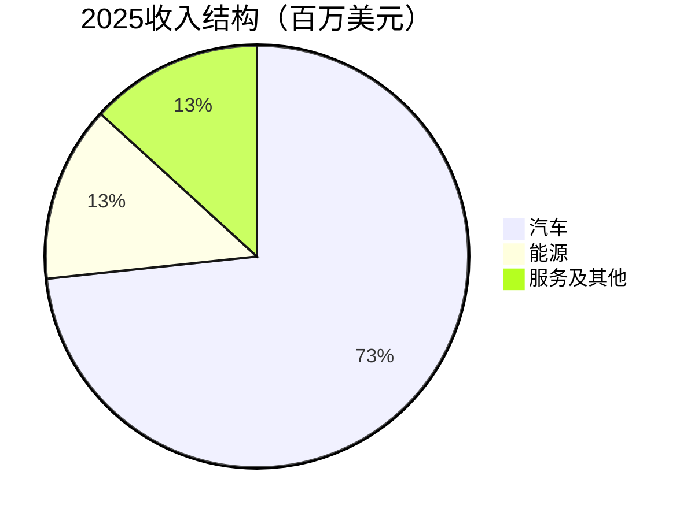
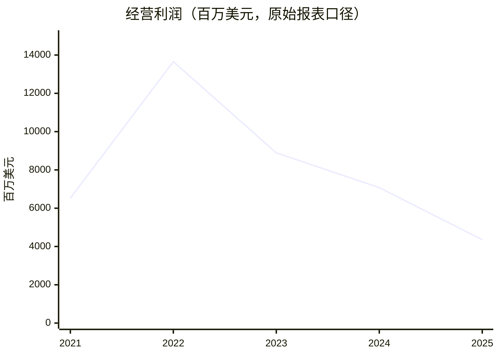

# 特斯拉（TSLA）独立投资研究：产品进步能否变成普通股东的现金回报？

研究日：2026-10-19（北京时间）。行情截至美国东部时间2026-10-16正常交易收盘；财务截至2026Q2，经营交付更新截至2026Q3。Q3财报预定10月21日发布，本文没有把交付数据冒充Q3利润。[S1][S2][S8]

方法：独立执行 `/investment-research`，非七家公司混写，亦非 `/investment-team`。金额默认**百万美元**，每股价格为美元；2036情景部分另标十亿美元。

**信息丰富度评级：A。AI研究局限性声明：**汽车和储能报表证据充分，机器人、无人驾驶远期单位经济性远未达到同等确定性。大量公开讨论容易把“技术进步”误读为“股东一定获利”。本报告的优势在口径对账和可复算约束，不声称拥有自动驾驶研发、事故赔付或供应链的一手信息。

**综合结论：当前价354.72美元，新增资金观望，不列为价值投资核心仓候选。**原因同时来自汽车业务利润压力、未验证业务占定价比重高、资本配置及稀释风险，以及三年模型的安全边际不足。十年模型只用于进一步收紧仓位，不能独自否决投资。愿意为无人驾驶商业化承担高损失概率的投资者，应把它作为独立风险预算，而不是用汽车销量为全部市值背书。

本报告的三年折现基准值128.40美元、主观概率加权值159.32美元；在基准情景不恶化的前提下，约96.30美元对应基准值的25%折价。它们是条件估值，不是股价预测，也不是承诺价格会到达。

## 0. 偏见自查

- 资料多不等于业务稳定：有收入的FSD与未来完全无人运营是两种不同证据。
- 如果删掉一半媒体报道，汽车/储能现金流判断变化不大，机器人估值应明显收缩。
- 我们没有证据证明多头愚蠢：若无人驾驶网络形成且利润大规模兑现，本报告可能严重低估。
- 最容易犯的错，是既把AI研发计入今天费用、又完全不给未来价值；相反的错是把每项研发承诺都折算成确定利润。以三情景而非单一故事处理。

## 1. 数据收集与口径核验

### 1.1 当前价格与资产负债表

| 指标 | 数值 | 来源与解释 |
|---|---:|---|
| 10月16日收盘价 | 354.72 | StockAnalysis、Macrotrends及Yahoo一致；不混用盘后352.46 [S2][S7] |
| 已发行普通股（股） | 3,949,547,394 | 10-Q封面2026-07-16精确值；StockAnalysis约39.50亿股 [S1][S2] |
| 股价×总股本市值 | 1,400,983.45 | 与第三方1,400,983百万美元一致，差异来自取整 |
| 现金及短期投资 | 43,524 | 2026Q2；不含比特币及长期股权投资 [S1][S4] |
| 债务及融资租赁 | 9,342 | 流动1,418＋长期7,924 [S1] |
| 经营租赁负债 | 6,738 | 流动1,022＋长期5,716 [S1] |
| 净现金，不含经营租赁 | 34,182 | 现金及短投减债务/融资租赁 |
| 净现金，含经营租赁 | 27,444 | 与StockAnalysis同口径 [S4] |
| 股东权益 | 86,858 | 不含非控股权益 [S1][S4] |
| TTM归母净利润 | 3,804 | 公司报表；第三方EPS分子为3,806，非完全相同口径 |
| TTM经营现金流 | 18,685 | 公司与第三方一致 [S1][S5] |
| TTM资本开支 | 12,923 | 公司现行含太阳能系统口径 [S1][S5] |
| TTM自由现金流 | 5,762 | CFO减capex，未经股权激励经济成本调整 |

**不能把39.50亿发行股本与约35.40亿季度稀释加权股本混用。**未归属奖励的会计处理使两者不同；用当前股价除TTM稀释EPS 1.08得328.44倍，用当前全股本市值除归母利润得368.29倍。本文估值统一用当前发行股本，不把两者差额误解为计算错误；未来新增奖励另外做敏感性，不重复把已发行奖励再加一次。

### 1.2 最近五年财务

下列年度均为自然年。收入、毛利、归母利润、现金流、现金及短投采用公司2025全年更新/10-K与StockAnalysis交叉核对；经营利润严格保留公司重组费用。[S3][S4][S5][S9]

| 指标 | 2021 | 2022 | 2023 | 2024 | 2025 |
|---|---:|---:|---:|---:|---:|
| 收入 | 53,823 | 81,462 | 96,773 | 97,690 | 94,827 |
| 毛利 | 13,606 | 20,853 | 17,660 | 17,450 | 17,094 |
| 毛利率 | 25.28% | 25.60% | 18.25% | 17.86% | 18.03% |
| 经营利润 | 6,523 | 13,656 | 8,891 | 7,076 | 4,355 |
| 经营利润率 | 12.12% | 16.76% | 9.19% | 7.24% | 4.59% |
| 归母净利润 | 5,519 | 12,556 | 14,997 | 7,091 | 3,794 |
| 经营现金流 | 11,497 | 14,724 | 13,256 | 14,923 | 14,747 |
| 资本开支 | 6,514 | 7,163 | 8,899 | 11,342 | 8,527 |
| 自由现金流 | 4,983 | 7,561 | 4,357 | 3,581 | 6,220 |
| 现金及短投 | 17,707 | 22,185 | 29,094 | 36,563 | 44,059 |

**已发现并处理的差异：**StockAnalysis标准化2024经营利润7,659，高于原始7,076，差额583对应重组相关重分类；2022列13,692而原始13,656，差额36。2025Q3第三方经营利润1,862而公司1,624，差额238；2025Q4第三方1,171而公司1,409，方向相反、差额238。不能用标准化季度表判断利润拐点。所有后续分析采用公司披露，差异原值保存在验证日志。2023归母净利还有大额递延税收益，不作为持续盈利峰值。

### 1.3 最近四个财务季度

| 指标 | 2025Q3 | 2025Q4 | 2026Q1 | 2026Q2 |
|---|---:|---:|---:|---:|
| 汽车收入 | 21,205 | 17,693 | 16,234 | 20,516 |
| 能源收入 | 3,415 | 3,837 | 2,408 | 3,139 |
| 服务及其他收入 | 3,475 | 3,371 | 3,745 | 4,581 |
| 总收入 | 28,095 | 24,901 | 22,387 | 28,236 |
| 毛利 | 5,054 | 5,009 | 4,720 | 4,751 |
| 经营利润 | 1,624 | 1,409 | 941 | 398 |
| 归母净利润 | 1,373 | 840 | 477 | 1,114 |
| 自由现金流 | 3,990 | 1,420 | 1,444 | -1,092 |

季度数据来自2026Q2官方更新第4、27、31页及10-Q，并用StockAnalysis核对收入/现金流；上述经营利润差异按原报解决。[S1][S4][S5]

| 收入类别毛利率 | 2025Q3 | 2025Q4 | 2026Q1 | 2026Q2 |
|---|---:|---:|---:|---:|
| 汽车 | 17.05% | 20.42% | 21.08% | 16.88% |
| 能源 | 31.42% | 28.62% | 39.53% | 20.39% |
| 服务及其他 | 10.53% | 8.84% | 9.24% | 14.15% |

毛利率由官方收入及对应成本重算；完整单季板块成本的独立第三方逐格复核仍有缺口，不把同一发行人的PDF与10-Q当两家独立提供者。

2026Q2汽车、能源、服务收入同比分别增长23.14%、12.55%、50.39%。但毛利并未随收入等比例改善：三个板块Q2毛利率分别16.88%、20.39%、14.15%。全部四季板块毛利率计算及原始成本见 `calculations.json` 和 `reproduce.py`；这些是收入类别拆分，不是公司独立披露的软件分部利润。

Q2的研发费用2,371百万美元；FSD活跃订阅指标148万，**包括一次性买断，不等于148万个按月付费订户**。归母净利润还受SpaceX股权未实现收益、数字资产及税项影响；不能以Q2净利润反弹取代经营利润分析。[S1]

2026Q3交付486,532辆、储能部署13.7GWh；与2025Q3的497,099辆相比，交付下降2.13%。车辆交付量不是收入，储能部署量不是利润，本文不外推尚未公布的Q3毛利率。[S8]

> 追问：如果所有AI叙事暂时拿掉，现有报表支持的是怎样的生意和价格？

## 2. 生意本质：把物理产品、能源系统和软件组织成一个平台

一句话：**Tesla目前主要靠制造和销售硬件赚取现金，试图把车队、充电、储能和自动驾驶软件变成持续收费的平台。**

汽车是低频耐用品：品牌、OTA、充电体验可以降低获客和售后摩擦，但消费者有大量替代选择，降价会同时冲击新车利润和存量残值。能源系统由初装、运维、软件调度组成，复购与可靠性更相关，仍受电芯、工程和竞争性招标约束。FSD可以形成高毛利复购，但客户购买的是可用能力，不是承诺中的最终等级。

经营杠杆的核心是**收入增长能否覆盖固定研发、算力折旧与新增产能**。2025资本开支下降帮助FCF回升，2026Q2资本开支5,789、FCF转负又说明“现金流改善”不能脱离建设周期。TTM FCF扣除SBC 3,798后为1,964百万美元，这是把股权报酬视为经济成本的粗略检验，非标准FCF；不能同时再把同一SBC全额扣一次利润。

Tesla Q2汽车毛利率高于部分传统车企整体毛利水平，但不能把金融、经销商和租赁合并口径混排；GM的TTM整体毛利率10.18%仅作方向参照。[S15] 软件公司毛利水平不应直接套到汽车硬件收入。

> 段永平式追问：这门生意好在哪里？工程和一体化交付能力已经成立；“可持续平台收费的好生意”仍要由留存、单车盈利和现金回款证明。

## 3. 五类护城河逐项检验

| 类型 | 已有证据 | 反证/边界 | 未来五年判断 |
|---|---|---|---|
| 品牌与定价权 | 直接销售、全球产品认知、生态体验 | 收入和利润下行说明品牌不保证提价；政治认知可能割裂用户 | 中等、分地区分化 |
| 转换成本 | 车机、充电、家庭能源、软件习惯 | 换车天然是重新选择时点，远低于企业数据库迁移成本 | 软件改善可增强，但不足以视为永久锁定 |
| 网络效应 | 车队数据、充电站点覆盖 | 数据多不等于有效监督信号；充电开放也让竞品受益 | 只有安全性能与单位成本同步进步才算扩大 |
| 规模效应 | 工厂、电池采购、全球渠道与充电基础设施 | 中国车企同样规模化，低利用率会反噬固定成本 | 真实但有周期性 |
| 技术/制造 | 整车软件、OTA、控制、储能集成与制造设计 | 领先不等于排他，感知路线、算力与法规都可能改变 | 对单一技术永久领先不下注 |

Q2已有8,704座超级充电站、82,357个接口，说明基础设施存量真实存在。[S1] 但“拿钱复制工厂”与“复制客户信任、运维经验和成熟供应链”不同；竞争者有规模且愿意承受低回报，仍可能压低整个行业利润。

过去五年，储能及软件能力增强，汽车定价权却未同步增强。未来十年最可能保留的是制造整合与基础设施能力，最难定价的是无人驾驶网络能否赢得超额利润。自动驾驶商业化必须同时跨越技术、监管、保险、远程支持和车队利用率；只完成技术演示不足以形成护城河。

> 巴菲特式追问：什么会摧毁护城河？同等体验的低成本替代、严重安全事件、资本回报持续低于融资成本，以及开放平台让利润流向其他环节。

## 4. 逆向思考：买入者最容易在哪里犯错？

以下风险评级是研究判断，不是可相加的精确概率。三情景的概率另列，避免将相互重叠风险误当独立事件。

| 失败路径 | 可能性判断 | 对股东的影响 | 验证指标 |
|---|---|---|---|
| 汽车销量回升但单车利润被竞争吃掉 | 中高 | 现金引擎不够支持AI投资 | 汽车毛利、库存、折扣、扣积分利润 |
| Robotaxi能运营但单位经济性不成立 | 中高 | 收入可观但自由现金流弱 | 付费里程、空驶、远程支持、维修保险成本 |
| Optimus长期停留在试点 | 中 | 资本开支和人才成本持续，终值下降 | 外部付费客户、复购、故障率、毛利 |
| 安全事故或监管导致特定地区停运 | 中；极端尾部无法可靠量化 | 可能前置发生，不能只抬折现率 | 监管许可、事故披露、赔偿与召回 |
| 关联交易/激励使公司价值未归普通股东 | 中 | 稀释、机会转移、资金占用 | 奖励条款、关联采购、投资和控制权 |
| 技术方向正确但建设过度 | 中高 | 折旧侵蚀利润，资金回收期拉长 | 产能利用率、现金消耗、投入资本回报 |

历史类比是机制而非结局预言：汽车规模冠军也会被产能与价格周期吞噬；互联网基础设施先驱即使需求兑现，投资者仍可能因购入价格过高而长期亏损。以Tesla是技术公司或车企作二元标签，会掩盖不同业务的资本密度。

最强空方论点：当前估值已需要汽车之外的极大盈利池，而今天的经营利润和现金转换没有相应证据。最强多方反驳：技术突破可能让利润曲线呈非线性，历史PE低估真实期权。本报告允许乐观情景，但不把非线性可能性当必然性。

> 芒格式追问：聪明人为什么不买？不是否认技术，而是不愿在不可验证的利润分配机制上付出巨大确定价格。

## 5. 管理层与资本配置

Elon Musk仍为CEO，制造、产品与融资动员能力是重要资产；关键人依赖、并行管理其他企业及治理结构也是成本。这里不以个人好恶代替资本回报检验。[S1][S10]

| 决策 | 已观察结果 | 研究评价 |
|---|---|---|
| 扩张全球制造与直接销售 | 形成规模和跨地区交付能力 | 产品组织能力强，盈利仍需看利用率 |
| 扩张储能与能源集成 | 2025能源收入12,771、毛利3,802 | 已有商业价值；Q2能源毛利回落提示不能线性外推 |
| 继续大额AI、车队与芯片投入 | Q2研发2,371、资本开支5,789 | 方向可能正确，增量ROIC尚未被现金流证明 |
| 股权激励及实施安排 | 2026Q2已发行股本显著高于此前年度 | 必须同时研究归属、投票和普通股分母 |

**所有权不等于投票权。**2026-06-17 Schedule 13G申报Musk控制699,580,882股，报告中的19.9%采用特定监管分母，并剔除423,743,904股附投票协议的业绩奖励。用10-Q披露的全部发行股本作分母，其受益拥有/可指示股票占全部发行股数的机械比率约17.71%（不等于实际投票权比例，投票协议要求秘书按包括Musk在内的其他股东投票比例处理奖励股份）；把无控制权的奖励名义计入合计为28.44%，不能叫作28.44%已自由持有经济权益或独立投票权。[S10] 第三方“内部人持股28.53%”不是Musk实际投票比例。[S2]

资本配置评价：现金储备能够购买试错时间，但资金充裕不等于每项项目都应投。核心纪律应是外部客户愿意付费、每单位资本创造现金、关联交易可被独立董事和普通股东解释。我们没有足够可比数据给研发ROI或并购成功率编造百分比。

> 段永平式追问：如果CEO离任，汽车和储能组织可以继续经营，但自动驾驶、机器人战略和融资叙事的连续性风险明显更大。

## 6. 行业、竞争与AI利润传导

IEA预测2026年全球电动车（纯电与插混合计）销量约2,300万辆、占新车28%；不是Tesla可独占的市场，也不能用Tesla纯电交付除该数后称全球纯电份额。IEA指出2025年中国车企供应约60%的全球电动车销量，意味着规模学习曲线并非Tesla独享。[S11]

| 市场 | 主要竞争机制 | Tesla可能获得价值的条件 |
|---|---|---|
| 电动车 | BYD及中国车企成本/产品迭代，传统车企渠道与融资 | 单位成本、体验和残值综合领先，不能只靠降价 |
| 储能 | 电芯、逆变器、集成商、系统运维之间分配利润 | 全生命周期可靠性、调度收益与交付能力可验证 |
| 无人驾驶出行 | Waymo等不同技术路线、网约车平台及当地运营商 | 低事故成本、足够利用率、监管可扩展、成本优势 |
| 机器人 | 通用模型、硬件厂商与工业自动化供应商 | 能替代真实工时，并让用户总成本下降 |

未来三年AI对利润有四条传导：FSD增购/订阅提升单车终身价值；制造优化降低成本；机器人/无人驾驶新增收入；研发、芯片、数据中心、保险与合规先增加支出。**收入期权兑现前，最后一条可以比前三条更大。**

供应链要同时考虑电池原料、先进计算芯片、地区工厂和电力；自制芯片/制造设施可能缓和依赖，也增加固定资本风险。公开信息不足以给出完整供应商采购占比，因此不编集中度数字。

20年后，电气化和自动化大概率更普遍，但产业扩大并不保证Tesla占有相同比例的利润。文明趋势回答需求方向，竞争与所有权决定股东拿到多少。

> 李录式追问：如果行业十年增长很大，普通股每股自由现金流是否仍可能停滞？答案是可能，竞争、再投资和稀释都能造成这种结果。

## 7. 估值与安全边际

### 7.1 当前定价，区别EPS与全股本口径

| 指标 | 本文计算 | 解释 |
|---|---:|---|
| 市值/TTM归母利润 | 368.29倍 | 当前全发行股本，主要估值口径 |
| 股价/TTM稀释EPS | 328.44倍 | 财报加权股本口径，仅展示差异 |
| 市销率 | 13.52倍 | 市值/103,619 |
| EV/收入 | 13.26倍 | EV扣含经营租赁后的净现金 |
| 市净率 | 16.13倍 | 市值/86,858 |
| FCF收益率 | 0.4113% | 5,762/市值 |
| 第三方PEG | 9.70倍 | 第三方预期增长口径；不作为本文价值锚 |

第三方当前PE368.10以3,806的EPS计算分子为基础；本文368.29用3,804归母净利润。可完全解释，无需篡改一方。自身历史年末PE（第三方一致系列）2022为30.91、2023为52.66、2024为181.82、2025为394.22倍：这不是估值“必然回归”的锚，2023税项和之后盈利收缩使PE可比性弱。[S6]

同行仅作机会成本对照：GM在同日第三方TTM PE42.29、PS0.40倍，不能用“车企应给多少倍”直接否定Tesla的软件价值；反过来也不能用软件企业估值覆盖全部硬件收入。BYD、Waymo等并不存在能无调整横比的同币种同业务PE，本报告不拼凑伪精确同行排名。[S15]

### 7.2 三年情景：回答当前价是否有安全边际

以TTM归母利润3,804为起点，目标为研究时点三年后稳态年盈利近似值。保持现有发行股本，暂不加回净现金（利润包含利息，避免双计），分红为零。增长不是分析师一致预期，而是下列经营假设反解；软件收入与整车收入须避免重复计入。

| 情景 | 2029利润（百万美元） | 年化利润增长 | 三年后PE假设 | 三年后每股价 | 10%折现现值 |
|---|---:|---:|---:|---:|---:|
| 悲观 | 5,000 | 9.54% | 25倍 | 31.65 | 23.78 |
| 基准 | 15,000 | 57.99% | 45倍 | 170.91 | 128.40 |
| 乐观 | 35,000 | 109.54% | 70倍 | 620.32 | 466.06 |

悲观假设汽车薄利、储能贡献抵消部分AI费用；基准假设汽车盈利修复、能源扩张，软件兑现可见但非全球无人网络垄断；乐观需要无人驾驶软件和运营利润显著放量。三档2029利润是“已扣经营费用、税和少数股东”的目标，不把毛利当净利。

三年PE是成长阶段再定价假设，25/45/70倍并非十年终值PE。即使基准利润增长很快，当前市值仍显著高于基准折现值。以悲观35%、基准45%、乐观20%的主观权重，现值159.32美元；高波动期权型生意没有窄而可靠的估值区间。

**可执行的研究价位：**约120—160美元进入深入复核区；约96美元以下才提供相对基准值25%的折价，仍须商业证据未恶化。354.72美元更接近为乐观商业化付费，尚不满足本报告的新资金条件。

### 7.3 反向DCF：市场要求什么？

采用股权现金流模型：起始年盈利4,000百万美元（接近当前盈利的研究假设）、十年内每年50%可分配、剩余再投资；r为10%，第十年之后g为2.5%、稳态增量ROIC为20%，终值PE为11.6667倍。现金流分配并非公司分红承诺，不额外加现金，未另扣未来稀释，已经偏宽松。

用二分法反解，当前市值要求十年盈利年增约52.45%，末年利润约271,310百万美元。若期间完全不分配且把未来稀释近似视为每年1个百分点拖累，要获得10%的近似年化回报，末年利润需约340,970百万美元。两种口径不能混为一个目标；共同含义是市场所需盈利远大于“现有汽车业务恢复”。计算见 `reproduce.py`。

### 7.4 十年经营情景：把利润拆出来

单位改为**十亿美元**。全部是2036年假设，不是已披露业绩；表中利润使用税后贡献，已将一般费用/损失单列。以下算式在脚本中重算。

| 2036盈利组成 | 悲观 | 基准 | 乐观 |
|---|---|---|---|
| 汽车及常规服务 | 收入100×净利率3%=3 | 收入180×6%=10.8 | 收入300×8%=24 |
| 能源 | 收入40×10%=4 | 收入100×12%=12 | 收入180×15%=27 |
| 独立增量软件/无人出行 | 收入3×30%=0.9 | 收入40×35%=14 | 收入150×40%=60 |
| 机器人 | 0 | 收入10×20%=2 | 收入80×20%=16 |
| 未分配费用及其他损益 | -1.9 | -3.8 | -7 |
| 净利润合计 | 6 | 35 | 120 |

基准已包含规模化软件盈利，绝非只按车企估值；乐观要求数个市场同时成功。公司未公开足够信息让这些假设具备统计可验证的概率，35/45/20只用于透明压力测试。

### 7.5 终值模型与折现率敏感性

美元r取10%。最新取得Fed H.15为10月16日发布、10月15日10年期5.10%；以5.10%＋研究假设ERP4.90%×规范化beta1组成10%。这里beta1是统一压力测试基准，不是Tesla实际历史beta；市场波动beta不用于掩盖离散风险。平台第三方历史beta约1.92仅作市场风险提醒，若采用更高实际要求回报，估值只会更紧。[S2][S12]

稳态增量ROIC取20%，代表制造、能源与高利润软件的组合，显著高于当前回报，是对转型成功的假设，不是历史ROIC直接外推。g为1%/2.5%/4%，是2036年之后的名义美元增长，不能替换前十年增速。

公式：`终值PE=(1-g/ROIC)/(r-g)`。本文遵循仓库规定的当年利润乘数，未额外乘一次(1+g)。

| 情景 | g | r-g | 终值PE | 2036净利（百万美元） | 十年近似年化回报 |
|---|---:|---:|---:|---:|---:|
| 悲观 | 1.00% | 9.00% | 10.5556倍 | 6,000 | -27.63% |
| 基准 | 2.50% | 7.50% | 11.6667倍 | 35,000 | -12.60% |
| 乐观 | 4.00% | 6.00% | 13.3333倍 | 120,000 | 0.34% |

工具称IRR，实际是终值市值的几何年化再加“股息率－稀释率”的简化值；本文k=-1%（未来常规新增净稀释假设，当前已发行奖励已入分母），不等于逐期现金流求根的精确IRR。场景回报概率加权约-15.27%，也不是组合财富的确定复合回报。其作用是暴露长期利润不足以覆盖今天价格的风险。

| r | 概率加权近似年化 | 是否覆盖r | 合法性 |
|---|---:|---|---|
| 8% | -12.53% | 否 | 美元区间外，仅供参考；乐观r-g为4个百分点，不可据此定价 |
| 9% | -14.02% | 否 | 区间内；最窄r-g为5个百分点 |
| 10% | -15.27% | 否 | 基准 |
| 11% | -16.35% | 否 | 区间内 |
| 12% | -17.29% | 否 | 区间外，仅供参考 |

已执行 `flip --delta 0.02`，因两侧均在币种合理区间外，再执行`--delta 0.01`。**区间内结论不翻转：9%—11%均未通过仓位压力测试。**它不能证明企业失败，也不能替代三年定价和商业分析。若2036仍处于超高速扩张，永续模型可能过早进入稳态；但必须显式构建延长增长期的现金流，不能偷偷提高终值PE。

**估值分歧对账：**公司工程价值和AI趋势偏正面，三年乐观情景仍有上行；三年基准定价和十年压力均偏负面。最终观望来自多维证据：汽车定价权与资本消耗、治理/稀释和三年安全边际不足，长期模型只是进一步拒绝核心大仓位。不能把“十年低于r”当唯一理由。

未建模离散风险：关联交易价值转移尚未定量；自动驾驶地区禁运/停运已进入悲观路径，但停运时间和事故赔偿未精算；极端破产/没收尾部也未给精确概率。因此三情景不是完整损失分布。工具audit中的旧“4.70%/中国ERP”说明为脚本固定背景，本文实际输入rf为5.10%、分析币种USD，不将旧文案当最新数据。

> 巴菲特式追问：r错两个百分点结论会翻转吗？本次区间内不会；更敏感的是2036净利和无人驾驶成功路径，而非小幅调r。
>
> 段永平式追问：股市关闭五年愿意持有吗？以当前价格和本文证据，不愿把它当确定性核心持仓。

## 8. 综合决策备忘录

| 维度 | 结论 | 信心 |
|---|---|---|
| 生意质量 | 汽车和储能真实，平台收费转型尚在验证 | 中 |
| 护城河 | 制造、软件集成和基础设施有价值；定价权非稳固 | 中 |
| 管理层 | 产品组织能力突出；资本分配和股东权利需要折价 | 中 |
| 最大风险 | 付了平台价，最终只得到低利润硬件和持续投入 | 中高 |
| 文明趋势 | 电气化与自动化方向强，利润归属不确定 | 方向高、份额低 |
| 估值 | 三年基准安全边际不足；十年压力未通过且区间内不翻转 | 计算高、假设低 |

**估值解除语：**估值维度不是唯一裁决，十年压力结果只约束仓位。没有已知资产负债状况、税务和组合信息，不给个人化仓位比例。

| 策略 | 条件性建议 |
|---|---|
| 空仓者 | 当前观望；进入120—160美元区间重做证据核验，约96美元以下才满足本文基准折价条件 |
| 持仓者 | 将成本价与未来回报分开；若投资理由仍只是汽车销量，应降低对平台溢价的依赖 |
| 卖出/减仓信号 | 无人驾驶成本不可控、现金消耗长期超预算、关键监管停运、重大股东利益转移 |
| 加仓信号 | 独立披露无人驾驶单位经济性和外部收入、扣正常投资后现金流改善、股价提供安全边际 |

最需要跟踪：10月21日Q3毛利和现金流、FSD真正经常性付费收入、能源单位利润、Robotaxi保险/远程支持/空驶成本、普通股分母与激励归属。交付超预期不能替代这些核查。

### 大师观点与模拟边界

已检索仓库与该议题相关的一手存档。段永平在2012-08-12原帖写：“我本人确实对特斯拉没兴趣。”出处见仓库《段永平雪球全量原发言》及原帖[S13]。这是历史偏好，不是2026年目标价；本报告只借其“能力圈和生意模式优先”的方法作独立分析，不把旧话当今天卖出建议。

巴菲特、芒格、李录：本轮没有读到足以支持其对**当前Tesla定价**判断的原文，资料不足，不模拟代言。读过李录2024北大演讲仓库存档，仍不把一般文明/价值投资理念伪装为Tesla推荐。所有“式追问”均为本报告分析提问，不是大师引语。

### 分析置信度与投资确定性

财报收入、现金流、股本以及计算的分析置信度高；季度标准化数据差异已按原报对账。未来软件收入、无人驾驶责任、稳态ROIC、情景概率与机器人利润属于低置信度推理。**信息丰富度A级，绝不等于投资确定性A级。**

## 附录A：关键数据交叉验证记录

| 字段 | 原始来源 | 第三方 | 处理 |
|---|---:|---:|---|
| FY2025收入 | 94,827 | 94,827 | 一致 |
| FY2025归母利润 | 3,794 | 3,794 | 一致 |
| FY2025现金及短投 | 44,059 | 44,059 | 一致 |
| Q2现金及短投 | 43,524 | 43,524 | 一致 |
| TTM归母/每股计算分子 | 3,804 | 3,806 | 差异0.053%，解释少数权益买出等EPS分子调整 |
| FY2024经营利润 | 7,076 | 7,659 | 超1%，采用原报，第三方标准化不作为同口径值 |
| 2025Q3经营利润 | 1,624 | 1,862 | 超1%，采用原报并保留差异 |
| 净现金含经营租赁 | 27,444 | 27,444 | 已将9,342债务与6,738经营租赁对齐 |

Macrotrends行情可检索，但收入/净利/股本页本轮返回403；未宣称完成其全量财务核验，改用公司/SEC原始披露与StockAnalysis。第三方标准化不是与公司完全独立的审计，亦可能有共同上游数据；本次是跨发布渠道和口径复核。

程序记录：[validation-log.txt](validation-log.txt)、[calculations.json](calculations.json)、[terminal-config.json](terminal-config.json)、[reproduce.py](reproduce.py)。日志保留超阈值差异，不能把脚本输出“通过”理解成未来预测正确。抽检结果及人工分类见同目录审计文件；模型假设只做算式复核，不伪装成外部事实双源。

## 附录B：来源

- [S1] [Tesla 2026Q2 10-Q](https://www.sec.gov/Archives/edgar/data/1318605/000162828026049270/tsla-20260630.htm)；[Q2官方更新](https://assets-ir.tesla.com/tesla-contents/IR/TSLA-Q2-2026-Update.pdf)，重点第4、5、27—31页。
- [S2] [StockAnalysis TSLA统计](https://stockanalysis.com/stocks/tsla/statistics/)，10/16收盘快照。
- [S3] [Tesla 2025 10-K](https://www.sec.gov/Archives/edgar/data/1318605/000162828026003952/tsla-20251231.htm)。
- [S4] [StockAnalysis财务](https://stockanalysis.com/stocks/tsla/financials/)；[资产负债表](https://stockanalysis.com/stocks/tsla/financials/balance-sheet/)；[季度损益](https://stockanalysis.com/stocks/tsla/financials/income-statement/?p=quarterly)。
- [S5] [StockAnalysis现金流](https://stockanalysis.com/stocks/tsla/financials/cash-flow-statement/)。
- [S6] [StockAnalysis历史比率](https://stockanalysis.com/stocks/tsla/financials/ratios/)。
- [S7] [Macrotrends股价历史](https://www.macrotrends.net/stocks/charts/TSLA/tesla/stock-price-history)；[Yahoo行情](https://ca.finance.yahoo.com/quote/TSLA/)。
- [S8] [Tesla 2026Q3交付与部署](https://ir.tesla.com/press-release/tesla-third-quarter-2026-production-deliveries-and-deployments)，2026-10-02。
- [S9] [Tesla 2025全年业绩更新SEC Exhibit 99.1](https://www.sec.gov/Archives/edgar/data/1318605/000162828026003837/exhibit991.htm)，包含2021—2025可比表。
- [S10] [Musk 2026-06-17 Schedule 13G](https://www.sec.gov/Archives/edgar/data/1318605/000110465926075203/xslSCHEDULE_13G_X02/primary_doc.xml)。
- [S11] [IEA Global EV Outlook 2026](https://www.iea.org/reports/global-ev-outlook-2026/executive-summary)。
- [S12] [Federal Reserve H.15](https://www.federalreserve.gov/releases/H15/)，2026-10-16版，末列10/15。
- [S13] [段永平2012-08-12雪球原帖](https://xueqiu.com/1247347556/22105245)，本轮实际读取仓库归档 `reports/段永平/段永平雪球全量原发言.md`，不声称原帖本轮可直接访问。
- [S14] [Tesla投资者关系](https://ir.tesla.com/)，用于财报日与文档目录核验。
- [S15] [GM同日估值/财务统计](https://stockanalysis.com/stocks/gm/statistics/)，只作有限同行参照。

本报告用于学习和研究，不构成针对个人账户的投资指令。
