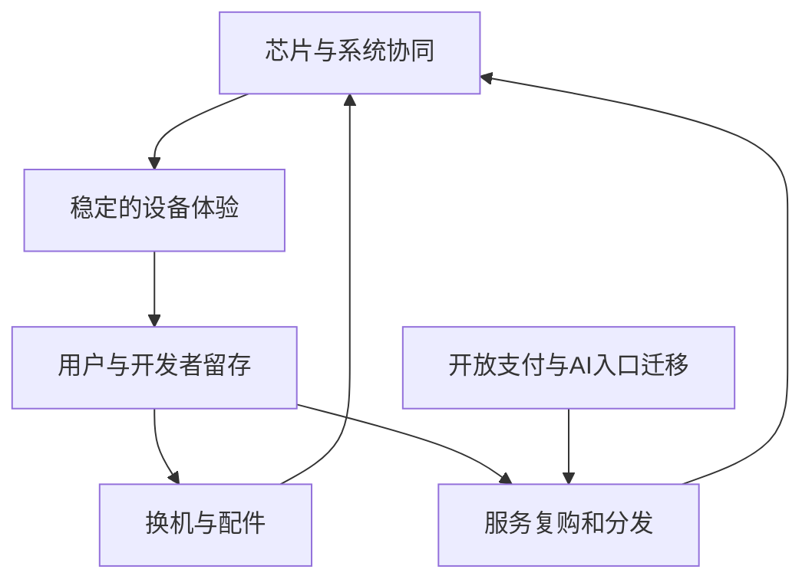

# 苹果（AAPL）独立投资研究报告

研究日期：2026-10-19（北京时间）。行情截止：2026-10-16 美东收盘；最新已披露季度：截至 2026-06-27 的 FY2026 Q3；FY2026 全年尚未披露。本报告单独执行 `/investment-research` 八步流程。金额除特别说明均为**百万美元**；估值模型用**十亿美元**；股价用美元。

**结论：优秀生意、当前价格偏贵。空仓者观望，现有持仓保留适度核心仓、不追高；基本面未变时优先等待 200—230 美元的分批买入区间，180 美元以下安全边际更充分。** 343.46 美元对应的市场预期，需要强劲增长持续兑现；不是因为十年压力测试低于资本成本就否定苹果。三年中性价值折现约 228 美元，合理估值观察带 210—260 美元。这些是研究假设下的价格，不是短期股价预测。

信息丰富度评级：**A**。AI 研究局限性声明：公开资料多，意味着历史数字容易核查，不意味着苹果的 AI 变现、换机周期、服务抽成和新 CEO 执行力容易预测。本文把事实、计算与情景假设分开；不把媒体产品传闻当盈利，不把四位投资者的风格当本人买卖建议。所有长期概率均为主观压力测试权重，无统计频率含义。

## 第一步：数据收集与财务核验

### 五年财务

| 指标 | FY2021 | FY2022 | FY2023 | FY2024 | FY2025 |
|---|---:|---:|---:|---:|---:|
| 收入 | 365,817 | 394,328 | 383,285 | 391,035 | 416,161 |
| GAAP净利润 | 94,680 | 99,803 | 96,995 | 93,736 | 112,010 |
| 经营现金流 | 104,038 | 122,151 | 110,543 | 118,254 | 111,482 |
| 资本开支 | 11,085 | 10,708 | 10,959 | 9,447 | 12,715 |
| 现金及全部有价证券 | 190,516 | 169,109 | 162,099 | 156,650 | 132,420 |
| 毛利率 | 41.78% | 43.31% | 44.13% | 46.21% | 46.91% |
| 经营利润率 | 29.78% | 30.29% | 29.82% | 31.51% | 31.97% |
| 自由现金流 CFO−资本开支 | 92,953 | 111,443 | 99,584 | 108,807 | 98,767 |

来源：[S1]、[S2]、[S3] 年报与 [S4] StockAnalysis；FY2025 收入、利润另有 Macrotrends 检索结果交叉核对 [S5]。现金栏是金融工具公允价值合计，**历史部分年份含受限证券，并非全额可随时分红**；FY2022 原始年报明确披露受限证券，因此不能据此推导无约束的历史净现金。FY2024 净利含爱尔兰税务事项一次性冲击，不能把 FY2025 净利反弹全归结为经营加速。

### 最近四季产品收入与增速

括号为同比；本表收入和比较期来自季度原始 PDF [S6—S9]，与 StockAnalysis 季度表 [S10] 对照。苹果的法定报告分部实际是地域，产品分类不能冒充独立可核查净利润分部。

| 产品分类 | FY25Q4 | FY26Q1 | FY26Q2 | FY26Q3 |
|---|---:|---:|---:|---:|
| iPhone | 49,025 (6.06%) | 85,269 (23.33%) | 56,994 (21.68%) | 54,252 (21.69%) |
| Mac | 8,726 (12.68%) | 8,386 (-6.69%) | 8,399 (5.66%) | 10,352 (28.66%) |
| iPad | 6,952 (0.03%) | 8,595 (6.27%) | 6,914 (8.00%) | 6,191 (-5.93%) |
| 可穿戴/家居/配件 | 9,013 (-0.32%) | 11,493 (-2.16%) | 7,901 (5.04%) | 7,883 (6.47%) |
| Services | 28,750 (15.13%) | 30,013 (13.94%) | 30,976 (16.25%) | 30,739 (12.09%) |
| 总收入 | 102,466 (7.94%) | 143,756 (15.65%) | 111,184 (16.60%) | 109,417 (16.36%) |

### 法定地域分部收入及披露毛利口径

| 地域 | FY25Q4 | FY26Q1 | FY26Q2 | FY26Q3 |
|---|---:|---:|---:|---:|
| 美洲 | 44,192 | 58,529 | 45,093 | 45,781 |
| 欧洲（含印度等） | 28,703 | 38,146 | 28,055 | 29,395 |
| 大中华区 | 14,493 | 25,526 | 20,497 | 18,816 |
| 日本 | 6,636 | 9,413 | 8,401 | 6,554 |
| 其他亚太 | 8,442 | 12,142 | 9,138 | 8,871 |

| 毛利率 | FY25Q4 | FY26Q1 | FY26Q2 | FY26Q3 |
|---|---:|---:|---:|---:|
| 硬件产品合计 | 36.22% | 40.68% | 38.69% | 40.07% |
| 服务 | 75.28% | 76.52% | 76.68% | 75.62% |
| 全公司 | 47.18% | 48.16% | 49.27% | 50.06% |

**披露边界：**公司没有公开逐个产品的毛利率；表中不能把全公司或硬件整体毛利率写成 iPhone 毛利率。地域分部披露的是分部经营利润而非毛利，本次未完整转录地域经营利润，故不编造其毛利率。FY26Q3 全公司毛利率包含约两个百分点关税退款收益；剔除后公司披露为约 48.1%，该退款不应永续化。[S6]

### 资产负债和市场快照

| 项目 | 数值 | 口径 |
|---|---:|---|
| 收盘股价（美元） | 343.46 | 2026-10-16，StockAnalysis + IBD [S11,S12] |
| 已发行普通股（十亿股） | 14.59418 | SEC 2026-07-17 封面数；第三方四舍五入为14.59 [S13,S11] |
| 重算市值（十亿美元） | 5012.5171 | 股价乘已发行股本；不能用季度稀释平均股数 |
| 网站显示市值（十亿美元） | 5010 | 低精度显示，与重算差异远低于阈值 |
| TTM收入 | 466823 | FY25 + FY26前九月 − FY25前九月 |
| TTM GAAP净利润 | 128930 | 同口径滚动计算 |
| TTM自由现金流 | 136683 | 经营现金流146724减资本开支10041 |
| 现金+短期证券 | 62399 | FY26Q3；严格短期现金口径 |
| 加长期有价证券后的总额 | 146517 | 并不全是现金等价物 |
| 有息债务（不含经营租赁） | 84344 | 商业票据1997+短债11007+长债71340 |
| 严格短期现金减有息债务 | -21945 | 不把长期债券当活期存款 |
| 全部现金证券减有息债务 | 62173 | 广义净现金，后续EV使用这一口径 |

股本是最近公开快照而非实时股本；七月至十月回购可能使真实市值稍低。第三方 FY2025 的 total debt 包含口径不同项目，与票据加债券并不一致，故不机械沿用其历史净现金增速。本期 84,344 与原始财报有息债务相符。应付账款属于经营负债；不应把“现金减全部负债”与净现金混为一谈。

**追问（研究者按段永平框架提出）：这些数字里，哪些是用户持续付费，哪些只是税项和资本配置效果？**

## 第二步：生意本质——消费入口、整机体验与服务复购

一句话：苹果通过可信赖的个人设备和统一系统获得高价值用户，再通过换机、配件和数字服务反复兑现关系价值。

| 价值链环节 | 顾客付钱的理由 | 盈利质量 | 脆弱点 |
|---|---|---|---|
| iPhone | 通信、拍摄、可靠性、身份与生态 | 高端定价，仍有换机周期 | 换机延后、竞争品牌足够好 |
| Mac/iPad | 软硬件协同、创作与办公 | 增强生态、覆盖不同场景 | PC周期、低价替代、AI工作流转移 |
| 可穿戴 | 健康、音频、便携 | 扩大设备组合 | 新品需求不确定，不能外推早期增速 |
| 服务 | 存储、内容、支付、分发等 | 复购与佣金、较低边际成本 | 监管、模型供应商收费、第三方绕开抽成 |

FY2025 iPhone 收入 209,586，服务 109,158；按脚本计算占比分别约一半和四分之一。服务增长对利润的意义大于对收入的意义：服务毛利率远高于硬件，但其中包括不同性质业务，不能把广告分成、应用分发、云存储和内容订阅都看成无风险年金。设备装机量是存量，服务收入是流量；多台设备可属于同一人，不能将官方披露的逾25亿活跃设备当作25亿独立付费用户。[S1,S8]



过去五年收入并非直线上升，但毛利与经营利润率总体改善，说明结构升级与运营能力有效。未来经营杠杆也有反面：设备收入波动时研发仍要投入；免费 AI 功能可能先增加推理、内存和云端成本，随后才看到换机收益。高价回购降低股数，却不是提高整家公司利润的同义词。

**追问：如果消费者三年才换一次手机，苹果还能否提高每个用户的终身毛利？判断偏正面，证据是复购服务与跨设备体验，而非“品牌永远不会变”。**

## 第三步：护城河——宽，但不同部分变化方向不同

| 护城河 | 当前判断 | 证据与可证伪信号 | 未来五年 |
|---|---|---|---|
| 品牌/定价权 | 强 | 高端需求与服务毛利；但单季收入不能区分量价贡献 | 稳中受内存涨价与消费力考验 |
| 转换成本 | 强 | 数据、已购应用、设备协同、家庭习惯 | AI跨平台助理可能降低转换成本 |
| 网络效应 | 中强、非垄断 | 开发者与高价值用户相互吸引；Android同样有大生态 | 应用分发规则开放将削弱独占变现 |
| 规模经济 | 强 | 全球采购、自研芯片摊销、渠道与服务基础设施 | 成本上升时优势可能扩大，但先进产能仍受制于供应商 |
| 技术壁垒 | 强在整合，中等在单项领先 | 芯片、OS、产品工程联合优化；不等于基础模型领先 | 必须不断投入，不能靠专利静态收租 |

竞争的单位是用户一天的任务体验，不是某个模型榜单。即使外部模型能力最强，苹果仍可通过设备权限、隐私和默认入口保住价值；但若模型商直接掌握用户关系，苹果可能从服务分发平台退回优秀硬件厂。后者仍赚钱，却不配相同估值。

历史类比：诺基亚说明硬件品牌不能抵挡平台迁移；微软说明成熟平台可通过新工作流再扩大价值。这只是机制比较，不能由类比直接推导苹果命运。过去五年硬件/服务协同的经济效果增强，监管保护下的分发抽成边界变窄；“护城河全部变宽”不成立。

**追问（巴菲特框架）：十年后护城河是否仍在？大概率仍有，但消费者入口、服务分成和价格敏感度可能改变，持续优势不等于持续高估值。**

## 第四步：逆向风险、多空论点与失败路径

| 路径 | 概率判断 | 盈利影响与监控 | 模型处理 |
|---|---|---|---|
| AI使跨平台服务弱化OS锁定 | 中，无法客观量化 | 留存/服务增速下滑，硬件沦为可替换终端 | 悲观增长档 |
| App Store佣金与搜索分成受压 | 中高，规则落地幅度不确定 | 服务高毛利收入被压缩 | 情景，不加进折现率 |
| 内存、先进制程与贸易成本 | 高波动，持续性不确定 | 价格涨、销量降或毛利被挤压 | 基准利润率受限，悲观档加重 |
| 中国竞争与品牌偏好变化 | 中 | 大中华区收入与出货份额背离 | 情景 |
| 台海严重断供 | 低频巨大损失，无法可靠给概率 | 生产中断超过常规周期 | 单列尾部压力，不伪造期望值 |
| 新CEO协作与资源配置失误 | 中低，记录尚短 | 产品延期、关键人才流失、投入无回报 | 基准不计改革红利 |
| 网络安全或大规模隐私事件 | 未建模 | 信任受损、赔偿与留存下降 | 明确未建模 |

台海尾部压力可设“数季交付中断、估值与利润同时减半”等假设检查承受能力，但没有可靠概率，不将其伪装成精确加权风险；当前十年三档并未覆盖毁灭性事件，期望回报不等于完整风险分布。

**多头最强论点：**用户规模、产品完整度、现金生成能力和供应采购优势难以复制；AI可以降低服务制造成本、提高设备价值，而苹果不必独自承担最前沿模型的全部资本开支。

**空头最强论点：**当前收益率很低，服务增速受监管与基数约束，芯片成本上涨和研发加速吞掉AI收益；持有苹果不等于持有AI计算需求的线性增长。价格隐含较强未来增长，单纯守住生意未必产生满意回报。

本报告最可能的错误：把当前强换机周期当永久趋势；或反向把短期成本冲击误判为品牌受损。两者都要通过连续季度的量、价、毛利与用户行为拆解。智能手机市场报告有初值与最终值差异，采用IDC后发修订，不能拼接初值做趋势。[S14]

**追问（芒格框架）：聪明人为什么不买？因为生意的确定性高于当前价格对应的收益确定性。**

## 第五步：管理层与资本配置

截至报告日期 CEO 已是 **John Ternus**，不是 Tim Cook。官方任命生效日为 2026-09-01；Cook 转为执行董事长。Ternus 2001年加入苹果、2021年进入高管团队，产品工程背景扎实，但新CEO独立资本配置记录尚短。[S15,S16]

| 决策/时期 | 可观察结果 | 研究评价 |
|---|---|---|
| 多代自研芯片与软硬件协同 | 形成产品能效、体验和供应协同 | 优秀，不能等同AI基础模型优势 |
| 服务业务扩展 | 服务收入与毛利的重要性提高 | 优秀，但监管风险集中 |
| 长期回购 | 降低股数、提升每股权益 | 价格决定价值，接近40倍利润回购的边际回报要谨慎 |
| 新旧CEO交接 | 工程背景新CEO配合原CEO外部关系经验 | 组织连续性较好，效果待观察 |
| AI投入与合作 | 产品已发布相关功能，费用仍增加 | 不给未验证的直接订阅盈利估值 |

2026 Proxy 披露 Tim Cook 信托持有普通股 3,280,295 股（2026-01-02），不含尚未归属RSU；这不是新任CEO持股。Apple无AB双层超级投票结构，不能把股权激励承诺当已拥有经济权益。Ternus最新完整经济持股/减持双源未核实，故本报告不填假精确比例；第三方“insiders合计”也不能代替CEO持股。[S17]

研发 FY2025 为 34,550；FY26 前九月 34,035，对比前期25,684，说明投入提速。研发费用已经进入损益；不能既以完整GAAP利润估值，又把全部研发减第二遍。相反，经营现金流把股权薪酬加回，因此FCF不能全部当作无稀释所有者收益。回购预算不等于实际注销数，应观察净股数变化。

**追问（段永平/巴菲特框架）：CEO退休后公司还能保持竞争力吗？制度、团队和生态能保留大部分优势；此次交接正提供现实检验，尚不能给新管理层满分。**

## 第六步：行业、AI与文明趋势

苹果处在个人计算和数字生活入口，AI是工作流级范式变化，智能手机硬件本身则是成熟市场。市场规模应拆为装机用户×换机率×售价，以及用户×服务支出×平台分成，不能把全球AI市场规模直接加到苹果收入。

IDC最终历史数据：2026Q2全球手机出货276.3百万部，苹果55.7百万部、份额20.2%；三星62.7百万部、22.7%；小米31.2百万部、11.3%。该页更新于2026-09-17，晚于部分七月初值，本文不混用初值。份额提升可能来自低价市场收缩，不能自动当作全市场扩张。[S14]

| 对手/生态 | 竞争位置 | 苹果能守住什么 | 可能丢掉什么 |
|---|---|---|---|
| Samsung/Android | 高端整机、可折叠、广泛渠道 | 自有OS与硬件整合、用户习惯 | 新形态产品、价格灵活性 |
| Huawei等中国厂商 | 本地高端需求、供应体系与品牌 | 全球生态、海外用户、部分用户粘性 | 中国份额与服务本地化 |
| Google及模型平台 | AI模型、跨平台助理、开发者服务 | 设备权限、身份与支付、端侧计算 | 助理入口与分成权 |
| Microsoft/Windows | 办公与企业AI工作流 | 创作者/消费端体验 | 企业任务入口 |

### 未来三年AI利润桥（假设，不是公司指引）

将AI带来的设备溢价/提前换机、服务新增毛利、研发和推理成本分开。作为分析量级：若AI对成熟期收入带来额外20—40十亿美元、对应贡献利润率25%—35%，贡献5—14十亿美元；再扣除新增年度研发和推理开销5—10十亿美元，净增益可能从负数到约9十亿美元。该桥只是“合理上限是否显著”的测试，不在三年模型之外重复加总。最大收益可能是保住既有利润，而非凭空新增一个高利润业务。

三年基准 EPS 增长8%，包含总体净利改善和温和净回购；乐观14%要求换机、服务和AI共同奏效；悲观负2%体现成本/监管压力。十年总利润增长另按零、7%、11%建模，不把每股增速当作总利润增速。

供应商集中：先进芯片、显示、存储和组装供应链无法短期无摩擦替代。苹果披露制造采购义务与供应商应收集中，这是资产轻模式背后的供应依赖；不要把供应商承担资本开支误读为产业系统不需资本。用户端分散也不意味着渠道、搜索合作或供应商同样分散。[S13]

**追问（李录框架）：二十年后哪层价值最难替代？可信设备、用户身份和行为权限仍可能稀缺；单项模型能力和单一应用入口更可能快速变化。**

## 第七步：估值、安全边际及仓位压力

### 当前估值

| 指标 | 重算值 | 说明 |
|---|---:|---|
| 股价/TTM稀释EPS | 39.3876 | Python/financial_rigor核算 |
| 市值/TTM净利 | 38.8778 | Python/financial_rigor核算 |
| 市销率 | 10.7375 | Python/financial_rigor核算 |
| EV/收入 | 10.6043 | Python/financial_rigor核算 |
| FCF收益率（%） | 2.7268 | Python/financial_rigor核算 |

市值/净利与股价/EPS略有差异，原因是期末实际股数与稀释加权股数不同，不是两套利润。第三方PEG约3.36仅供参考，其增长预测窗口未完整复核，不用来裁决。FY2021—FY2025年末PE第三方约25.65、24.22、27.60、36.95、33.85倍，受FY2024一次性税项影响；这些只是时点，不是完整历史分位。[S4,S11]

同业估值不能用硬件整机、云厂商或广告平台的PE直接类推：苹果同时拥有硬件和服务属性。本次没有核完同一收盘日的全部对手估值，故不输出貌似精确的横向PE排名；这也是本报告比较估值的实质缺口。三年PE选择来自苹果成熟消费平台所需收益率和当前增长质量判断，非终值PE来源。

### 三年三情景：回答现在贵不贵

起点EPS取8.61，即第三方TTM 8.72扣除公司披露本季关税退款每股0.11的近似正常化。不是公司调整后指引。EPS的未来增速包括净回购，不另加回购收益。

| 情景 | EPS年增速假设 | 三年EPS | 三年PE | 三年价格 | 以10%折现的今日值 | 价格年化（不含股息） |
|---|---:|---:|---:|---:|---:|---:|
| 悲观 | -2% | 8.1037 | 22 | 178.28 | 133.94 | -19.63% |
| 基准 | 8% | 10.8461 | 28 | 303.69 | 228.17 | -4.02% |
| 乐观 | 14% | 12.7561 | 34 | 433.71 | 325.85 | 8.09% |

三年中性折现值约228美元，乐观折现值仍低于当前343.46美元。当前价格的主要问题已在三年模型里成立：起点估值高，需要更强盈利增长或更高退出倍数；不是十年模型单方面否决。210—260美元是围绕中性估值、允许增长和倍数误差的观察区间；200—230美元可分批，180美元以下仍需确认基本面未恶化。不能仅因跌到价格区间就买。

### 反向DCF：市场要求的增长

股权现金流近似采用正常化所有者现金流120十亿美元：TTM FCF 136.683较高，扣除股权薪酬经济成本并考虑营运资本正常化后取整。此为分析假设；它不是财报名为FCFE的科目。现金流含现有现金产生的收益，不再把广义净现金额外加一遍。公式为十年每期现金流折现，加第十年后3%永续增长终值；美元折现率10%。

重算后，要支持当前市值约5012.52十亿美元，前十年正常化现金流需年增约 **17.08%**。起始现金流为110、120、130十亿美元时，所需增速分别为 18.26%、17.08%、15.99%。这比成熟设备生态的保守基准更苛刻，但不是不可能：它需要服务变现、份额/单价与AI新品形成持续增量。

### 十年：仓位压力测试，不是唯一买卖开关

美元 r=10%，用5.1%无风险利率加 beta=1×4.9%权益风险溢价假设构成；Fed H.15于2026-10-16发布的最新表末列为10月15日，十年美债5.10%，因此不是10月16日收盘值。[S18] 美元合理区间9%—11.5%。稳态增量ROIC取25%，显著低于被回购压低资本基数的当前账面ROIC，不假设新投入永久复制早期生态回报。g分别1%、2.5%、4%，基准低于美元4%上限；g与r不联动。

终值PE唯一来自 `(1-g/ROIC)/(r-g)`；分别留存4%、10%、16%，分母9、7.5、6个百分点，均满足至少5个百分点。利润起点为TTM净利减退款净利近似数127.311十亿美元。十年只增长公司总利润；k=2%是股息约0.3%加净股数收缩约1.7%的工作假设，低于近年净回购增厚强度，且不再把回购加到总利润。工具按几何终值回报加k作近似，**并非逐年现金流精确XIRR**，不能称为完整总回报预测。

| 情景 | 主观权重 | 总利润年增 | 十年利润（十亿美元） | 永续g | 终值PE | 十年回报近似 |
|---|---:|---:|---:|---:|---:|---:|
| 悲观 | 30% | 0% | 127.311 | 1.0% | 10.6667 | -10.24% |
| 基准 | 50% | 7% | 250.441 | 2.5% | 12.0000 | -2.99% |
| 乐观 | 20% | 11% | 361.491 | 4.0% | 14.0000 | 2.10% |

| r敏感性 | 概率加权回报近似 | 是否覆盖r | 有效性 |
|---|---:|---|---|
| 8% | -1.15% | 否 | 区间外，仅供参考；乐观分母亦不足硬约束 |
| 9% | -2.78% | 否 | 币种区间内复核 |
| 10% | -4.15% | 否 | 主基准 |
| 11% | -5.32% | 否 | 币种区间内复核 |
| 12% | -6.35% | 否 | 区间外，仅供参考 |

已运行 `flip --delta 0.02`，因两侧均在币种区间外，另运行 `--delta 0.01`。**区间内未随折现率扰动翻转，始终未覆盖资本成本。** 这里很低的结果很大部分来自十年末增长降到稳态、退出倍数显著收缩，不能直接断言苹果未来十年必定负收益。如果十年后仍有增长跑道，实际市场倍数可能不同；反过来，永久把今天的高倍数搬过去也不可接受。该模型用于限制重仓。

### 估值分歧对账

商业质量倾向持有，三年定价偏贵，十年压力测试更严苛。三者并非同一问题：三年中性EPS增长仍无法抵消当前高PE；十年模型又假定成熟终值、回报分布更弱。最终空仓观望由**三年缺乏安全边际、逆向DCF要求高、监管和成本风险**与优秀生意并列得出；不是用十年未覆盖r一票否决。现有持仓可保留核心仓，因为生态优势未被证伪；十年压力测试只把研究性单股仓位上限收紧为组合约3%—5%，不建议上到集中重仓。仓位区间是示例，不涉及用户未知资产、税务和杠杆条件。

**追问（巴菲特/段永平框架）：折现率错两个百分点会翻转吗？在工具许可的9%—11%内不会。市场关门五年，我愿意持有这门生意，但在当前价新增重仓的证据不足。**

## 第八步：综合决策备忘录

| 并列维度 | 结论 | 信心 |
|---|---|---|
| 生意质量 | 优秀，设备入口与复购结合，现金创造强 | 高 |
| 护城河 | 宽，整合与留存强，分发抽成边界受侵蚀 | 中高 |
| 管理层 | 体系成熟，新CEO记录不足，回购须看价格 | 中 |
| 最大风险 | 服务监管、AI入口、供应集中与高起点估值 | 中高 |
| 文明趋势 | 仍占据个人计算入口，AI收益分配未定 | 中 |
| 估值 | 三年：偏贵；十年：不支持重仓，区间内flip不翻转 | 模型算术高，参数判断中低 |

估值解除语：估值维度不是最终决策唯一裁决。十年折现未覆盖r只下调仓位，不能单独改变空仓者或持仓者建议。

| 策略 | 建议 |
|---|---|
| 空仓者 | 当前观望；200—230美元、且生态/服务指标保持时分批研究买入；180以下更有余地 |
| 持仓者 | 适度核心仓可持有，不追高；超出组合承受能力时降低集中度，而非机械全卖 |
| 加仓信号 | 服务增速、毛利与现金质量持续，AI使用转化可验证；价格回到中性价值附近 |
| 卖出信号 | 留存与入口控制实质恶化；服务抽成/分成永久降档；研发增量长期不产生产品回报 |
| 重新估值触发 | FY2026全年报、Ternus任内产品/成本执行、监管最终规则、供应瓶颈变化 |

### 四位大师原文核验与有限延伸

- **段永平：**读取仓库存档 `reports/英伟达/段永平雪球发言-NVDA相关.md` 第14条（2024-04-20），原话短引：“苹果我可以肯定10年后大概率还是这么厉害。” 原始链接 https://xueqiu.com/1247347556/286929132 。本报告同意其“长期生意强”的方向；本报告的价格审慎不代表他本人当前看空或卖出。他说的是竞争力，不是承诺任何买价的收益。此处只对已读原文作有限延伸。
- **巴菲特：资料不足，不模拟代言。** 本轮未读取足够一手原话来支持对2026年苹果价格的点评。
- **芒格：资料不足，不模拟代言。** 使用逆向分析框架并不授权虚构他的苹果结论。
- **李录：资料不足，不模拟代言。** 未发现可支撑当前价格判断的已读原文。

### 置信度与限制

AI分析置信度：已披露收入、现金流与市场快照高；护城河机制中高；AI利润增量、十年利润、概率与估值区间中低。实际投资确定性：强生态提高长期存续和盈利质量的确定性，但不能保证今天买入的回报。即使删掉一半媒体资料，收入/现金流事实和“当前预期较高”的算术仍成立；最脆弱的是对未来增长分配的判断。

仍待补充：Ternus最新经济持股/薪酬/减持独立双源；逐地域经营利润完整历史；同日同业估值；真实用户AI使用与付费转化；毁灭性供应风险概率。未建模离散风险包括重大网络安全事件及未知诉讼尾部；不能因为工具准出就声称这些风险已量化。

## 附录：来源、重算与审计

所有网页读取日期为2026-10-19北京时间；财务来源取数按报表对应期，不混用未来数据。Macrotrends直接打开收入页返回403，使用可核查搜索摘要验证FY2025收入、利润及短期现金，其余核心值由SEC/苹果原表+StockAnalysis交叉核验，未声称完整获得Macrotrends历史表。不同平台是独立发布渠道，基础财务均源于发行人，并非独立审计意见。

| 编号 | 来源与用途 |
|---|---|
| S1 | [Apple FY2025 10-K](https://www.sec.gov/Archives/edgar/data/320193/000032019325000079/aapl-20250927.htm)，年度经营、2023—2025财务 |
| S2 | [Apple FY2022 10-K](https://www.sec.gov/Archives/edgar/data/320193/000032019322000108/aapl-20220924.htm)，2021—2022财务与受限证券 |
| S3 | [Apple FY2023 10-K](https://www.sec.gov/Archives/edgar/data/320193/000032019323000106/aapl-20230930.htm)，历史现金核对 |
| S4 | [StockAnalysis年度财务](https://stockanalysis.com/stocks/aapl/financials/)，独立发布渠道 |
| S5 | [Macrotrends收入](https://www.macrotrends.net/stocks/charts/AAPL/apple/revenue)、[净利](https://www.macrotrends.net/stocks/charts/AAPL/apple/net-income)、[短期现金](https://www.macrotrends.net/stocks/charts/AAPL/apple/cash-on-hand) |
| S6 | [FY26Q3公告](https://www.apple.com/newsroom/2026/07/apple-reports-third-quarter-results/)、[原始PDF](https://www.apple.com/newsroom/pdfs/fy2026q3/FY26_Q3_Consolidated_Financial_Statements.pdf) |
| S7 | [FY26Q2原始PDF](https://www.apple.com/newsroom/pdfs/fy2026q2/FY26_Q2_Consolidated_Financial_Statements.pdf) |
| S8 | [FY26Q1公告](https://www.apple.com/newsroom/2026/01/apple-reports-first-quarter-results/)、[原始PDF](https://www.apple.com/newsroom/pdfs/fy2026-q1/FY26_Q1_Consolidated_Financial_Statements.pdf) |
| S9 | [FY25Q4原始PDF](https://www.apple.com/newsroom/pdfs/fy2025-q4/FY25_Q4_Consolidated_Financial_Statements.pdf) |
| S10 | [StockAnalysis季度原始口径](https://stockanalysis.com/stocks/aapl/financials/?p=quarterly&type=as-reported) |
| S11 | [StockAnalysis统计快照](https://stockanalysis.com/stocks/aapl/statistics/) |
| S12 | [IBD 2026-10-16行情报道](https://www.investors.com/news/technology/apple-stock-top-defensive-play-amid-ai-sell-off/) |
| S13 | [Apple FY26Q3 10-Q](https://www.sec.gov/Archives/edgar/data/320193/000032019326000020/aapl-20260627.htm)，股数/现金流/风险 |
| S14 | [IDC手机份额最终历史数据](https://www.idc.com/promo/smartphone-market-share/) |
| S15 | [CEO任命公告](https://www.apple.com/newsroom/2026/04/tim-cook-to-become-apple-executive-chairman-john-ternus-to-become-apple-ceo/) |
| S16 | [Apple现任CEO简历](https://www.apple.com/leadership/john-ternus/) |
| S17 | [2026 Proxy](https://www.sec.gov/Archives/edgar/data/320193/000130817926000008/aapl014016-def14a.htm) |
| S18 | [Fed H.15正式利率表](https://www.federalreserve.gov/releases/H15/) |

复算入口：在仓库根目录运行 `python3 reports/美股七姐妹-20261019/苹果/recalculate.py`。原始数值转录与口径在 [source_data.json](source_data.json)；公式结果在 [calculations.json](calculations.json)；终值配置在 [terminal_config.json](terminal_config.json)；所有金融工具命令、输出与退出码在 [financial_audit.log](financial_audit.log)。

关键工具输入与输出摘要（逐字原始输出在完整日志中）：

```text
FY25 revenue: Apple10K=416161, StockAnalysis=416161, Macrotrends_search=416161
FY25 net income: Apple10K=112010, StockAnalysis=112010, Macrotrends_search=112010
FY25 cash short term: Apple10K=54697, Macrotrends=54697
FY26Q3 cash all securities: ApplePDF=146517, StockAnalysis=146517
shares: SEC_July17=14594180000, StockAnalysis_rounded=14590000000
FY26Q3 debt: ApplePDF=84344, StockAnalysis=84344
终值基准: ROIC=25%, g=2.50%, r=10.00%
留存率=10.0%; 分子=0.9000; 分母=0.0750; 退出PE=12.0x
flip ±1pp: r=9% / 10% / 11%; 加权回报=-2.78% / -4.15% / -5.32%
区间内未翻转；十年测试只约束仓位，不自动等于回避。
```

抽检记录单独保留：`report_audit_extract.log`、`report_audit_results.json`、`report_audit_verdict.log`。它们核验实际数据或明确标注的模型重算；模型假设不得伪装成外部财务事实。审计工具会跳过空值，因此必须阅读核验范围与缺口，不能只看工具打印的“准出”。

最终抽检：原始随机清单26项，4项是日期/季度代码等解析误报，明确排除；余22项中18项为事实或事实计算、4项为模型参数/重算。22项数值核对通过；其中欧洲FY26Q2地域收入只取得一手原表，未满足独立双源。模型核对不是外部事实认证。最终终值audit退出码为零。历史地域表其余季度的独立第三方覆盖也未全部完成，保留这一缺口。

本报告用于学习与投资研究。
