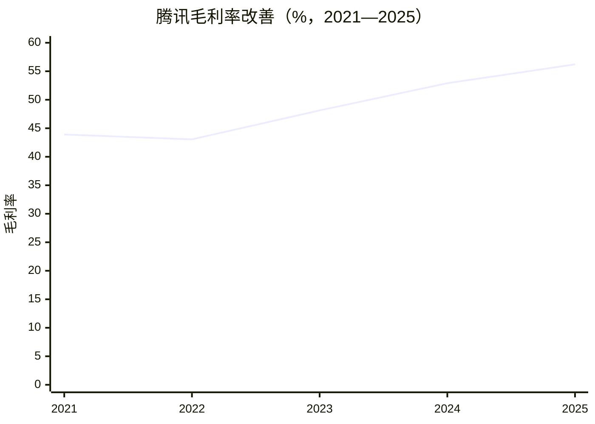
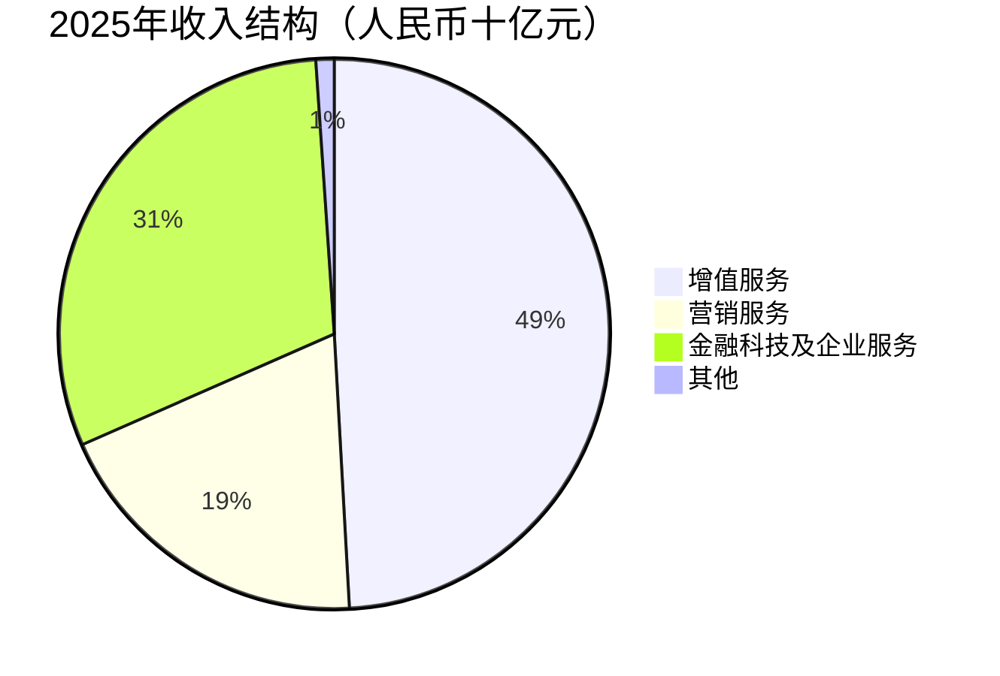

# 腾讯控股（0700.HK）研究报告

> 研究截止：2026年10月21日北京时间。收盘价393.80港元；按最近核验的10月15日已发行股数计算，市值3.581万亿港元。最新财务为2026年中报，最新完整年度为2025年。按固定换算假设1港元＝0.8525元人民币，TTM归母利润PE为12.96倍；本报告正常化利润假设下为15.26倍。
>
> 腾讯仍是有竞争优势的生意，当前价格有条件地具备投资价值。决定安全边际的关键，是AI投入之后能够持续留给普通股东多少现金。

行情由[StockAnalysis](https://stockanalysis.com/quote/hkg/0700/history/)与[经济通](https://content.etnet.com.hk/content/cpyrevamp/sc/stock_quote.php?code=00700)交叉确认。汇率仅是固定估值假设，并非已核验的当日收盘汇率。完整计算底稿见[research-20261021](research-20261021/)。本文为研究学习材料。

## AI研究偏见自觉

信息丰富度为A级。腾讯资料充分，最容易产生的偏见是把“微信很重要”直接推导成“腾讯股票必然便宜”。资料能够支持其现有关系网络与赚钱能力，无法直接证明新增算力的回报或未来估值倍数。

- [x] 不以历史最高价、自己的成本价作为价值依据。
- [x] 不把模型调用量和免费用户增长当作现金利润。
- [x] 不把资本开支和算力预付款全部视为可以永久加回的临时项目。
- [x] 不把联营利润资本化后，再完整加一次投资组合价值。

AI研究局限性：未取得内部利用率、客户付费留存、算力合同及产品级利润表。财报事实、管理层陈述、研究推论、模型假设在下文分别标识。部分项目只有公司原件，未获得同口径独立双源；文末明确披露，不能把计算通过等同于事实全面核实。

---

## 第一步：核心数据

下表财务单位为人民币十亿元；利润采用归属普通股股东的口径。五年收入和归母净利与独立数据平台一致；公司FCF与第三方狭义“经营现金流减资本开支”不同。

| 年度 | 收入 | IFRS归母净利 | 毛利率 | 经营利润率，年报重列口径 | 公司FCF |
|---|---:|---:|---:|---:|---:|
| 2021 | 560.118 | 224.822 | 43.91% | 22.26% | 108.1 |
| 2022 | 554.552 | 188.243 | 43.05% | 19.98% | 88.4 |
| 2023 | 609.015 | 115.216 | 48.13% | 26.28% | 167.0 |
| 2024 | 660.257 | 194.073 | 52.90% | 31.52% | 155.3 |
| 2025 | 751.766 | 224.842 | 56.21% | 32.13% | 182.6 |

依据[2025年报五年摘要](https://static.www.tencent.com/uploads/2026/04/09/62d786fcf3d3c8cb7e54791ee95439ac.pdf)、[独立财务表](https://stockanalysis.com/quote/hkg/0700/financials/)。经营利润使用同一最新年报的重列序列，不能与早期年报包含投资其他收益的原始经营利润混用。历史IFRS净利受投资处置和重估影响，不是主业增长的纯指标。

FCF原件补充：[2021—2022历史展示](https://static.www.tencent.com/uploads/2023/12/06/f1206a50c257264b24823257505b46c7.pdf)、[2023业绩展示转载](https://investgame.net/news/pdf/tencent-fy2023-earnings-release/)、[2024业绩](https://static.www.tencent.com/uploads/2025/03/19/81cb1f36bec218d27d6e0b24eec012b6.pdf)、[2025展示](https://static.www.tencent.com/uploads/2026/03/18/2804dbdae364ca25b82d21bc8304f1d3.pdf)。历史FCF未全部完成独立双源，只用于趋势。



### 收入结构与最近季度

| 业务 | 2025收入 | 2026Q2收入 | Q2同比 | Q2毛利率 |
|---|---:|---:|---:|---:|
| 增值服务 | 369.281 | 98.414 | +8% | 64% |
| 营销服务 | 144.973 | 43.565 | +22% | 57% |
| 金融科技及企业服务 | 229.435 | 60.286 | +9% | 52% |
| 其他 | 8.077 | 2.520 | +37% | -35% |

来源：[2026中报](https://www.tencent.com/wp-content/uploads/2026/08/E700_IR.pdf)。增值服务包括游戏与社交增值服务；微信的免费通信并不单独按月活收费。广告商为转化付费，商户为支付及服务付费，游戏玩家为内容和体验付费。



| 近四季度，人民币十亿元 | 2025Q3 | 2025Q4 | 2026Q1 | 2026Q2 |
|---|---:|---:|---:|---:|
| 集团收入 | 192.869 | 194.371 | 196.458 | 204.785 |
| 增值服务 | 95.860 | 89.920 | 96.110 | 98.414 |
| 营销服务 | 36.242 | 41.116 | 38.171 | 43.565 |
| 金融科技及企业服务 | 58.174 | 60.818 | 59.885 | 60.286 |

季度序列核对了[2025Q3公告镜像](https://financialfilings.com/filings/tencent-holdings-limited/interim-quarterly-report/2025/19504180/)、[2025Q4公司公告](https://www.prnewswire.com/apac/news-releases/tencent-announces-2025-annual-and-fourth-quarter-results-302717280.html)及[2026Q1公司公告](https://www.prnewswire.com/apac/news-releases/tencent-announces-2026-first-quarter-results-302770779.html)。这些转载仍是公司原始披露，历史分部表未逐项取得独立第二源。季度间存在游戏发行、广告旺季等季节性，不用环比直接外推全年。

### 最重要的变化：盈利仍增，现金投入增加

二季度收入2047.85亿元、非IFRS归母利润684.15亿元；公司报告同比增长分别为11%及9%。非IFRS经营利润756亿元，剔除新AI产品后为861亿元。后一个数能解释主业盈利能力，但新增AI费用确实由股东承担，不能据此把公司整体利润说成861亿元。[腾讯二季度业绩公告](https://www.tencent.com/wp-content/uploads/2026/08/Tencent-Announces-2026-Second-Quarter-Results.pdf)

当季FCF为负138亿元，剔除算力采购预付款后为正376亿元。两者之间反映采购时点，但预付款最终需要转化为服务或资产，不等于未来免费收益。资本开支确认额528亿元和资本开支付款593亿元属于不同口径；现金流中的预付款也不能直接与确认资本开支机械相加。

这构成最强的多空分歧：多方认为现金压力是前置投入，后续能兑现收入；空方认为这是未来长期资本强度上升的开端。仅凭一季现金流不能判定谁正确。

6月末现金及现金等价物2069.30亿元，叠加定期存款等库务资金后，公司总现金5111.54亿元；扣借款及票据4529.63亿元，公司口径净现金581.91亿元。上市投资4872亿元、未上市投资账面3879亿元不等于可立即分配现金。[中报资金与投资披露](https://www.tencent.com/wp-content/uploads/2026/08/E700_IR.pdf)

> 段永平式追问：账面赚到的钱，扣除维持竞争力所需投入后，还有多少可以长期分给股东？

---

## 第二步：生意本质

腾讯把难以集体迁移的关系网络、身份和交易连接，转化为重复发生的娱乐、广告与商业服务收入。

微信关系网让新进入者很难通过补贴让全部亲友、客户和商户同时迁移。游戏组合通过工作室、IP、社交关系及长期运营赚钱；广告通过改善匹配和转化获得商家预算；支付靠频次、商户覆盖与信任积累收入。它们共享分发基础，但各自的竞争、资本需求和定价权不同。

最值得跟踪的利润变量是广告变现质量、游戏组合生命周期，以及AI投入后的经营杠杆。用户数量已很大，未来主要依赖单位用户价值、海外业务和企业服务，不能继续假设国内用户数量高增长。

与网易相比，腾讯业务更多元，游戏之外的关系和交易基础更广；与Meta相比，腾讯收入结构不只依赖广告，但支付与云的资本回报并不能直接套用广告业务；与阿里相比，两者对商家预算和云投入都有竞争。这是商业机制比较，本报告没有取得同日同口径同业估值，故不列伪精确排名。

腾讯拥有推荐、风控、游戏生产和基础设施技术积累，但基础模型领先地位尚不能视为永久专利。模型榜单和调用量是技术采用信号，付费留存、单位任务成本及毛利才是经济证据。新AI产品尚无足够独立损益披露，不制造产品级收入预测。

> 段永平式追问：这门生意好在哪里？客户与用户反复回到同一关系及服务体系；但每一项新增AI业务都须独立证明值得投入。

---

## 第三步：护城河

| 来源 | 判断 | 可检验的边界 |
|---|---|---|
| 网络效应 | 强 | 单个用户可安装新工具，集体关系迁移较难；但搜索和购物决策可以先被绕开 |
| 转换成本 | 强，分业务 | 群体沟通和商户运营迁移麻烦，广告预算与游戏时间却能迅速转移 |
| 品牌与定价权 | 中强 | 玩家为好内容付费，商户为效果付费；收费超过创造的价值会流失 |
| 规模效应 | 强 | 共用分发、研发与风控；更大的算力采购不自动带来更高资本回报 |
| 技术壁垒 | 中 | 数据、运营与工程能力较难复制；基础模型领先可能快速变动 |

过去五年商业化效率改善，但对注意力的竞争没有减弱。未来最大的威胁未必是微信消失，而是用户仍用微信聊天，却把高价值搜索、购买决策与服务入口交给别人的AI助手。腾讯保留基础连接，却可能失去更高利润的上层收费权。

> 巴菲特式追问：十年后关系网还在，是否也意味着普通股东能以合理资本投入获取利润？二者必须分开验证。

---

## 第四步：风险与下跌解释

今天单日下跌已确认，但不能从价格倒推出唯一原因。主业增长、AI投入上升、市场对盈利兑现的疑虑共同构成合理解释；没有足够证据把当日跌幅精确归因给某条消息。任何尚未披露的三季度利润数字，都只是预测。

| 失败路径 | 主观发生判断 | 影响 | 预警信号 |
|---|---|---|---|
| AI持续消耗现金，回报不足 | 中高 | 高 | 多个季度投入扩大，付费及毛利不见改善 |
| 折旧与推理费用追上利润表 | 中高 | 高 | 收入增长却经营利润率下降，FCF长期弱于利润 |
| 微信高价值入口被绕过 | 中，长期 | 很高 | 商户获客及交易转移，广告投入回报下降 |
| 游戏或广告同时降速 | 中 | 中高 | 老游戏留存走弱，新品依赖变高，广告客户削预算 |
| 资本配置失去纪律 | 中 | 高 | 持续补贴、低回报并购，回购被股权激励抵销 |
| 游戏、支付及数据监管重击 | 中低，难量化 | 高 | 收费或经营许可发生实质约束 |
| 地缘限制、VIE失效 | 无可靠频率 | 极高 | 合同或采购权利出现实质变化，需重做投资论文 |

这些是研究判断，不是统计测得的发生概率。模型内30/50/20的情景权重也不是上表事件概率。

美国2026年6月官方名单仍列腾讯；相关国防采购限制已有具体实施安排。应认真跟踪，但名单并不自动等同全面芯片禁运或股票交易禁令。[Federal Register名单](https://www.govinfo.gov/content/pkg/FR-2026-06-10/pdf/2026-11571.pdf)、[官方采购限制说明](https://www.businessdefense.gov/i2s/industrial-security-division.html)。本报告未量化全面断供或VIE法律尾部损失，不以提高折现率掩盖缺口。

Prosus通过出售腾讯股份支持自身回购，是公开资本安排；股票供给可能压制短期价格，但不能据此认定腾讯经营恶化。[Prosus回购说明](https://www.prosus.com/investors/share-information/share-buyback-programmes)。腾讯10月发行新债也不直接说明流动性危机，需同时看融资期限、净现金和未来支出。[10月14日发债公告](https://www1.hkexnews.hk/listedco/listconews/sehk/2026/1014/2026101400063.pdf)

最强空方论点：微信可以一直强大，而腾讯的股东现金回报依然变差。竞争迫使公司不断买算力、补贴用户和增加研发，原有高利润为新业务承担成本；此时低PE可能合理存在多年。

历史类比只提示机制：技术成熟后，利润可能从平台转移到设备、算力或新的入口；不能把另一家企业的成功复苏路径直接套到腾讯。最容易犯的错，是把一次性采购解释无限延长，每季都说现金会在“下一季”回来。

> 芒格式追问：聪明人为什么不买？因为他可能认可微信，却无法判断未来维护竞争力的真实成本。

---

## 第五步：管理层与资本配置

| 决策 | 已有证据 | 判断 |
|---|---|---|
| 社交基础长期保持低使用门槛 | 关系与服务生态稳定 | 对用户体验的克制创造了商业化空间 |
| 游戏与生态投资 | 多产品与被投企业组合 | 分散单产品风险，但增加会计及资本分配复杂度 |
| 效率改善与股东回报 | 利润率改善，2025回购约800亿港元 | 有兑现记录；回购是否增值仍取决于价格 |
| 加大AI投入 | 现金支出及新产品费用明显增加 | 战略理由可以理解，财务回报仍需检验 |

2025回购数据见[全年业绩](https://static.www.tencent.com/uploads/2026/03/18/bd32d8ee320b72f0d72d545fd2d65851.pdf)。回购总额不等于每股价值增长，须扣除股权激励、观察实际注销和股数变化。模型不把回购同时加入现金收益与EPS增速。

6月末马化腾法定权益披露804,859,700股、8.85%，其中包括基金会相关股份；不能全部解释为个人可自由支配经济利益。腾讯普通股未采用本报告识别到的创始人超级投票权结构。该比例来自6月法定披露，不是10月实时持股；独立同口径第二来源不足。[中报董事权益](https://www.tencent.com/wp-content/uploads/2026/08/E700_IR.pdf)

管理层未来最值得检验的能力，是能否在战略竞争中终止低回报项目。成熟组织降低对单人的依赖，但AI资源分配和用户体验上的取舍仍高度依赖领导层。

> 段永平式追问：如果CEO退休，生意是否继续好？关系与游戏体系不会立即消失，资本配置纪律需要重新观察。

---

## 第六步：行业趋势与价值归属

AI可以降低内容生产、匹配和任务执行成本，腾讯同时是使用者、基础设施投入者和潜在服务入口。即使AI成为文明级变化，股东也不会自动获得回报：客户、员工、芯片厂、竞争对手都可能分走增量收益。

腾讯有优势的连接点是身份、社交、商户、支付和服务履约。模型足够好以后，可靠完成任务、获得授权、处理退款和责任，比聊天回答更重要。但若其他助手控制决策入口，腾讯可能只保留利润较薄的后台服务。

不把广告、支付流水、云收入与AI潜在产值相加成一个巨大TAM。广告市场受商户利润约束，游戏受用户时间和预算约束，云受企业真实算力需求约束。客户分散降低单一客户风险，宏观消费疲弱却会同时影响多个分部；供应端关键算力受技术及政策约束。

> 李录式追问：行业增长最终由谁收钱？要看到腾讯拥有并维护收费权，而不只是参与了新技术。

---

## 第七步：估值与安全边际

### 当前价格意味着什么

| 指标 | 工具验算值 | 限制 |
|---|---:|---|
| 市值 | 35806.84亿港元 | 股数为10月15日公告快照 |
| 人民币市值 | 30525.33亿元 | 固定汇率假设0.8525 |
| TTM IFRS归母PE | 12.96倍 | 投资会计影响仍在，非网站滚动稀释EPS口径 |
| 2025归母PE | 13.58倍 | 静态完整年度 |
| 正常化PE | 15.26倍 | 下述2000亿元利润假设 |
| TTM PS | 3.87倍 | 不代表不同分部具有相同利润率 |
| EV/收入 | 3.80倍 | 简化为市值减公司净现金；未剥离全部投资 |
| 2025公司FCF收益率 | 5.98% | 不是2026年FCF预测 |
| 已公布股息对应收益率 | 1.35% | 每股5.30港元；未来不保证 |

股数和市值用[公司披露](https://www.tencent.com/wp-content/uploads/2026/10/e_Next-Day-Disclosure-Return_20261015.pdf)与经济通反算核验。StockAnalysis显示约90亿在外股，和公告已发行口径相差约1.03%；本报告采用官方较大的已发行数，披露该差异而不假装完全相同。报价网站PE差异还可能来自稀释EPS、折算汇率和更新时点。

历史PE受投资收益和利润口径改变影响，不能直接说低于历史均值即应回归。本文不使用未经统一复权和EPS处理的历史分位，也不把卖方预期增长输入PEG后称其客观便宜。

### 三年三情景：当前是否贵

正常化利润起点假设2000亿元人民币。可理解为2025非IFRS归母2596.26亿元，扣约300亿元股权激励经济成本，再扣约296.26亿元未来折旧及AI盈利不确定性缓冲。后两项是压力假设，不是精确会计桥，更不是2026预测。利润中已保留投资收益能力，不另加投资组合或净现金价值。

按固定股数及汇率，正常化每股盈利25.8015港元。当前14—18倍正常化PE对应约361—464港元。区间选择反映成熟平台质量及资本强度不确定性，是判断，不是外部事实。

| 三年情景 | EPS年增速 | 退出PE | 三年末价格，港元 | 含固定股息年化IRR | 按8%折现今日价值，港元 |
|---|---:|---:|---:|---:|---:|
| 悲观 | 0% | 10 | 258.02 | -11.59% | 218.48 |
| 基准 | +7% | 16 | 505.73 | +9.94% | 415.12 |
| 乐观 | +12% | 20 | 724.99 | +23.68% | 589.18 |

未来每年股息均假设5.30港元，不是公司承诺。三年末505.73港元不能直接与今日价格比较后说有很大安全边际；折回今天并计股息，基准约415港元，现价低约5.14%，仅是有限余量。若希望未来三年年化10%、退出16倍且股息维持，上述正常化EPS需要约7.06%的年增长。

### 反向DCF：市场到底要求多少增长

独立模型采用股东可分配经济现金，r为人民币8%，十年之后永续增长2%。前十年等比增长，所有维持和增长所需投入已由现金起点及其增长路径承担；不额外加投资组合，与利润法不相加、不平均。

| 起点年度股东现金，亿元人民币，假设 | 使估值等于现价所需十年增长 |
|---|---:|
| 1200 | +7.23% |
| 1600 | +3.50% |
| 2000 | +0.59% |

真正的争论集中在现金起点。若AI之后只能长期留下1200亿元，现价并不只要求零增长；若能稳定留下2000亿元，市场要求就很低。不能先采用乐观现金起点，再把反解出的低增长当独立证据。

### 十年折现：仓位压力测试

采用人民币r＝8%，解释为合成无风险基准2%＋β1×权益风险补偿6%；2%不是当日实测国债收益率。稳态增量ROIC假设20%，既承认生态效率，也不把微信历史高回报直接复制给新AI资本。基准永续g不超过人民币2%，乐观3%仅为上行假设；g不随r调整。

终值倍数唯一来源为PE＝(1−g/ROIC)/(r−g)。前十年利润增速与永续g分开，不用同业现价推出十年终值。

| 情景 | 前十年利润增速 | 十年末利润，亿元人民币 | 永续g | r−g | 终值PE | 工具近似年回报 | 固定股息精确现金流IRR |
|---|---:|---:|---:|---:|---:|---:|---:|
| 悲观 | 0% | 2000.00 | 0% | 8个百分点 | 12.5 | -0.63% | -0.51% |
| 基准 | +6% | 3581.70 | 2% | 6个百分点 | 15.0 | +7.16% | +6.88% |
| 乐观 | +10% | 5187.48 | 3% | 5个百分点 | 17.0 | +12.54% | +12.07% |

主观权重依次30%、50%、20%，工具加权近似回报5.90%，低于8%。工具名为irr，但实际是资本年化加起点股息率；表中另列逐年固定股息的精确现金流IRR。加权近似回报不是承诺收益，也不是概率混合现金流的IRR。固定股数，不叠加回购缩股，股权激励成本已在正常化利润扣除。

| 折现率敏感性 | 加权近似年回报 | 是否覆盖r | 是否可用于决策 |
|---|---:|---|---|
| 6%（r−2pp） | +10.11% | 数学上通过 | 基准/乐观分母仅4/3个百分点，违反C2，仅参考 |
| 7%（补充） | +7.77% | 数学上通过 | 乐观分母4个百分点，违反C2，仅参考 |
| 8%（基准） | +5.90% | 未通过 | 币种与分母约束均通过 |
| 9%（补充） | +4.34% | 未通过 | 币种与分母约束均通过 |
| 10%（r＋2pp） | +3.01% | 未通过 | 人民币合理区间外，仅参考 |

已运行flip的±2pp和±1pp。工具只按币种检查时提示表面翻转，但6%和7%档不能通过全部分母约束。满足币种及C2的8%和9%档均未通过，合法档之间没有翻转。不能为了“通过”而下调r。

VIE失效及全面断供未建模；AI回报不足和游戏经营受限放在经营情景中，没有偷偷加进r或β。三档并未穷尽极端损失。

### 估值分歧对账

三年基准显示现价低于条件价值，但余量有限；十年压力测试显示长持回报对现金兑现、终值和增长要求较高。前者是定价判断，后者用于仓位约束，不能用十年未通过一票否决好生意。

与仓库10月20日报告相比，本文重做了估值口径：采用正常化利润并不另加投资资产，补全强制十年压力测试；不沿用旧报告523.50港元DCF基准。两份报告的差异来自现金起点、投资资产计价与终值假设，不能解释成一天内公司价值发生同幅变化。

综合六个维度，我仍倾向有条件分批买入、已有持仓继续持有，但不支持仅因低PE建立高集中仓位。初次投入可只使用原本计划给腾讯配置资金的一小部分，后续额度取决于现金验证；未知组合和资金用途，不给个人账户精确仓位上限。

> 巴菲特式追问：折现率错两个百分点会怎样？表面翻转来自不满足分母约束的低折现率档；合法档仍提示仓位应克制。
>
> 段永平式追问：股市关闭五年愿意买吗？若理解资本周期并能接受现金回收慢于预期，可以分批；仅靠短期反弹回本的逻辑不足。

---

## 第八步：股价回升条件与行动

股价回升不一定等到利润见底，但持续上涨需要市场上调未来每股现金预期，或降低对这些现金的不确定性折价。便宜本身不能规定上涨日期。

| 回升路径 | 需要出现的变化 | 观察证据 | 不足以证明什么 |
|---|---|---|---|
| 短期预期修复 | 财报没有悲观预期那么差，投入指引不再上修 | 经营利润、费用及资本开支指引 | 一次反弹不能证明AI项目成功 |
| 现金流修复 | 前置采购被消化，新增支出与业务规模匹配 | 滚动FCF、预付款余额、资本开支付款 | 只剔除所有预付款后的数字不够 |
| 核心业务支撑 | 游戏组合与广告转化继续贡献利润 | 游戏留存、广告收入及毛利、商家复投 | 单款爆款不等于永久高增长 |
| AI获得经济回报 | 用户愿付费、使用能覆盖推理成本 | 付费留存、收入、毛利、亏损收窄 | token数量、下载排名不等于利润 |
| 每股兑现 | 分红与净回购可持续，股份真正减少 | 回购减激励后的股数、现金覆盖 | 回购金额大不保证价值创造 |
| 风险偏好改善 | 宏观、利率或监管预期改善 | 实际规则与资金变化 | 市场反弹不能替代经营验证 |

下一次明确窗口为11月18日第三季业绩董事会。[腾讯公告](https://www.tencent.com/wp-content/uploads/2026/09/E700_BM.pdf)。建议连续两至三个财报窗口看投入和回款配合，这是研究监测标准，不是公司指引或上涨时间表。

若利润增长而估值倍数继续下降，股价仍可能不涨；若利润短期承压但现金投入出现可信拐点，股价也可能提前修复。要回到更高价格，需要盈利增长、倍数修复或两者共同发生，不能只凭“以前到过”。

| 六个维度 | 结论 | 信心 |
|---|---|---|
| 生意质量 | 重复收费能力强，业务组合有韧性 | 高 |
| 护城河 | 社交及交易基础强，上层AI入口有不确定性 | 中高 |
| 管理层 | 有经营效率与回报记录，AI纪律待验证 | 中高 |
| 最大风险 | 维持竞争力所需资本长期超预期 | 中 |
| 文明趋势 | AI扩大服务能力，利润归属尚不确定 | 中 |
| 估值 | 三年基准余量有限；十年压力未通过，合法档未翻转 | 中低 |

估值不是唯一裁决；十年模型在这里收紧仓位，并未单独改变买入/持有判断。

| 策略 | 建议及条件 |
|---|---|
| 空仓者 | 393.80港元可小规模分批建立观察仓；更大投入需要更低价格或现金证据 |
| 持仓者 | 基础竞争力未破坏可继续持有；不因成本价高就被动等待，也不因跌价自动加仓 |
| 加仓信号 | 价格进入更有余量的区域，同时预付款消化、FCF改善、AI亏损受控 |
| 卖出或减仓信号 | 正常化利润/现金持续下修、入口收费权受损、资本配置无约束，或价格大幅超过更新价值 |

| 股价区间，港元 | 本模型下的行动含义 |
|---|---|
| 330以下 | 安全边际明显增强，前提是生意与现金假设未被破坏 |
| 330—370 | 更有吸引力的分批区间 |
| 370—420 | 现价区域，有限吸引力，控制初始投入 |
| 420—465 | 接近正常化合理价值上半区，优先等待基本面验证 |
| 465以上 | 需要盈利上修或AI回报证据，不按旧假设追涨 |

以上是围绕约361—464港元正常化价值、三年基准折现约415港元设置的研究门槛，边界不是精确内在价值。若正常现金假设下降，全部区间都要重算。与其他优质资产比较，腾讯应凭风险后的现金回报胜出，而不是仅因自己熟悉微信。

### 原话与方法边界

已读取仓库段永平原发言存档。2026年2月4日，他回答腾讯估值问题：“想想10年后腾讯能赚多少钱吧。”[雪球原帖](https://xueqiu.com/1247347556/374768304)，[本地存档](段永平雪球发言-腾讯相关.md)。本文由此延伸为十年利润及现金投入测试，这是本报告推论，不代表他认可本文参数或价格区间。

巴菲特、芒格、李录：本次未取得足够与腾讯当前议题对应的原始点评，资料不足，不模拟代言。各节“式追问”是研究框架的问题，不是真实引语，也不暗示持仓或背书。

## AI分析置信度与投资确定性

对已披露收入、利润和产品关系基础，分析置信度较高；对AI投资回报、正常现金起点、长期增长及终值倍数，置信度中低。投资确定性取决于竞争优势能否转化为股东现金，不能由资料多、计算精确或大师姓名提高。

最需要补充的一手验证：AI企业客户真实续费和毛利、算力利用率及经济寿命、微信AI任务完成率，以及广告主扣除退款后的投入回报。模型精确计算只证明条件如何组合，不证明条件必然发生。

## 数据来源与审计记录

优先查公司与港交所原件，独立聚合数据用于交叉核验。AASTOCKS直接财务页面读取失败；Macrotrends美元财务存在汇率口径差异，本次未与人民币数直接硬比。公司官网、港交所与公司新闻稿转载不能算三个独立来源。

2024公司FCF原件：[2024业绩新闻稿](https://static.www.tencent.com/uploads/2025/03/19/81cb1f36bec218d27d6e0b24eec012b6.pdf)。

| 关键项目 | 原始值与独立来源 | 结果 |
|---|---|---|
| 收盘价 | StockAnalysis 393.80；经济通393.80港元 | 一致 |
| 股价×股数 | 393.80×9,092,644,829＝3,580,683,533,660.20港元；经济通3580.684十亿港元 | 四舍五入一致 |
| 2025收入 | 公司751766；StockAnalysis 751766，百万元人民币 | 工具偏差0.00% |
| 2025归母利润 | 公司224842；StockAnalysis 224842，百万元人民币 | 工具偏差0.00% |
| 6月现金等价物 | 公司206930；StockAnalysis 206930，百万元人民币 | 工具偏差0.00% |
| 总现金/净现金 | 公司511154/58191；第三方现金投资458904，百万元人民币 | 不同集合，不声称交叉通过 |
| 2025公司FCF | 182600；第三方狭义FCF215570，百万元人民币 | 内容和租赁等扣项不同，采用公司定义 |
| 2025经营利润 | 公司241562；第三方245628，百万元人民币 | 超过1%，采用年报重列口径 |
| 管理层权益 | 6月法定披露8.85%，包括基金会 | 原件核验；同口径独立双源不足 |

金融工具原始输出保存在[财务交叉验证](research-20261021/financial-crosscheck.txt)及[估值工具记录](research-20261021/valuation-tool-output.txt)。模型参数与完整计算见[valuation.py](research-20261021/valuation.py)及[valuation-data.json](research-20261021/valuation-data.json)。

已完成定稿抽样及终值口径复检。随机抽中十五项，其中九项历史事实逐项核对原件，六项模型参数或计算结果单独复算；另增四项独立双源事实检查。事实一致性工具返回PASS，终值口径检查通过。多数随机历史事实仍只有原始公司来源，因此整体属于“附资料缺口的研究结论”，尚未达到技能要求的所有关键数据独立双源完整准出标准。

原始记录见[抽检判决](research-20261021/audit-verdict.txt)、[审计范围](research-20261021/audit-scope.md)和[终值最终检查](research-20261021/terminal-final-audit.txt)。以下摘录工具结论，适用范围以上述说明为准：

```text
交叉验证: FY2025 revenue (Cross-Validation)
Tencent filing: 751,766.00 RMB million (偏差 0.00%)
StockAnalysis: 751,766.00 RMB million (偏差 0.00%)
所有来源偏差 ≤ 1.0%, 数据一致

交叉验证: FY2025 IFRS parent net income (Cross-Validation)
Tencent filing: 224,842.00 RMB million (偏差 0.00%)
StockAnalysis: 224,842.00 RMB million (偏差 0.00%)

交叉验证: 2026H1 cash equivalents (Cross-Validation)
Tencent filing: 206,930.00 RMB million (偏差 0.00%)
StockAnalysis: 206,930.00 RMB million (偏差 0.00%)
```

这些结果证明取数或计算的一致性，不证明未来经营假设成立。
