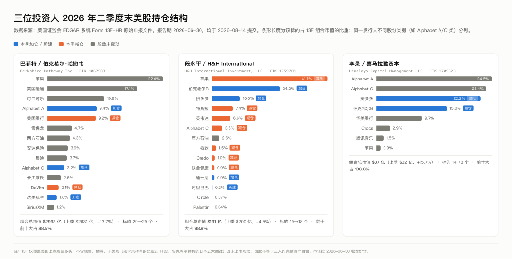
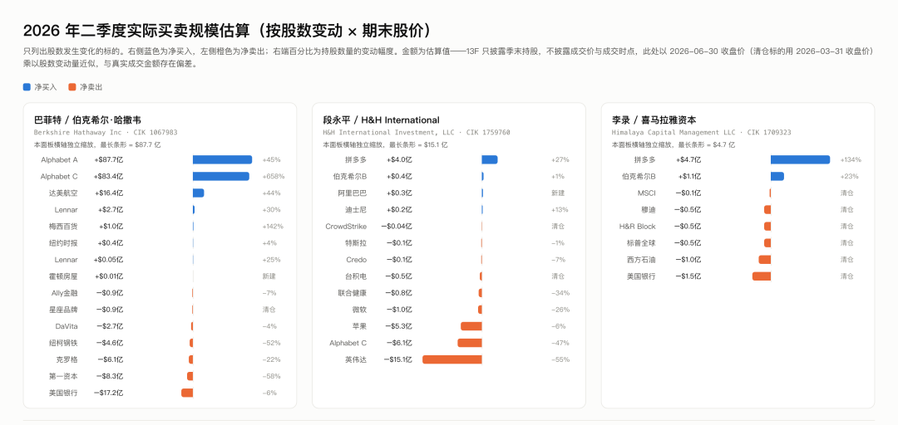
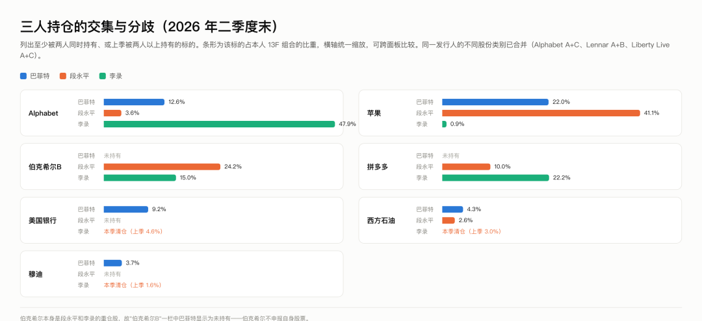

> 公众号发表：2026-08-16｜发表标题：巴菲特、段永平、李录 2026Q2 13F 持仓全解
> 公众号原文：https://mp.weixin.qq.com/s?__biz=MzIzNjQ4Nzc2OQ==&mid=2247484090&idx=1&sn=a9966734b69aa985750953ac0444dafd&chksm=e8d6578cdfa1de9ace4c5d5f9dfd9e28f2de1cb033d04469e0ca7e8e672f9c5b1984c89e5353
> 原稿：[reports/大师持仓追踪-13F-2026Q2-20260815.md](../../reports/大师持仓追踪-13F-2026Q2-20260815.md)
> 以下正文抓取自公众号发表版本。

# 巴菲特、段永平、李录 2026Q2 13F 持仓全解

## 摘要

| 维度 | 巴菲特 / 伯克希尔 | 段永平 / H&H | 李录 / 喜马拉雅 |
| --- | --- | --- | --- |
| 13F 组合市值 | $2,992.5 亿 | $191.0 亿 | $37.0 亿 |
| 环比 | +13.74% | −4.52% | +15.67% |
| 标的数（按 CUSIP） | 29 → 29 | 19 → 18 | 14 → 8 |
| 前十大集中度 | 88.5% | 98.8% | 100% |
| 第一大持仓 | 苹果 22.04% | 苹果 41.05% | Alphabet 47.94%（A+C） |
| 本季主线 | 大举加仓 Alphabet，净买入创近年新高 | 砍英伟达、加拼多多、新建阿里 | 大幅收缩，一季度前刚建的仓位几乎全清，拼多多仓位翻倍还多 |

#### 五条核心发现

**一、巴菲特在二季度停止了囤积现金，转为大规模买入**。 现金流量表口径下，伯克希尔二季度买入股票 亿、卖出36.9 亿，净买入 亿；同期回购自家股票42.1 亿。现金加短期美国国债从一季度末的 亿降至3,600.0 亿，单季减少 $307.4 亿。（来源：2026Q2 10-Q，非 13F）

**二、Alphabet 已成为伯克希尔第三大持仓**。 A 类加 C 类合计 1.0598 亿股、市值 亿，占组合171 亿——这一笔就占了全季净买入的绝大部分。

**三、段永平在减仓英伟达，同时加仓拼多多、新建阿里巴巴**。 英伟达持股从 1,384 万股砍到 628 万股（−54.6%）。苹果小幅减 6.4%，但因股价上涨，权重反而从 36.72% 升到 41.05%。

**四、李录做了一次罕见的大收缩，并且推翻了自己上一个季度的操作**。 标的从 14 个降到 8 个。2026Q1 他罕见地新开了 5 个仓位（腾讯音乐、标普全球、穆迪、H&R Block、MSCI），二季度就把其中 4 个全部清仓，持有期只有一个季度；同时清掉美国银行和西方石油。唯一的大动作是拼多多——从 460.8 万股加到 1,076.1 万股（+133.5%），一举成为第三大持仓（22.17%）。

**五、三人的唯一共同点是 Alphabet 和苹果，但方向完全相反**。 巴菲特大举加仓 Alphabet，李录满仓不动（占其组合 47.94%），段永平却在减持 46.9%。苹果这边，段永平重仓 41.05% 并小幅减持，巴菲特 22.04% 一股未动，李录只有 0.86%。

---

### 全局图：三人持仓结构

*图 1：三位投资人 2026Q2 末美股持仓结构。条形长度为占本人 13F 组合的比重*

*图 2：二季度买卖规模估算。注意三个面板横轴各自独立缩放*

---

### 一、巴菲特 / 伯克希尔·哈撒韦

#### 1.1 组合概况

| 指标 | 2026Q1 | 2026Q2 | 变化 |
| --- | --- | --- | --- |
| 13F 申报市值 | $2,630.96 亿 | $2,992.54 亿 | +13.74% |
| 申报条目数 | 90 条 | 89 条 | −1 |
| 标的数（按 CUSIP 归并） | 29 | 29 | 0 |
| 前十大集中度 | 90.7% | 88.5% | −2.2pp |

组合市值涨了 13.74%，但这里面大部分不是买出来的。若把一季度末的持仓一股不动拿到二季度末，市值本身就会涨 8.01%。

从换手看，本季有 15 个标的的股数发生变化、15 个完全没动，但没动的那 15 个占了二季度末市值的 **71.9%**。前十大持仓里只有三行动过——Alphabet A 类、Alphabet C 类、美国银行。苹果、可口可乐、美国运通、雪佛龙、西方石油、安达保险、穆迪、卡夫亨氏全部一股未动。

#### 1.2 本季全部变动（7 加仓、1 新建、6 减仓、1 清仓）

| 标的 | 动作 | Q1 股数 | Q2 股数 | 变动 | 幅度 | 估算金额 |
| --- | --- | --- | --- | --- | --- | --- |
| Alphabet A 类 | 加仓 | 54,249,798 | 78,791,167 | +24,541,369 | +45.2% | +$87.7 亿 |
| Alphabet C 类 | 加仓 | 3,585,215 | 27,188,433 | +23,603,218 | +658.3% | +$83.4 亿 |
| 达美航空 | 加仓 | 39,809,456 | 57,320,000 | +17,510,544 | +44.0% | +$16.4 亿 |
| Lennar A 类 | 加仓 | 10,099,642 | 13,111,741 | +3,012,099 | +29.8% | +$2.7 亿 |
| 梅西百货 | 加仓 | 3,038,355 | 7,347,426 | +4,309,071 | +141.8% | +$1.0 亿 |
| 纽约时报 | 加仓 | 15,146,535 | 15,700,000 | +553,465 | +3.7% | +$0.4 亿 |
| Lennar B 类 | 加仓 | 237,703 | 298,117 | +60,414 | +25.4% | +$0.05 亿 |
| 霍顿房屋 | 新建 | 0 | 3,564 | +3,564 | — | +$0.01 亿 |
| Ally 金融 | 减仓 | 29,000,000 | 27,000,000 | −2,000,000 | −6.9% | −$0.9 亿 |
| 星座品牌 | 清仓 | 632,890 | 0 | −632,890 | −100% | −$0.9 亿 |
| DaVita | 减仓 | 30,100,585 | 28,880,209 | −1,220,376 | −4.1% | −$2.7 亿 |
| 纽柯钢铁 | 减仓 | 3,907,075 | 1,857,752 | −2,049,323 | −52.5% | −$4.6 亿 |
| 克罗格 | 减仓 | 50,000,000 | 39,000,000 | −11,000,000 | −22.0% | −$6.1 亿 |
| 第一资本 | 减仓 | 7,150,000 | 3,000,000 | −4,150,000 | −58.0% | −$8.3 亿 |
| 美国银行 | 减仓 | 513,624,165 | 483,394,015 | −30,230,150 | −5.9% | −$17.2 亿 |

估算金额 = 股数变动 × 期末股价（清仓标的用 2026-03-31 价），非真实成交额。13F 不披露成交价与成交时点。

#### 1.3 Alphabet：一笔占全季度大头的买入

这是本季最大的动作。A 类加 2,454 万股、C 类加 2,360 万股，合计增持 4,814 万股，按期末价约 $171 亿。

|  | Q1 | Q2 |
| --- | --- | --- |
| A 类（GOOGL，02079K305） | 54,249,798 股 / $156.00 亿 | 78,791,167 股 / $281.58 亿 |
| C 类（GOOG，02079K107） | 3,585,215 股 / $10.28 亿 | 27,188,433 股 / $96.06 亿 |
| 合计 | 57,835,013 股 / $166.29 亿 | 105,979,600 股 / $377.64 亿 |
| 占 13F 组合 | 6.32% | 12.62% |

Alphabet 因此从伯克希尔的第五大持仓升至**第三大**，超过可口可乐（$325.08 亿 / 10.86%）。前四大变为：苹果 22.04%、美国运通 17.14%、Alphabet 12.62%、可口可乐 10.86%。

值得注意的是 C 类的加仓幅度（+658.3%）远大于 A 类（+45.2%）。A 类有投票权、C 类没有。伯克希尔在两个类别上同时大额买入、且明显提高了无投票权 C 类的占比，这与"不谋求影响公司治理、纯粹要经济利益"的一贯做法一致（事实陈述；具体动机文件中未披露）。

#### 1.4 这笔加仓有一半是场外拿的——Alphabet 定向配售

13F 只显示股数变了，不显示股从哪来。这一笔的答案在 Alphabet 自己的 SEC 文件里。

2026 年 6 月 1 日，Alphabet 提交自由书面招股说明书（FWP，CIK 1652044，注册号 333-296395），宣布总额 $800 亿的股权融资计划，用于扩建 AI 算力基础设施。

按公告价格折算，这笔定向配售对应：

|  | 配售金额 | 配售价 | 对应股数 | 本季实际增持 | 差额（配售之外） |
| --- | --- | --- | --- | --- | --- |
| A 类 | $50 亿 | $351.81 | 14,212,217 | 24,541,369 | +10,329,152 |
| C 类 | $50 亿 | $348.20 | 14,359,563 | 23,603,218 | +9,243,655 |
| 合计 | $100 亿 | — | 28,571,780 | 48,144,587 | **+19,572,807** |

也就是说：本季 4,814 万股的增持里，约 2,857 万股（59%）来自这笔场外定向配售，剩下约 1,957 万股来自于公开市场买入。

配售价 （类）低于伯克希尔二季度末的持仓均价357.37（由申报市值除以申报股数反算），即配售价比季末市价低约 1.6%。

这件事改变了对这笔投资的解读：**这不是一次单纯的二级市场建仓，而是伯克希尔直接向 Alphabet 提供了 $100 亿的一级市场资金，用于对方的 AI 资本开支**。 伯克希尔历史上的类似交易（2008 年高盛、2011 年美国银行、2019 年西方石油）都带有优先股或认股权证等特殊条款；这一次公开文件显示是普通股平价配售，未见优先条款——就披露信息看，条件比历史上那几笔要少。

#### 1.5 现金流量表交叉验证：这不只是加仓，是转向

13F 只告诉你季末持有什么，10-Q 才告诉你钱怎么动的。把两份文件对起来看，本季的信号比 13F 单独看要强得多。

| 项目（百万美元） | 2026Q1 | 2026Q2 | 数据来源 |
| --- | --- | --- | --- |
| 买入股票 | 15,938 | **23,467** | 10-Q 现金流量表，二季度数 = 上半年数 − 一季度数 |
| 卖出股票 | 24,087 | 3,693 | 同上 |
| 净买入 | −8,149（净卖出） | **+19,774** | 计算值 |
| 回购自家股票 | 235 | **4,209** | 10-Q 现金流量表 |
| 现金及等价物（保险及其他） | 51,478 | 35,096 | 10-Q 资产负债表 |
| 短期美国国债 | 339,261 | 324,905 | 10-Q 资产负债表 |
| 现金 + 短期国债 | **390,739** | **360,001** | 计算值，环比 −30,738 |

一季度还在净卖出 亿，二季度掉头净买入198 亿；回购从 亿跳到42.1 亿；现金加国债单季少了 $307 亿。三个指标同时转向。

#### 1.6 反面：不要过度解读

- 没动的持仓占二季度末市值的 71.9%，包括苹果、可口可乐、美国运通、西方石油、雪佛龙、安达保险等全部核心仓。撇开 Alphabet 这一笔，这仍然是一个极度稳定的组合。
- 一季度伯克希尔是净卖出 亿，二季度净买入198 亿。**单个季度不构成趋势**。 上半年合计净买入 亿，放在3,600 亿现金加国债的体量下，只动用了约 3%。
- 现金加国债从 亿降到3,600.0 亿，仍在历史高位区间。作为参照，2025 年底是 亿（现金477.19 亿 + 国债 亿），二季度末只比半年前低了91.5 亿。说"巴菲特开始大规模花钱了"，数据目前只支持"这个季度花得比往常多"。
- 13F 不区分是巴菲特本人还是 Todd Combs / Ted Weschler 决定的。梅西百货、纽约时报、霍顿房屋这类小仓位（合计不到组合的 0.5%）通常被认为出自副手，但文件本身不披露决策人

---

### 二、段永平 / H&H International Investment

#### 2.1 组合概况

| 指标 | 2025Q4 | 2026Q1 | 2026Q2 |
| --- | --- | --- | --- |
| 13F 申报市值 | $174.89 亿 | $200.04 亿 | $191.01 亿 |
| 环比 | — | +14.38% | −4.52% |
| 标的数 | 14 | 19 | 18 |
| 前十大集中度 | — | 99.2% | 98.8% |
| 苹果权重 | 50.30% | 36.72% | 41.05% |

申报人为首席合规官 Eric Hu，无其他包含管理人，无保密处理申请。

组合缩水 4.52% 不是因为持仓跌了——如果一季度末的持仓一股不动拿到二季度末，市值会涨 7.65%。缩水是卖出来的：本季估算卖出约 亿、买入约4.9 亿，净卖出 $24.3 亿。

#### 2.2 本季全部变动

| 标的 | 动作 | Q1 股数 | Q2 股数 | 变动 | 幅度 | 估算金额 |
| --- | --- | --- | --- | --- | --- | --- |
| 英伟达 | 减仓 | 13,843,775 | 6,280,675 | −7,563,100 | −54.6% | −$15.1 亿 |
| Alphabet C 类 | 减仓 | 3,706,000 | 1,968,600 | −1,737,400 | −46.9% | −$6.1 亿 |
| 苹果 | 减仓 | 28,945,607 | 27,098,707 | −1,846,900 | −6.4% | −$5.3 亿 |
| 微软 | 减仓 | 1,016,000 | 754,100 | −261,900 | −25.8% | −$1.0 亿 |
| 联合健康 | 减仓 | 601,400 | 399,600 | −201,800 | −33.6% | −$0.8 亿 |
| 台积电 | 清仓 | 151,200 | 0 | −151,200 | −100% | −$0.5 亿 |
| Credo | 减仓 | 751,200 | 701,200 | −50,000 | −6.7% | −$0.1 亿 |
| 特斯拉 | 减仓 | 3,408,900 | 3,380,400 | −28,500 | −0.8% | −$0.1 亿 |
| CrowdStrike | 清仓 | 10,000 | 0 | −10,000 | −100% | −$0.04 亿 |
| 拼多多 | 加仓 | 19,748,294 | 25,022,094 | +5,273,800 | +26.7% | +$4.0 亿 |
| 伯克希尔 B | 加仓 | 9,147,796 | 9,229,696 | +81,900 | +0.9% | +$0.4 亿 |
| 阿里巴巴 | 新建 | 0 | 301,400 | +301,400 | — | +$0.3 亿 |
| 迪士尼 | 加仓 | 1,511,800 | 1,706,600 | +194,800 | +12.9% | +$0.2 亿 |

未变动：西方石油 10,261,500 股、Circle 20 万股、Palantir 6 万股、新思科技 1 万股、Snowflake 1 万股、Tempus AI 2 万股、Innodata 1 万股。

#### 2.3 英伟达：一个完整的往返

把三个季度连起来看，这笔操作的形状才出来：

|  | 2025Q4 | 2026Q1 | 2026Q2 |
| --- | --- | --- | --- |
| 持股 | 7,237,100 | 13,843,775 | 6,280,675 |
| 环比 | — | **+91.3%** | **−54.6%** |
| 市值 | $13.50 亿 | $24.14 亿 | $12.57 亿 |
| 占组合 | 7.72% | 12.07% | 6.58% |
| 期末股价（申报值反算） | $186.50 | $174.40 | $200.09 |

一季度接近翻倍加仓，二季度砍掉一半以上，持股数已低于 2025 年底。两个季度净减 13.2%。买入发生在股价 到174 的区间，卖出发生在股价回到 $200 之后——单从价格看这笔往返不亏，但持仓路径本身说明这不是一个长期头寸。

#### 2.4 阿里巴巴：清仓一个季度后又买回来

|  | 2025Q4 | 2026Q1 | 2026Q2 |
| --- | --- | --- | --- |
| 持股 | 2,560,500 | 0（清仓） | 301,400（新建） |
| 市值 | $3.75 亿 | $0 | $0.29 亿 |
| 占组合 | 2.15% | 0% | 0.15% |

买回来的量只有原来的 11.8%，占组合 0.15%，是一个试探性头寸的规模，不是回归重仓。

#### 2.5 中国资产在加，美国 AI 在减

本季操作有一个方向性很清楚的分布：

- **减的**：英伟达（−54.6%）、Alphabet C（−46.9%）、微软（−25.8%）、联合健康（−33.6%）、台积电（清仓）、CrowdStrike（清仓）——集中在美国大科技与 AI 相关。
- **加的**：拼多多（+26.7%）、阿里巴巴（新建）——集中在中概。

拼多多是连续第二个季度加仓：11,536,694（2025Q4）→ 19,748,294（2026Q1）→ 25,022,094（2026Q2），两个季度累计 +117%。而拼多多股价在二季度从 跌到76.28（−25.3%），这一季的加仓是在下跌中完成的。

**反面**：这个"减美股 AI、加中概"的概括有两个漏洞。第一，苹果仍占组合 41.05%，是绝对第一大重仓，本季只减了 6.4%；伯克希尔 B 占 24.18% 还在加。前两大持仓合计 65.2%，都是美国资产，结构上并没有转向。第二，被减的英伟达、Alphabet、微软本季股价都在涨（英伟达 +14.7%、Alphabet C +23.2%、微软 +0.8%），减仓也可能只是涨上来后的再平衡，不一定是看法变化。文件本身不区分这两者。

---

### 三、李录 / 喜马拉雅资本

#### 3.1 组合概况

| 指标 | 2025Q4 | 2026Q1 | 2026Q2 |
| --- | --- | --- | --- |
| 13F 申报市值 | $35.69 亿 | $32.01 亿 | $37.03 亿 |
| 环比 | — | −10.31% | +15.67% |
| 标的数 | 9 | 14 | **8** |
| 前十大集中度 | 100% | 95.6% | **100%** |

三个季度走了一个"扩张再收回"的完整来回：9 → 14 → 8。二季度末的标的数比一年前还少。

#### 3.2 本季全部变动

| 标的 | 动作 | Q1 股数 | Q2 股数 | 变动 | 幅度 | 估算金额 |
| --- | --- | --- | --- | --- | --- | --- |
| 拼多多 | 加仓 | 4,608,000 | 10,761,119 | +6,153,119 | +133.5% | +$4.7 亿 |
| 伯克希尔 B | 加仓 | 897,749 | 1,108,318 | +210,569 | +23.5% | +$1.1 亿 |
| 美国银行 | 清仓 | 2,997,987 | 0 | −2,997,987 | −100% | −$1.5 亿 |
| 西方石油 | 清仓 | 1,466,500 | 0 | −1,466,500 | −100% | −$1.0 亿 |
| 标普全球 | 清仓 | 121,463 | 0 | −121,463 | −100% | −$0.5 亿 |
| H&R Block | 清仓 | 1,626,906 | 0 | −1,626,906 | −100% | −$0.5 亿 |
| 穆迪 | 清仓 | 117,784 | 0 | −117,784 | −100% | −$0.5 亿 |
| MSCI | 清仓 | 18,939 | 0 | −18,939 | −100% | −$0.1 亿 |

未变动：Alphabet A 254.33 万股、Alphabet C 245.13 万股、华美银行 277.64 万股、Crocs 88.71 万股、腾讯音乐 659.08 万股、苹果 11.06 万股。

只有两个方向：加拼多多和伯克希尔，其余全是清仓。没有一笔"减一点"，全是"清光"。

#### 3.3 他推翻了自己上一个季度的操作

这是本季最值得注意的一点。把 2026Q1 和 Q2 并排放：

| 标的 | 2025Q4 | 2026Q1 | 2026Q2 | 结果 |
| --- | --- | --- | --- | --- |
| 腾讯音乐 | 0 | 6,590,836（新建） | 6,590,836 | 留下 |
| 标普全球 | 0 | 121,463（新建） | 0 | **一个季度后清仓** |
| 穆迪 | 0 | 117,784（新建） | 0 | **一个季度后清仓** |
| H&R Block | 0 | 1,626,906（新建） | 0 | **一个季度后清仓** |
| MSCI | 0 | 18,939（新建） | 0 | **一个季度后清仓** |
| 美国银行 | 10,431,387 | 2,997,987（−71.3%） | 0 | 两个季度清完 |
| 西方石油 | 1,466,500 | 1,466,500 | 0 | 清仓 |

一季度新开的 5 个仓位，二季度清掉 4 个，持有期只有一个季度。这四家（标普全球、穆迪、MSCI、H&R Block）在一季度被广泛解读为"金融数据/评级基础设施"的主题配置——如果确实是一个主题下注，那么这个主题在一个季度内就被完全放弃了。

对一位以长期持有著称、组合常年不足 10 只股票的投资人来说，这个换手率是异常的。**但要注意两个可能的替代解释**：其一，这四笔仓位单笔都在 万到5,200 万之间，占组合 0.3%–1.6%，规模上更接近试探性头寸而非核心配置；其二，13F 不披露原因，也无法排除申报口径调整、账户结构变化等非投资性因素。文件本身不支持进一步判断。

#### 3.4 拼多多成为第三大持仓

|  | 2025Q4 | 2026Q1 | 2026Q2 |
| --- | --- | --- | --- |
| 持股 | 4,608,000 | 4,608,000 | 10,761,119 |
| 市值 | $5.23 亿 | $4.71 亿 | $8.21 亿 |
| 占组合 | 14.64% | 14.71% | **22.17%** |
| 期末股价 | $113.39 | $102.18 | $76.28 |

连续两个季度按兵不动后，在股价从 跌到76（−25.3%）的这个季度里一次性加了 133.5%。加仓成本区间无法从 13F 得知，但整个二季度拼多多的价格都在下行通道中。

**值得并列观察的是：段永平同期也在加拼多多（+26.7%）。两人在同一个季度、同一只票上同向加仓，是本季三人操作中唯一的明确共识**。

---

### 四、三人对比

#### 4.1 谁在动，动了多少

|  | 巴菲特 | 段永平 | 李录 |
| --- | --- | --- | --- |
| 标的数（Q1→Q2） | 29 → 29 | 19 → 18 | 14 → 8 |
| 股数变动的标的 | 15 | 13 | 8 |
| 完全未动的标的 | 15 | 7 | 6 |
| **未动标的占 Q2 市值** | **71.9%** | **2.8%** | **62.9%** |
| 估算买入 | $191.7 亿 | $4.9 亿 | $5.8 亿 |
| 估算卖出 | $40.8 亿 | $29.2 亿 | $4.1 亿 |
| 估算净额 | **+$150.9 亿** | **−$24.3 亿** | +$1.7 亿 |
| 持仓不动的话本季涨幅 | +8.01% | +7.65% | +10.41%（注） |

#### 4.2 交集与分歧

*图 3：三人共同持有或曾共同持有的标的*

**同时被三人持有的只有两只：Alphabet 和苹果**。 但仓位含义完全不同。

| 标的 | 巴菲特 | 段永平 | 李录 |
| --- | --- | --- | --- |
| **Alphabet** | 12.62%（本季大举加仓，A+C 合计增持 4,814 万股） | 3.64%（本季 C 类减持 46.9%） | 47.94%（三个季度一股未动，第一大持仓） |
| **苹果** | 22.04%（一股未动，第一大持仓） | 41.05%（本季减 6.4%，仍是第一大持仓） | 0.86%（一股未动，最小持仓） |
| **伯克希尔 B** | —（不申报自身股票） | 24.18%（本季加 0.9%，第二大持仓） | 14.98%（本季加 23.5%，第四大持仓） |
| **拼多多** | 未持有 | 9.99%（本季加 26.7%） | 22.17%（本季加 133.5%，第三大持仓） |
| **西方石油** | 4.30%（一股未动） | 2.61%（一股未动） | 本季清仓 |
| **穆迪** | 3.73%（一股未动） | 未持有 | 本季清仓 |
| **美国银行** | 9.20%（本季减 5.9%） | 未持有 | 本季清仓 |

三条可以从数据里直接读出来的结论：

**一、Alphabet 上出现了本季最明显的对立**。 同一个季度里，巴菲特把它买成第三大持仓，段永平把 C 类砍掉近一半。李录则是三个人里持仓最重的（47.94%）也是最不动的（连续三个季度 4,994,600 股不变）。三种做法对应三种不同的判断，13F 不告诉你谁对。

**二、拼多多是唯一的明确共识**。 段永平和李录在同一个季度、同一只票上同向加仓，而这个季度拼多多股价跌了 25.3%（76.28）。两人合计增持 1,142.7 万股 ADS。

**三、金融和能源被李录单方面清出，另外两人没动**。 美国银行、穆迪、西方石油李录全部清仓，同期巴菲特的穆迪和西方石油一股未动、美国银行只减 5.9%，段永平的西方石油一股未动。

---

### 五、13F 这份文件不能告诉你什么

在使用上面任何一个数字之前，这些限制必须先摆出来：

1. **只有美股多头**。 13F 只覆盖 SEC 认定的 13(f) 证券（主要是美国交易所上市的股票、ADR、部分期权与可转债）。现金、债券、港股、A 股、非上市股权全部不在内。李录最著名的持仓是比亚迪 H 股，那部分从来不会出现在这份文件里；本报告不对其当前是否仍持有作任何判断。伯克希尔的日本五大商社同理——本季 13F 申报市值 亿与资产负债表上的股票投资3,237.8 亿之间那 $245.3 亿的差额，就是这类持仓。
2. **45 天滞后**。 二季度末的持仓在 8 月 14 日才公开。三家都是在最后一天（截止日）提交的。这 45 天里发生了什么，文件不说。
3. **只有季末快照，没有过程**。 一个标的季初买入、季中卖出、季末归零，在 13F 里完全看不见。本报告所有"估算金额"都是用期末价乘以股数差得到的，与真实成交额必然有偏差——伯克希尔的例子最清楚：13F 口径估算净买入 亿，现金流量表口径的实际净买入是197.7 亿，差了 $46.8 亿。
4. **不披露决策人**。 伯克希尔的 89 条申报来自 14 家子公司，但文件里的"其他管理人"编号指的是持股的法律主体（国民赔偿、GEICO、通用再保险等保险子公司），不是投资决策人。哪些是巴菲特买的、哪些是 Todd Combs 或 Ted Weschler 买的，13F 不区分。
5. **不披露动机**。 本报告刻意没有为任何一笔操作编造理由。段永平砍英伟达、李录一个季度清掉四个新仓，公开渠道均未找到本人说明。
6. **空头和衍生品基本看不到**。 本季三份文件的 `putCall` 字段全部为空，说明申报范围内没有期权头寸；但 13F 本身也不要求申报空头，所以"没有空头"这个结论是推不出来的。
